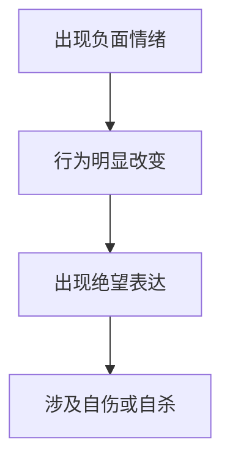

# 心理危机的概念、类型及预警信号识别

## 什么是心理危机

心理危机是指个体面对压力、创伤、冲突或重大生活变化时，原有的应对方式和心理资源暂时失效，导致情绪、认知、行为或人际关系出现明显失衡，并可能危及生命安全的状态。

> [!IMPORTANT]
> 心理危机不只是“情绪不好”，而是压力情境与个体反应相互作用的结果，重点关注其对学习、生活和社会功能的影响。

## 危机的常见类型

| 类型 | 典型表现 | 识别重点 |
|---|---|---|
| 自杀危机 | 出现死亡、绝望、告别、遗言等表达 | 是否存在具体计划、手段和时间 |
| 抑郁危机 | 持续情绪低落、兴趣丧失、绝望、自责 | 是否明显影响正常生活 |
| 焦虑危机 | 强烈紧张、惊恐、失控感 | 是否伴随身体症状或功能受损 |
| 创伤后危机 | 噩梦、闪回、回避、麻木、过度警觉 | 创伤后反应是否持续并影响生活 |
| 急性应激危机 | 创伤后出现混乱、麻木、激越或崩溃 | 情绪和行为是否严重失控 |
| 人际或发展危机 | 严重冲突、失恋、适应困难、身份困扰 | 是否出现自伤、自杀或暴力想法 |

> [!NOTE]
> 创伤事件不一定直接威胁生命。即使事件本身没有生命危险，只要引发强烈的害怕、无助或恐怖体验，也可能构成心理创伤。

## 如何识别预警信号

预警信号一般可分为三个层次：

1. **情绪信号**：持续绝望、极度恐惧、愤怒、羞耻、情绪麻木。
2. **认知信号**：无法集中注意、明显自责、感到活着没有意义。
3. **行为信号**：突然告别、赠送珍爱物品、回避社交、成绩骤降、酗酒或自伤。
4. **言语信号**：直接谈“不想活了”“撑不下去了”，或询问自伤、自杀方法。
5. **人际信号**：明显疏远亲友、寻求帮助或突然与他人告别。

> [!WARNING]
> “只是发泄情绪”不能成为忽视自伤或自杀信号的借口。遇到明确计划、手段、时间，或已经实施自伤，应立即启动紧急转介，不宜只靠劝说或陪伴。

## 发现危机后怎么做

- **保持冷静并倾听**：不争辩、不评价，不说“这点事算什么”。
- **直接询问安全**：可平静地问：“你现在有没有伤害自己的想法？”
- **共同制定安全方案**：远离可用危险物品，联系可信任的人陪同，约定危机时求助方式。
- **及时转介**：联系学校心理中心、辅导员、医院精神科或当地急救资源。
- **持续跟进**：危机情绪可能反复，不能因一次状况好转就停止关注。

## 急救题中的易错点

心理危机干预常与现场急救结合，要掌握基本急救原则和止血方法。

| 题目 | 正确结论 |
|---|---|
| CPR中文全称 | 心肺复苏，不是“心脏急救” |
| ABC原则 | Airway气道、Breathing呼吸、Circulation循环 |
| 前臂出血压迫部位 | 压迫肱动脉，不是锁骨下动脉 |
| 止血带位置 | 伤口近心端，避免直接扎在伤口上 |
| 止血带松解时间 | 通常每20～30分钟松解一次 |
| 语言交流 | 不属于ABC原则 |

> [!TIP]
> 记忆口诀：**ABC先 airway，止血绑近心；每隔二三松，压迫看动脉。**

例如，判断题“英文CPR的中文全称是心脏急救”应选 **B.错误**。准确说法是：**CPR即心肺复苏（Cardiopulmonary Resuscitation）**。
