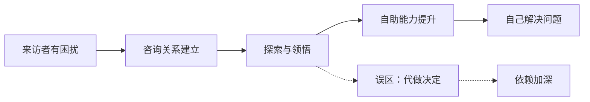

# 心理咨询的性质、功能与常见误区

心理咨询的本质是==“助人自助”==：由受过专业训练的咨询者运用心理学理论与技术，帮助来访者认识自己、理清困扰、提升解决问题的能力，而不是代替来访者做决定或规划人生。

## 性质：它是什么、不是什么

心理咨询是**专业助人活动**，具有以下性质：

| 维度 | 心理咨询 | 易混概念 |
| --- | --- | --- |
| 目标 | ==助人自助== | 心理治疗：矫治严重障碍 |
| 对象 | 一般心理困扰的正常人 | 精神科：精神疾病患者 |
| 关系 | 平等、合作、保密 | 教育：指导与被指导 |
| 手段 | 对话、倾听、技术引导 | 医疗：药物、仪器 |

> [!NOTE]
> 心理咨询≠心理治疗≠思想政治教育，三者对象、目标、方法都不同。

## 功能：为什么需要

- **发展性**：促进自我认识、潜能发挥、生涯规划。
- **预防性**：早期识别问题，防止恶化。
- **矫治性**：缓解焦虑、抑郁、人际冲突等一般困扰。

## 目标与常见误区

核心原则：咨询者提供帮助，来访者学会自己解决，==咨询者不替代其做决定==。

> [!CAUTION]
> **高频误区**：以为咨询=给出明确生活/工作规划、快速解决问题、直接提供方案。这三者都违背“助人自助”。

> [!TIP]
> 记忆口诀：咨询给“渔”不给“鱼”。

## 算对了的例子

题干：《心灵捕手》两位老师关于 Will 前途的争吵，反映心理咨询根本目标是？

- A. 咨询者做出明确生活、工作规划
- B. ==“助人自助”==，来访者学会自己解决问题
- C. 快速解决迫在眉睫的问题
- D. 咨询者代替来访者解决问题

**解析**：A、D 都是“代替”，C 是“速效方案”，均违背核心原则。答案选 **B**。

> [!WARNING]
> 看到“咨询者代替/明确规划/快速解决”等表述，一律排除；看到“提升来访者能力/自己解决”，才是正确方向。
