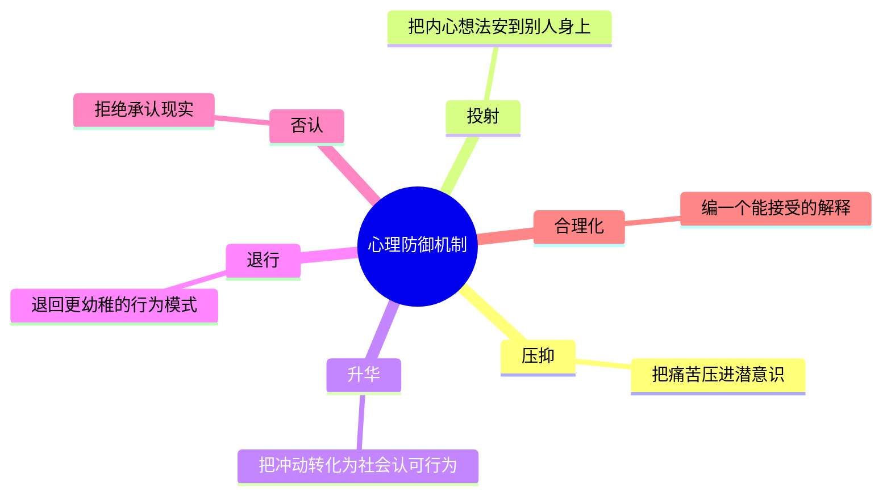

# 弗洛伊德心理防御机制（压抑、投射、升华、退行等）

## 弗洛伊德心理防御机制

当现实压力来袭，人会产生焦虑。弗洛伊德认为，自我会启动一套**无意识**的心理策略来缓解焦虑、保护自我价值感，这套策略就是心理防御机制。它像情绪的“安全气囊”：短期能让你不崩溃，长期过度使用却可能扭曲现实、阻碍成长。

### 四种核心机制

**压抑**是最基础的机制。它把无法接受的冲动、记忆或情绪**主动推出意识之外**，但又没真正消失。比如考试梦：白天理智上觉得“考试早过去了”，但早年考试焦虑被压抑在潜意识里，遇到类似评价性场景时，就以噩梦和莫名紧张的形式“泄漏”出来。判断题中“考试情结”被隐藏多年、条件反射般紧张焦虑，描述的正是==压抑的内容并未消失，只是转入潜意识持续影响行为==。

**投射**是把自己不愿承认的想法、感受**安放到别人身上**。比如自己讨厌某同学，却坚信“是他在讨厌我”。这样就不用面对“我居然会讨厌别人”的道德压力。投射常与“自欺”混淆：压抑是“我看不到”，投射是“我看到的都是别人”。

**升华**是==最成熟的防御机制==：把不被社会接受的本能冲动转化为被认可甚至被赞赏的行为。例如性格好斗的人成为对抗性运动的职业选手，或把失恋的痛苦写成获奖小说。升华不否认冲动，而是给冲动换了一条建设性的出口。

**退行**是在压力下**退回早期发展阶段的行为模式**。大学生遇到考试失利就哭闹、摔东西、赌气不吃饭，或生病时特别依赖父母，都是退行。短期退行可以喘息，长期退行会让人失去与年龄匹配的应对能力。

### 常见机制速览

| 机制 | 一句话理解 | 校园场景举例 | 成熟度 |
|------|-----------|-------------|--------|
| 压抑 | 压进潜意识，眼不见为净 | 怎么也想不起被霸凌的细节 | 基础 |
| 投射 | 我的问题，安到你头上 | “不是我想卷，是他们都卷我” | 低 |
| 升华 | 冲动变高级输出 | 焦虑时疯狂跑步拿校运会名次 | 高 |
| 退行 | 变小了求安慰 | 挂科后在宿舍哭闹、蒙头睡一天 | 低 |
| 合理化 | 找个好听的理由 | “没拿奖学金是因为我不屑于卷” | 中 |
| 否认 | 捂住眼睛说没有 | “我根本没复习也没关系，题不难” | 低 |

> [!IMPORTANT]
> 防御机制本身不是病，人人都在用。判断心理是否健康的关键是：==是否只依赖少数低成熟度机制，且长期扭曲现实、阻碍解决问题==。

> [!WARNING]
> 最容易踩的坑是把“投射”和“压抑”当成一回事。区别在于：压抑是对**自己内部**说“看不见”，投射是对**外部他人**说“是你在想”。考题中“条件反射般紧张、理智上认为没必要但仍然焦虑”，指向的是压抑——焦虑的源头已被推出意识，却仍在暗中驱动情绪。

> [!TIP]
> 记忆口诀：**“压、投、升、退”**——压下去（压抑）、推给别人（投射）、升上去（升华）、缩回去（退行）。判断题看到“隐藏多年却仍发作”，优先锁定**压抑**。

### 一个“算对了”的例子

回到那道判断题：离开学校多年，现实生活出现类似评价性场景时，噩梦和焦虑条件反射般出现，理智上却觉得没必要。

- 早年考试焦虑被**压抑**进潜意识 → 平时感觉不到它的存在；
- 但它没有消失 → 遇到“被评价”的扳机场景，便以**噩梦、莫名紧张**的形式重返；
- 理智与情绪的矛盾（“没必要却仍然焦虑”）恰好说明源头在**意识之外**。

所以“考试情结”被隐藏多年仍会发作，判 **√**。
