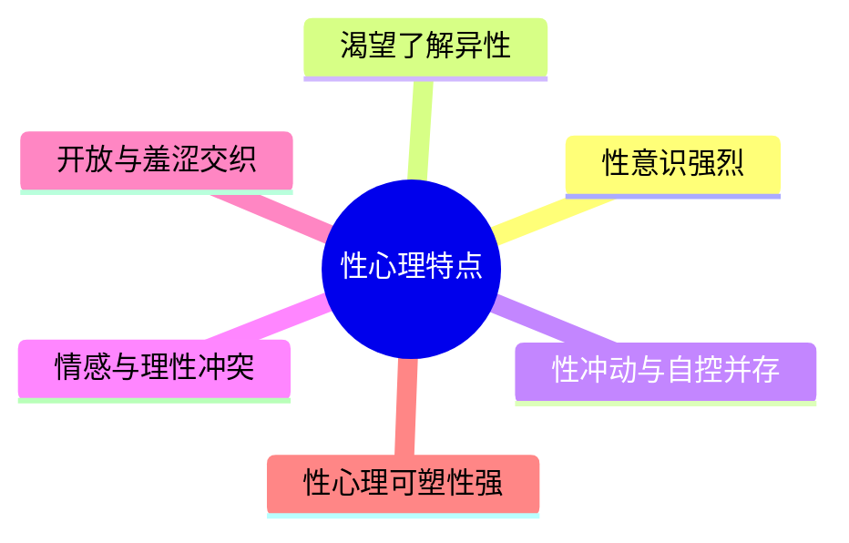

# 大学生性心理发展的特点与性道德观

## 它是什么

大学生性心理发展的特点与性道德观，是"第7章 大学生恋爱与性心理"的核心内容，讨论两个问题：大学生性心理发展有哪些规律性特点？大学生应当树立怎样的性道德观？理解它，才能理性对待恋爱中的亲密关系、识别不健康的交往模式，并形成负责任的性态度。

> [!IMPORTANT]
> 性心理是人对性生理变化、性别角色、两性交往的==心理体验==，不等同于性行为本身；性道德观则是个体==对性关系中责任、尊重与规则的内在标准==。

## 大学生性心理发展的特点

大学生处于青年中期（约18～23岁），性生理已成熟、性心理仍在完善，呈现出明显的过渡性特点。

- **性意识增强**：关注自身与异性的体态、气质，开始系统思考性别角色与亲密关系。
- **渴望与焦虑并存**：既向往两性交往，又担心被拒绝、被评价。
- **冲动与自制冲突**：性冲动是生理自然现象，但大学生需要在社会规范、法律与健康风险之间做出理性选择。
- **情感外露而隐蔽**：表达大胆但私密性强，常有"公开场合不愿承认"的心理。
- **可塑性强**：这一阶段形成的恋爱观、性观念会深刻影响成年后的婚恋模式。

## 代表性研究：金赛报告

20世纪40年代中期，美国性学专家==阿尔弗雷德·金赛（Alfred Kinsey）==接受洛克菲勒基金会经费，在印大成立性研究学会；1948年出版《男性性行为》，1953年出版《女性性行为》，开创现代性学研究先河。

> [!TIP]
> 记忆：==金赛（Kinsey）= 现代性学奠基人==，报告分男（1948）女（1953）两卷。不是弗洛伊德（精神分析）、不是马斯特斯与约翰逊（性反应实验研究）。

## 性道德观的基本内容

| 维度 | 内涵 | 大学生常见误区 |
|------|------|----------------|
| 尊重 | 尊重对方人格与意愿 | 忽视"同意"，用感情施压 |
| 责任 | 对自身与对方的健康、情感负责 | 只谈感觉不谈后果 |
| 忠诚 | 恋爱中的专一与诚实 | 同时发展多段关系 |
| 自律 | 性冲动受理性与规范约束 | "成年人可以随心所欲" |
| 法律 | 遵守相关法律法规 | 传播隐私影像属违法 |

> [!WARNING]
> ==性道德的核心是"尊重与责任"，而非单纯的"禁欲"或"放任"==。"自愿+知情+无害+合法"四要素缺一不可。

## 与相近概念的区别

| 概念 | 含义 | 侧重 |
|------|------|------|
| 性生理 | 性成熟、第二性征 | 生物基础 |
| 性心理 | 对性的认知、情感、意向 | 主观体验 |
| 性道德观 | 对性关系的规范判断 | 社会伦理 |
| 性法律 | 强制性约束 | 国家强制力 |

## 常见的坑

- 把"性冲动"等同于"品德败坏"——它是生理现象，关键是==如何表达与控制==。
- 把"性开放"等同于"性道德"——道德要求自律与责任，不是行为放纵。
- 混淆金赛与马斯特斯、约翰逊：前者是大规模调查报告，后者是实验室性反应研究。

> [!NOTE]
> 做题关键词：金赛报告、《男性性行为》《女性性行为》、现代性学、尊重与责任、自愿与知情。

## 一个做对了的例子

**题目**：20世纪40年代中期，（ ）接受洛克菲勒基金会经费在印第安纳大学成立性研究学会，出版《男性性行为》《女性性行为》，开创现代性学研究先河。

**思路**：抓住"洛克菲勒基金""印第安纳大学""1948《男性性行为》"三个线索 → ==阿尔弗雷德·金赛==，排除弗洛伊德（精神分析）、约翰逊与马斯特斯（性反应实验）。

**答案**：D（阿尔弗雷德·金赛）。
