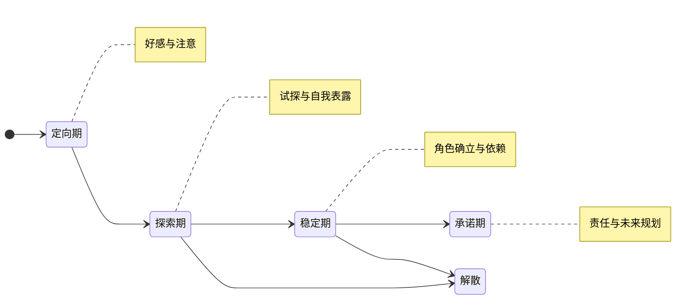

# 大学生恋爱的心理过程与发展阶段

# 大学生恋爱的心理过程与发展阶段

恋爱并非瞬间的冲动，而是一个动态的心理演变过程。理解这一过程，有助于我们理性看待情感波动，避免在错误的阶段做出越界或退缩的行为。

## 它是什么：四个典型阶段

大学生恋爱心理发展通常遵循“定向—探索—稳定—承诺”的路径。我们可以将其视为一个状态转移过程：

1.  **定向期**：对特定异性产生注意和好感，但尚未明确心意。
2.  **探索期**：双方通过互动试探对方态度，进行有限的自我表露。
3.  **稳定期**：确立恋爱关系，情感依赖加深，排他性增强。
4.  **承诺期**：考虑长期发展，涉及价值观融合与未来规划。

> [!IMPORTANT]
> ==核心结论==：大多数情感困惑源于==阶段错位==，例如在“探索期”强行要求“承诺期”的责任。

## 为什么需要关注：环境的情感基调

情感的产生具有情境依赖性。我们对他人的好感，往往不只是针对人本身，还融合了所处环境的氛围。

> [!TIP]
> **解题技巧**：当题目涉及“表白场所”、“浪漫氛围”时，联想==环境情感基调==。环境会作为“背景色”渲染我们的情绪体验。

以真题为例：
*   **题干**：表白的场所之所以重要，是因为我们对另一个人的感情经常是缘于所处环境的情感基调。
*   **解析**：正确。温馨、私密或浪漫的环境能降低防御心理，提升积极情绪唤醒水平，使个体更容易将这种愉悦感归因于对方，从而促进关系推进。

## 怎么做：匹配阶段的行为策略

不同阶段应采取不同的交往策略，切忌“拔苗助长”。

| 阶段 | 关键任务 | 常见误区 | 建议行为 |
| :--- | :--- | :--- | :--- |
| **定向期** | 建立印象 | 过度解读眼神/巧合 | 自然接触，观察共性 |
| **探索期** | 信息交换 | 过早暴露全部隐私 | 适度自我表露，测试反馈 |
| **稳定期** | 角色适应 | 忽略个人空间 | 建立边界，深化信任 |
| **承诺期** | 价值整合 | 回避现实冲突 | 坦诚沟通未来规划 |

## 常见的坑：混淆激情与亲密

> [!WARNING]
> **高危误区**：将“生理唤醒”等同于“深层爱意”。

在探索期，许多同学容易因为心跳加速（可能源于紧张或环境刺激）而误判为深爱。请记住，==真正的亲密需要时间的沉淀和真实的自我接纳==，而非仅靠环境烘托的瞬时激情。

## 算对了的例子

回顾前述判断题：
*   **情境**：男生选择在烛光晚餐而非嘈杂食堂表白。
*   **分析**：烛光晚餐提供了柔和、私密的==环境情感基调==。这种基调降低了女生的社交焦虑，提升了浪漫感知。
*   **结论**：表白成功率高，不仅因为男生优秀，更因为环境辅助了情感的正向归因。因此，题干所述“感情缘于环境情感基调”是符合心理学原理的。
