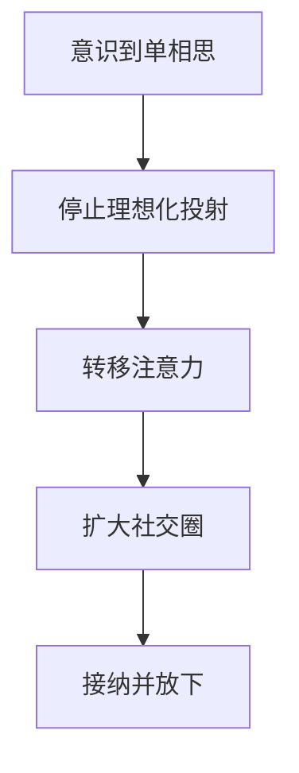
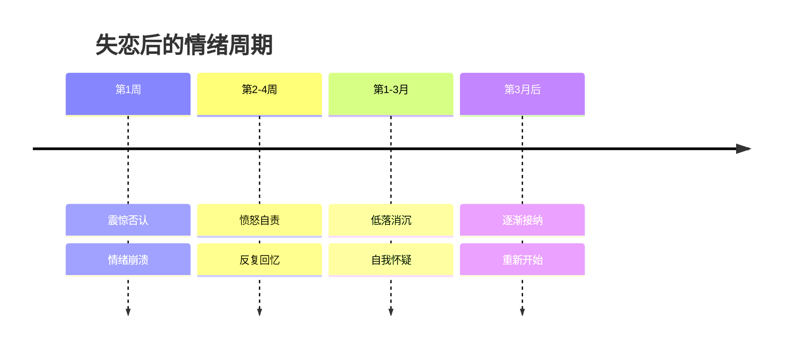
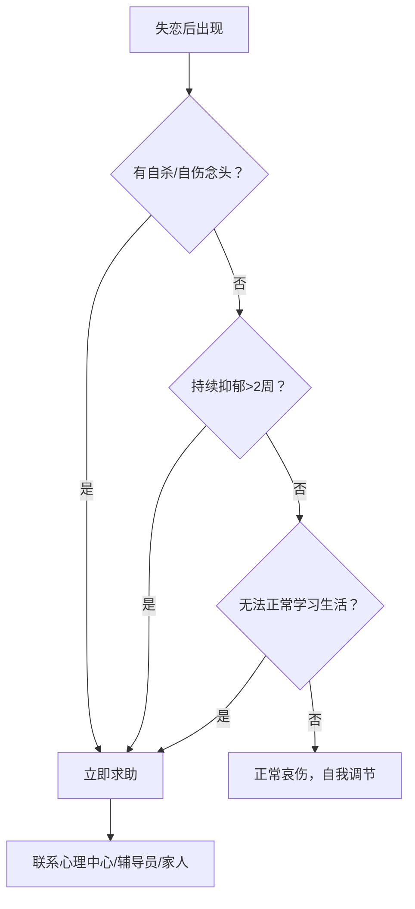

# 单相思、失恋的心理调适与危机应对

单相思与失恋，是大学生恋爱中最常见的两种"不如意"状态。它们本身不是心理疾病，但处理不当，可能演变成抑郁、焦虑，甚至出现自伤、自杀等危机事件。

## 什么是单相思

单相思（单恋）指一方对另一方产生爱慕之情，却得不到对方回应，或明知不可能得到回报仍无法割舍的心理状态。它有两种典型形态：

| 类型 | 特征 | 风险 |
|------|------|------|
| 无感单恋 | 对方完全不知情，或知情后无回应 | 长期自我消耗，影响学业社交 |
| 被拒单恋 | 表白后被明确拒绝，仍无法放下 | 易陷入执念，可能做出纠缠行为 |

单相思者常陷入"理想化投射"——把对方想象得过于完美，忽视真实缺点，从而越陷越深。

> [!WARNING]
> 单相思最大的坑，是把"感动自己"当成"感动对方"。持续送礼、堵门、刷屏式关心，不是深情，是给对方造成压力，甚至构成骚扰。

## 单相思的心理调适

如果你正经历单相思，可以按下面的路径逐步调整：

- **停止理想化**：列出对方的缺点和不适合的地方，打破"完美滤镜"。
- **转移注意力**：把精力投入学习、运动、社团活动，减少反复琢磨对方的时间。
- **扩大社交圈**：接触更多人，你会发现"非他/她不可"的感觉会自然淡化。
- **接纳情绪**：允许自己难过，但设定一个"止损期限"，比如两周内不主动联系。

> [!TIP]
> 问自己一个问题："如果对方现在答应和我在一起，我真的快乐吗？还是我只是不甘心？" 很多时候，执念源于"得不到"本身，而非对方这个人。

## 失恋的心理调适

失恋指恋爱关系破裂后，一方或双方产生的心理失落状态。它比单相思更痛，因为曾经拥有，失去时伴随"丧失感"和自我价值怀疑。

失恋后的情绪反应通常经历几个阶段：

> [!IMPORTANT]
> 失恋后的痛苦是正常的哀伤反应，不是软弱。但==如果持续超过3个月仍无法正常生活、学习，或出现自伤念头，必须寻求专业心理帮助==。

具体调适方法：

| 方法 | 说明 |
|------|------|
| 情绪宣泄 | 找信任的朋友倾诉，写日记，运动出汗 |
| 认知重构 | 停止"都是我不好"的全盘自我否定，理性分析分手原因 |
| 行为激活 | 强迫自己保持作息，参加集体活动，避免长期卧床刷手机 |
| 环境隔离 | 暂时屏蔽对方动态，扔掉或收起 trigger 物品 |

## 危机应对：何时必须求助

失恋是大学生心理危机的高发诱因。出现以下信号，意味着已超出正常调适范围：

> [!CAUTION]
> =="我不想活了""活着没意思"这类话不是矫情，是求救信号==。无论是你自己还是身边同学说出这句话，都必须认真对待，立即报告辅导员或心理中心，不要让当事人独处。

## 一个真实的例子

小张和女友恋爱两年，分手后被拉黑。他连续一周失眠，凌晨三点给共同好友打电话哭诉，第三天在宿舍楼顶被同学发现。辅导员介入后，心理中心评估其存在==中度抑郁伴自杀意念==，启动危机干预：24小时专人陪护、通知家长、转介专业医院。经过两个月药物治疗和心理疏导，小张情绪逐渐稳定，重返课堂。

这个案例的关键在于：同学发现异常后==没有犹豫，立即报告==，抓住了黄金干预时间。

> [!NOTE]
> 单相思和失恋的共同点，是都涉及"丧失"——单相思丧失的是幻想中的关系，失恋丧失的是真实的关系。两者的调适核心，都是==接纳现实、停止执念、重建自我价值==。
