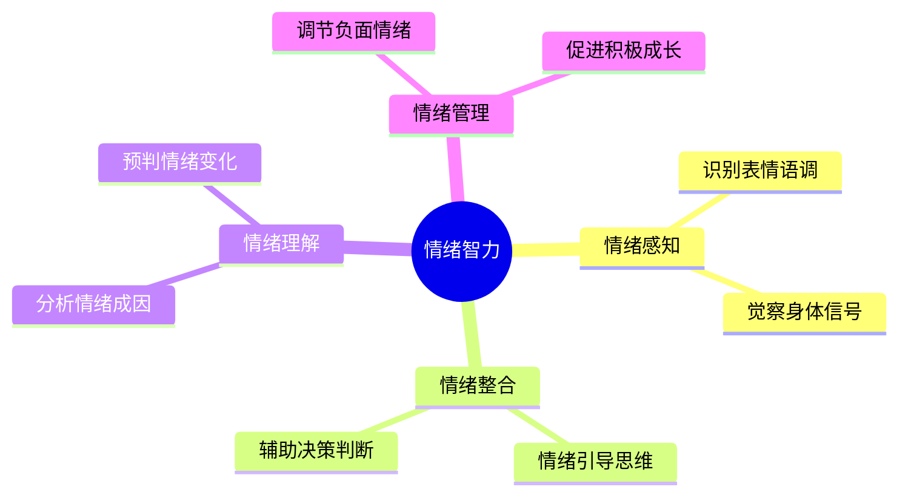

# 情商（EQ）的概念与情绪智力的培养

## 情商究竟是什么

提到情商（EQ），你首先想到的是“会说话”还是“人缘好”？在《大学生心理健康》课程中，情商有着严格的学术定义。它并非单纯的社交技巧，而是==情绪智力（Emotional Intelligence）==的简称，指个体监控自己及他人的情绪和情感，并识别、利用这些信息指导自己思维和行为的能力。

> [!IMPORTANT]
> 核心定义：情商是**感知、理解、管理自我与他人情绪**的综合心理能力，而非圆滑世故的代名词。

## 为什么需要培养情绪智力

大学阶段面临学业、人际与生涯多重压力，高情绪智力是心理韧性的基石。它能帮助你在考试焦虑时快速平复心态，在宿舍冲突中准确识别对方需求而非陷入争吵。研究表明，情绪智力对大学生主观幸福感的预测力显著高于单纯智商。

## 情绪智力的四维模型与培养路径

如何系统提升情商？我们可以从萨洛维和梅耶（Salovey & Mayer）的四维度模型入手，这也是本课程考核的重点框架：

培养情绪智力可遵循“觉察-接纳-调节-共情”四步法。例如，当你在小组作业中感到愤怒时，先命名情绪（“我感到被忽视”），再探究原因（“我的建议未被讨论”），接着选择建设性表达（“我希望听听大家对我方案的反馈”），最后尝试理解队友的立场。这种刻意练习能将本能反应转化为==适应性情绪策略==。

## 情商与相近概念的辨析

| 概念 | 核心内涵 | 与情商的关键区别 |
| :--- | :--- | :--- |
| 智商（IQ） | 认知、逻辑与学习能力 | 处理“事”的能力，相对稳定 |
| 性格 | 稳定的态度与行为模式 | 先天倾向性强，不易改变 |
| 社交技能 | 外显的人际互动技术 | 仅是情商的外在表现之一 |

> [!NOTE]
> 情商包含但远超社交技能。一个内向者可能不善言辞，但若能精准觉察自我情绪并有效调节，依然具备高情绪智力。

## 常见误区与典型例题解析

> [!WARNING]
> 最大误区：将“压抑情绪”等同于“情绪管理”。真正的情绪管理是**适度表达与转化**，而非强行忍耐，长期压抑反而导致心理问题。

来看一道典型考题：“小明在答辩前极度紧张，他告诉自己‘紧张说明我在乎这次机会，适度紧张能让我更专注’，随后顺利完成答辩。这体现了情绪智力的哪个维度？”

**解析**：此题正确答案为“情绪整合”（或称“情绪运用”）。许多同学误选“情绪管理”，但小明并未消除或降低紧张感，而是==将紧张情绪转化为专注的动力==，使情绪服务于当前任务目标。这正是情绪整合的核心特征——让情绪成为思维的助力而非阻力。若他通过深呼吸放松来降低紧张水平，才属于情绪管理维度。区分关键在于：是“用情绪”还是“管情绪”。
