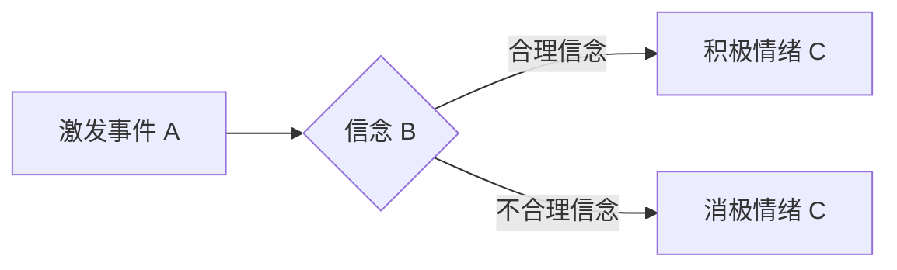

# 艾利斯情绪ABC理论（合理情绪疗法）

> [!IMPORTANT]
> 核心结论：==人们的情绪障碍是由不合理信念造成的==，而非事件本身。

## 它是什么

试想一下：同样没考好，为什么有人觉得“下次努力就行”，有人却崩溃到想退学？差别到底在哪？

艾利斯（Ellis）提出的**情绪ABC理论**（又称**合理情绪疗法**）给出了答案。该理论认为，人的消极情绪和行为障碍结果（C），不是由某一激发事件（A）直接引发的，而是由个体对这一事件的认知评价产生的信念（B）直接引起的。

- **A**（Activating event）：激发事件
- **B**（Belief）：个体对该事件的信念（分为合理信念与不合理信念）
- **C**（Consequence）：情绪与行为后果

## 为什么需要

大学生在学业、人际、情感中常遭遇挫折。如果误以为是“A导致了C”，就会陷入“只要改变环境就能开心”的被动局面。合理情绪疗法的价值在于指出：==改变非理性信念，才能从根本上消除情绪障碍==。这种疗法就是要以理性治疗非理性。

## 怎么做

合理情绪疗法的干预流程可概括为四步：

1. **列出事件**：找出引发不良情绪的激发事件（A）。
2. **揪出信念**：识别引发不良情绪认识上的非理性信念（B）。
3. **辩论替代**：帮助求治者以合理的信念代替不合理的信念。
4. **改善情绪**：最大限度减少不合理信念给情绪（C）带来的不良影响，从而减少或消除已有的情绪障碍。

> [!TIP]
> 记忆口诀：“找事（A）、抓念（B）、换脑、舒心（C）”。

## 算对了的例子

结合判断题考点，我们来看一个标准案例：

| 步骤 | 内容示例 |
| :--- | :--- |
| **A（事件）** | 高数期中考试不及格 |
| **B（不合理信念）** | “我连高数都考不过，我真是个彻头彻尾的废物，大学肯定毕不了业了。”（绝对化要求、糟糕至极） |
| **C（情绪后果）** | 极度抑郁、焦虑，甚至逃避上课 |
| **干预（替换B）** | 引导其认识到：“这次没考好只代表复习不到位，不代表我整个人毫无价值。”（合理信念） |
| **新C（新后果）** | 情绪平复，开始制定补考复习计划 |

## 与相近概念的区别

很多同学容易把ABC理论和日常说的“别多想”混淆，或者分不清“事件”和“信念”。

| 比较维度 | 朴素安慰（如“别想了”） | 合理情绪疗法（ABC理论） |
| :--- | :--- | :--- |
| **归因点** | 试图压抑情绪或忽略事件 | 精准定位并反驳不合理信念（B） |
| **操作方式** | 逃避、转移注意力 | 以理性治疗非理性，用合理信念替代 |
| **长期效果** | 治标不治本，易复发 | ==从认知根源消除情绪障碍== |

## 常见的坑

> [!WARNING]
> 考试中最常见的错误是认为“事件（A）直接导致了情绪（C）”。请记住：A只是间接原因，==B才是引起情绪及行为反应的直接原因==。

> [!CAUTION]
> 不要把“不合理信念”等同于“想法”。不合理信念通常具有三个特征：**绝对化要求**（必须/应该）、**过分概括化**（以偏概全）、**糟糕至极**（灾难化）。只有具备这些特征的信念才属于需要被替代的靶子。
