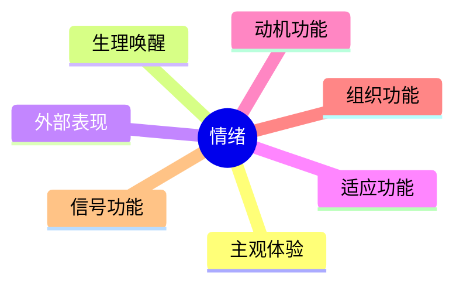

# 情绪的成分、功能及基本情绪理论（如詹姆斯-兰格理论、认知评价理论）

情绪不是单一的“感觉”，而是一个复杂的心理过程。想象一下：你在南邮仙林校区突然遇到一条没拴绳的狗，心跳加速、拔腿就跑，事后才觉得“好害怕”。是先有恐惧感再跑，还是先跑了才感到恐惧？这就涉及情绪的成分与经典理论。

## 情绪的三成分与功能

情绪由三个成分构成，缺一不可：

- **主观体验**：你内心感受到的“开心”“愤怒”或“焦虑”。
- **生理唤醒**：身体内部的反应，如心跳加快、血压升高、出汗。
- **外部表现**：面部表情、肢体动作和语调变化。

> [!IMPORTANT]
> 情绪具有四大功能：==适应功能==（遇险逃跑保命）、动机功能（推动行为）、组织功能（影响认知效率）和信号功能（通过表情传递信息）。

## 基本情绪理论

面对同样的刺激，为什么有人暴跳如雷，有人一笑而过？不同理论给出了不同的解释路径。

### 詹姆斯-兰格理论

该理论主张“因为哭所以悲伤，因为跑所以害怕”，即==生理唤醒在先，情绪体验在后==。

### 认知评价理论

拉扎勒斯等人认为，决定情绪的不是事件本身，而是你对事件的“看法”。同样是考试失利，评价为“彻底完了”会引发绝望，评价为“查漏补缺的机会”则会引发平静或动力。

| 对比维度 | 詹姆斯-兰格理论 | 认知评价理论 |
| :--- | :--- | :--- |
| 核心观点 | 身体反应决定情绪 | 认知评价决定情绪 |
| 发生顺序 | 刺激→生理→情绪 | 刺激→评价→情绪+生理 |
| 常见误区 | 忽视大脑认知的加工 | 低估本能生理反应的作用 |

> [!NOTE]
> 相近概念辨析：“情绪”短暂且伴随明显生理唤醒；“心境”是微弱、持久、弥漫的情绪状态；“激情”则是爆发式、强烈而短暂的。

## 怎么做：用理论指导情绪管理

理解了理论，我们就能主动干预情绪。结合判断题考点，具体做法如下：

1. **觉察并记录**：正如考题所述，记录情绪是为了清楚什么类型的事件能引发你的情绪、情绪的关键词类型、发作频次与力量。这是打破自动化反应的起点。
2. **警惕“野马结局”**：心理学上把因芝麻绿豆小事大动肝火，造成不可挽回损失的现象称为“野马结局”（情绪效应）。这提醒我们，失控的外部表现会带来现实破坏。
3. **改变认知评价**：运用认知评价理论，在“刺激”和“反应”之间插入思考，重新评估事件意义，从而改变情绪走向。

> [!TIP]
> 记忆口诀：“詹兰重身体，认知重想法；记录找规律，防做野马傻。”

> [!WARNING]
> 常见坑：做题时极易将詹姆斯-兰格理论与坎农-巴德理论混淆。记住詹姆斯-兰格强调“外周生理反应引起情绪”，而坎农-巴德强调“丘脑同时向大脑和身体发信号”。

## 真题验证

来看一道考过的判断题：

**题干**：心理学上就管因为一点点芝麻绿豆的小事而大动肝火，从而造成不可挽回的损失的现象叫做“野马结局”。也称之为“情绪效应”。

**解析**：正确（√）。这道题直接考查了情绪失控（外部表现过度）带来的负面后果。“野马结局”正是情绪管理章节中警示大家不要因小失大的核心案例，体现了情绪的组织功能和信号功能失调时的破坏力。
