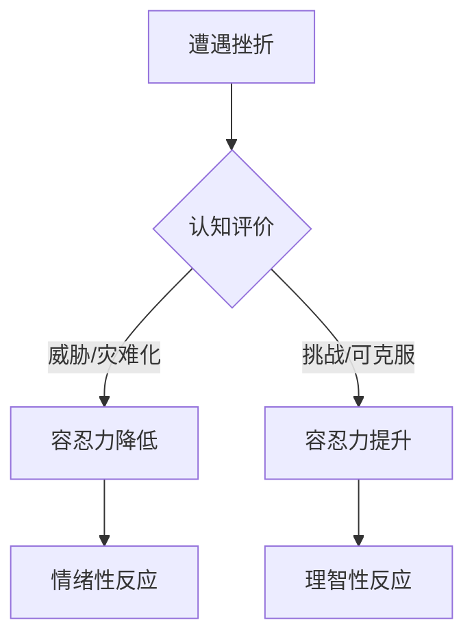

# 挫折的反应类型与挫折容忍力的影响因素

当你考研落榜、竞选学生会主席失败，或者和恋人分手时，你的第一反应是什么？是暴怒砸东西，还是躲在宿舍哭一天，又或者是冷静复盘准备二战？这些不同的表现，就是心理学中“挫折的反应”。而为什么有人越挫越勇，有人一蹶不振？这就涉及“挫折容忍力”。

## 挫折的反应类型

挫折反应是指个体在从事有目的的活动过程中，遇到障碍或干扰致使动机不能实现、需要不能满足时所产生的==情绪和行为反应==。通常分为三类：

```mermaid
mindmap
  root(("挫折反应"))
    情绪性反应
      "愤怒/攻击"
      "焦虑/抑郁"
      "冷漠/退化"
    理智性反应
      "调整目标"
      "改变策略"
    防御性反应
      "合理化(酸葡萄)"
      "投射/压抑"
```

- **情绪性反应**：最直接的本能反应，如愤怒、焦虑、冷漠甚至行为退化（像小孩一样哭闹）。
- **理智性反应**：==最成熟的应对方式==，表现为分析原因、调整目标或改变策略。
- **防御性反应**：通过心理防御机制来减轻痛苦，如“酸葡萄心理”（吃不到葡萄说葡萄酸）属于合理化。

> [!NOTE]
> 情绪性反应与防御性反应的区别：前者是“直接发泄”，后者是“自我欺骗式保护”。比如考试挂科，大哭一场是情绪性反应；安慰自己“这课本来就没用”则是防御性反应中的合理化。

## 挫折容忍力的影响因素

试着想一想：同样是失恋，为什么大一新生的崩溃程度往往比大四学生更剧烈？因为他们的经历、认知和支持系统不同。

挫折容忍力（又称耐挫力）是指个体遭遇挫折时，免于行为失常、能够适应环境并恢复平衡的==心理承受能力==。其高低受以下因素制约：

| 影响因素 | 说明 | 举例 |
| :--- | :--- | :--- |
| **生理条件** | 身体健康者神经系统的耐受阈值更高 | 长期熬夜者更易因小事暴躁 |
| **过去经验** | 曾成功克服挫折的人容忍力更强 | 复读生面对大学考试失利更淡定 |
| **认知评价** | ==核心因素==，对挫折事件的归因方式决定情绪走向 | 将失败归因为“努力不够”而非“我很笨” |
| **个性特征** | 意志坚强、性格开朗者容忍力高 | 外向者更倾向寻求社会支持 |
| **社会支持** | 亲友、学校等外部支持网络 | 南邮心理辅导中心提供的干预 |



> [!IMPORTANT]
> 在所有影响因素中，==认知评价是最具主观能动性、也是大学生心理健康教育中最强调的一环==。我们无法改变已发生的挫折，但可以通过改变认知（如合理情绪疗法中的驳斥非理性信念）来提升挫折容忍力。

## 常见的坑

> [!WARNING]
> **误区：挫折容忍力是天生的，无法改变。**
> 实际上，挫折容忍力具有动态可塑性。通过刻意积累“微小成功体验”、学习积极的归因方式（将失败归因为不稳定的、可控的因素），可以显著提升耐挫力。

> [!CAUTION]
> 答题时切勿将“挫折容忍力”与“心理防御机制”混为一谈。容忍力是一种**能力状态**，而防御机制是面对挫折时采用的**具体手段**。容忍力低的人往往过度依赖消极的防御机制（如逃避、否认）。

> [!TIP]
> 记忆口诀：“**生经认个社**”——**生**理、**经**验、**认**知、**个**性、**社**会支持，五要素缺一不可，其中“认知”是拿分关键眼。
