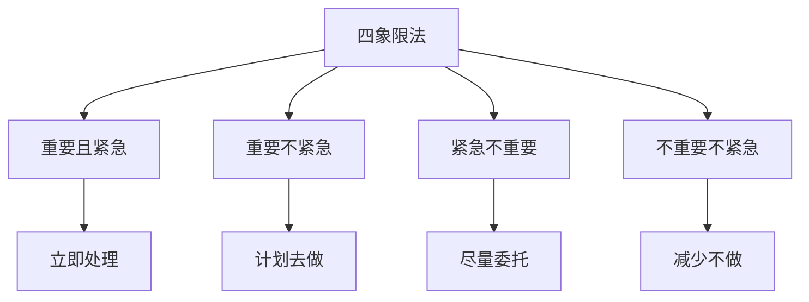

# 大学生时间管理的原则与技巧

## 为什么需要时间管理

大学学习节奏快、事务杂，同样的 24 小时，有人从容应对，有人疲于奔命。差别往往不在努力程度，而在**时间分配是否合理**。时间管理不是把每一分钟塞满，而是用科学原则减少浪费、把精力投放到高价值任务上，从而 ==缓解拖延与学业压力，提升学习效率==。

先想一个问题：为什么“期末前通宵复习”效果远不如“每天复习一小时”？答案指向两个关键点——**事情的轻重缓急**，以及**精力的高低起伏**。时间管理的原则与技巧正是围绕这两点展开。

## 基本原则

### 确立目标，围绕目标分配时间

目标是时间分配的依据。目标应具体、可衡量、有期限，例如“本周背完第 4 章 20 个核心概念”，而不是“我要好好学习”。目标越清晰，时间投向越明确。

### 区分轻重缓急：四象限法

把所有待办事项按“重要性”和“紧急性”分成四类：

> [!IMPORTANT]
> ==高效学习者把主要时间投在“重要不紧急”的象限==（如日常预习、规律复习），这样“重要且紧急”的危机（如考前突击）自然会减少。反过来，总在“救火”的人，本质是忽视了重要不紧急的事。

### 匹配精力节律

人的精力有高峰和低谷。把高认知负荷任务（如啃难点、写论文）安排在个人精力最好的时段，把机械性事务（如整理资料、回消息）放到低谷时段，效率会明显提升。

## 实用技巧

- **列清单**：每天开始前列出待办清单，完成一项划掉一项，获得掌控感。
- **番茄工作法**：专注 25 分钟后休息 5 分钟，每 4 个番茄钟长休一次，用外部节奏对抗走神与拖延。
- **拒绝干扰**：学习时关闭无关通知，把手机放远，给自己一段“免打扰时间”。
- **善用碎片时间**：排队、等车等碎片时段适合背单词、回顾知识点，整块时间则留给需要深度思考的任务。
- **预留弹性**：不要把日程排满，预留约 20% 的缓冲，应对突发任务，避免计划一被打乱就全盘放弃。

## 相近概念辨析

| 概念 | 核心含义 | 关键区别 |
|------|----------|----------|
| 时间管理 | 合理分配与规划时间 | 关注“何时做、做多久” |
| 学习策略 | 为达成学习目标而采用的方法 | 关注“用什么方法学” |
| 拖延应对 | 针对推迟行为的干预 | 时间管理是预防，拖延应对是补救 |

三者有交叉，但侧重点不同：时间管理是“总调度”，学习策略是“具体打法”，拖延应对是“故障维修”。

## 常见误区

> [!WARNING]
> 把“忙碌”当“高效”——日程排满不等于有效，关键看是否完成了高价值目标。

> [!CAUTION]
> 计划定得过于理想，一旦某天没完成就彻底放弃。正确做法是允许弹性、动态调整，而不是追求完美执行。

## 一个安排合理的例子

某生周四有：高数作业（重要不紧急）、社团海报（紧急不重要）、英语单词（重要不紧急）、刷短视频（不重要不紧急）。

- 精力最好的晚上 19:00–20:30 → 高数作业（约 3 个番茄钟）
- 午休前 20 分钟 → 英语单词
- 委托社团同伴做初稿 → 自己只审核，省下整块时间
- 短视频 → 限定为完成全部任务后的放松奖励

这样安排后，高价值任务都在精力高峰完成，既保证了学习质量，也没有忽视必要事务——这正是时间管理原则与技巧的综合运用。
