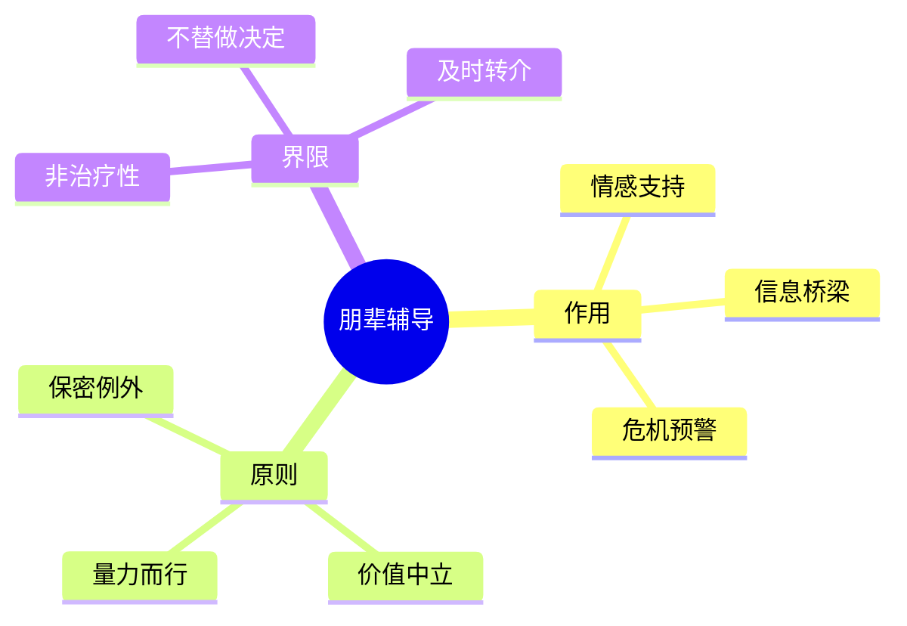

# 朋辈心理辅导的作用、原则与界限

## 朋辈心理辅导是什么

朋辈心理辅导是指受过一定训练的非专业学生，在平等、尊重的基础上，为同学提供心理支持与帮助的过程。它不是“心理咨询”，而是==互助式的情感支持与信息引导==。

为什么需要它？专业心理咨询师资源有限，且存在距离感。同龄人之间拥有共同的语言体系和成长背景，更容易建立信任，实现早期发现与即时安抚。

## 核心原则与操作界限

开展朋辈辅导时，必须严守以下原则，否则可能适得其反：

> [!IMPORTANT]
> **保密原则及其例外**
> 一般情况下严格保密，但当涉及==自伤、伤人或违法==风险时，必须突破保密，立即上报老师或专业机构。这是生命至上的体现。

> [!WARNING]
> **常见误区：越界拯救**
> 许多热心同学容易陷入“救世主情结”，试图替对方做决定或进行深度心理分析。请记住：你的角色是==陪伴者与倾听者==，而非治疗师。

| 维度 | 朋辈心理辅导 | 专业心理咨询 |
| :--- | :--- | :--- |
| **主体资格** | 受过培训的学生 | 持证心理咨询师/医师 |
| **工作深度** | 浅层支持、日常困扰 | 深层人格、障碍干预 |
| **核心目标** | 缓解情绪、提供资源 | 心理成长、症状消除 |
| **责任边界** | 发现问题、及时转介 | 制定方案、持续治疗 |

## 怎么做：从倾听到转介

有效的朋辈辅导遵循“倾听—共情—评估—转介”的流程。

1.  **积极倾听**：多用开放式提问（如“你当时感觉怎么样？”），少给建议。
2.  **共情回应**：反馈对方的情绪（如“听起来你感到很无助”），而非评判对错。
3.  **危机评估**：若对方流露轻生念头，需直接询问风险程度。
4.  **及时转介**：超出能力范围时，温柔而坚定地推荐校心理中心。

> [!TIP]
> **话术示例**
> “我很关心你，但这个问题超出了我的专业能力。为了对你负责，我建议我们一起联系心理中心的老师，好吗？”

## 典型案例分析

**情境**：室友小 A 因失恋情绪低落，连续三天失眠，向你哭诉“活着没意思”。

**错误做法**：
-   盲目安慰：“别想太多，下一个更好。”（否定情绪）
-   强行讲理：“你父母养你不容易，不能这样。”（道德绑架）
-   独自承担：承诺保守秘密，试图每晚陪聊化解。（忽视风险，耗尽自身能量）

**正确做法**：
1.  **接纳情绪**：坐在身边，递上纸巾，安静陪伴，表示“我在这里陪你”。
2.  **评估风险**：温和询问“你提到的‘没意思’，是否有具体的计划？”
3.  **打破保密**：若发现有具体自杀计划或严重抑郁倾向，==立即启动危机干预流程==，通知辅导员或心理中心，即使小 A 反对也要以生命安全为重。
4.  **后续跟进**：在专业人员介入后，继续给予日常的生活关心，但不涉及心理治疗内容。

通过明确==助人自助==的定位，既能温暖他人，也能保护自己不被负面情绪吞噬。
