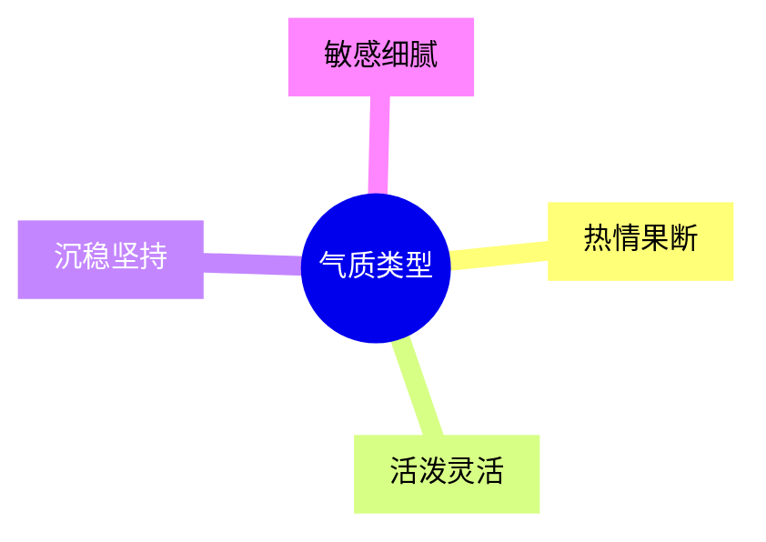

# 气质类型学说（胆汁质、多血质、黏液质、抑郁质）

## 气质类型学说

气质是人格中相对稳定、贯穿一生的心理动力特征，主要表现在心理活动的速度、强度和灵活性等方面。气质类型学说用于描述个体在情绪反应、活动节奏和适应方式上的典型倾向。

> [!IMPORTANT]
> 胆汁质、多血质、黏液质、抑郁质是四种典型气质类型。多数人不是单一类型，而是以某种类型为主、兼有其他类型特点。

## 四种气质类型

| 类型 | 主要表现 | 典型反应 |
|---|---|---|
| **胆汁质** | 反应快、热情直率、精力旺盛、行动果断，有时急躁、冲动 | 兴奋时行动迅速，情绪强烈，缺少耐心 |
| **多血质** | 活泼好动、灵活敏捷、兴趣广泛、健谈富于表情 | 接受新事物快，兴趣容易转移 |
| **黏液质** | 沉稳安静、反应缓慢、耐心持久、行动稳重，有时迟钝、固执 | 情绪表达不明显，但稳定坚持 |
| **抑郁质** | 敏感细腻、情绪体验深刻、认真谨慎、想象丰富，有时多疑、焦虑 | 对刺激反应较弱，内心波动较明显 |

气质本身并无绝对优劣。它会影响学习、工作和交往方式，但不能据此直接判断一个人的能力、品德或成就。

## 如何辨别类型

可从三个方面观察：

1. **活动速度**：反应是快还是慢；
2. **活动强度**：情绪和行动是强烈还是平缓；
3. **心理活动的灵活性**：兴趣是否容易转移，行为是否灵活。

例如，面对一次公开答辩：胆汁质学生可能迅速发言、表达强烈；多血质学生会主动交流并较快适应；黏液质学生准备充分但发言较慢；抑郁质学生可能因担心评价而谨慎发言。==判断时应看整体、稳定表现，而不是某一次情绪。==

## 与性格、能力的区别

| 概念 | 主要回答的问题 | 典型特点 |
|---|---|---|
| **气质** | “心理活动通常以什么速度、强度和灵活性进行？” | 相对稳定，受生理机制影响较大 |
| **性格** | “一个人对现实和他人形成怎样的稳定态度与行为方式？” | 体现社会评价和人格的“社会性” |
| **能力** | “能否顺利完成活动并达到要求？” | 表现为活动效率和学习、工作的效果 |

> [!NOTE]
> 气质偏向“如何反应”，性格偏向“怎样对待”，能力偏向“能否做好”。例如，同样准备小组作业，黏液质可能按部就班完成，体现的是稳定的行为节奏；认真负责主要体现性格；顺利完成任务则体现能力。

## 常见误区

> [!WARNING]
> 不能把四种类型当成固定标签，更不能说“抑郁质就是抑郁症”。气质类型描述的是正常人格差异，不能用于临床诊断。

> [!CAUTION]
> 考试中不要死记四个形容词。掌握“胆汁快而强、多血快而灵活、黏液慢而稳、抑郁敏感而细”的主线即可。

## 计算对了的例子

若某学生课堂上发言积极、反应迅速、兴趣广泛，但注意力常随活动改变，最符合**多血质**。这些表现同时指向反应快、活动强和灵活，因此不能只因“热情”便判为胆汁质，也不能因“兴趣广泛”便判断性格。
