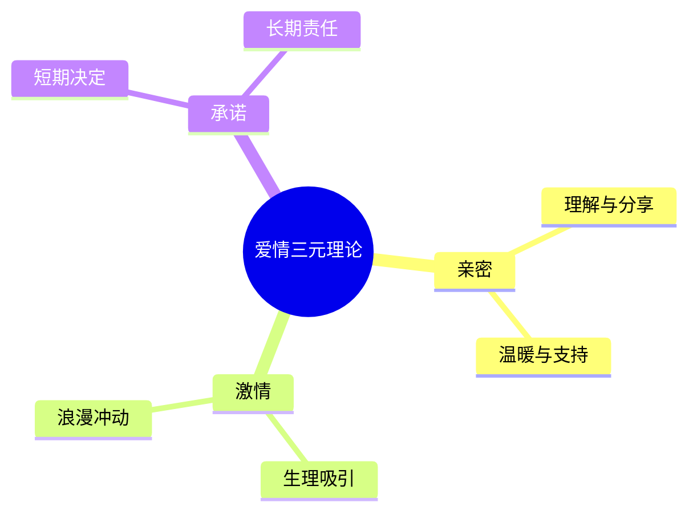

# 斯滕伯格爱情三元理论（亲密、激情、承诺）

## 斯滕伯格爱情三元理论

在讨论“什么是爱情”时，我们常常觉得它捉摸不定。心理学家斯滕伯格（Sternberg）提出了一个清晰的理论框架，把爱情拆解成三个基本成分。

这三个成分分别是：

- **亲密**：指心理上的喜欢、理解、分享与支持。比如“我们无话不谈”“在一起很自在”。
- **激情**：指生理上的吸引、浪漫的冲动。比如“一见钟情”“想要时刻在一起”。
- **承诺**：指维持关系的决定与责任。短期表现为“我决定爱这个人”，长期表现为“我要为这份关系持续付出努力”。

这三个成分就像三原色，不同组合构成了不同类型的爱情。

### 为什么需要这个理论

如果不理解这三个成分各自独立又共同作用，就容易产生下面这类误解：

> “恋爱一年了，没有刚在一起时那种心跳加速的感觉，是不是我不爱他了？”

根据三元理论，刚在一起时，==激情往往处于峰值==。随着时间推移，激情可能自然回落，但亲密和承诺却在逐渐积累。爱情并没有“变质”，只是==结构发生了变化==。

`[!IMPORTANT]`
`> 爱情发展的常态路径：初期激情主导 → 中期亲密深化 → 长期承诺巩固。`

### 八种爱情类型

根据三个成分的有无与组合，斯滕伯格划分出以下类型：

| 类型 | 亲密 | 激情 | 承诺 | 举例 |
| :--- | :---: | :---: | :---: | :--- |
| 无爱 | ✕ | ✕ | ✕ | 路人 |
| 喜欢 | ✓ | ✕ | ✕ | 好朋友 |
| 迷恋 | ✕ | ✓ | ✕ | 一见钟情 |
| 空爱 | ✕ | ✕ | ✓ | 包办婚姻初期 |
| 浪漫之爱 | ✓ | ✓ | ✕ | 热恋但没规划未来 |
| 伴侣之爱 | ✓ | ✕ | ✓ | 老夫老妻 |
| 愚昧之爱 | ✕ | ✓ | ✓ | 闪婚 |
| ==**完美爱情**== | ✓ | ✓ | ✓ | 三者皆备的理想状态 |

`[!TIP]`
`> 记忆口诀：亲密是“温暖”，激情是“火热”，承诺是“冷静”。完美爱情＝温暖+火热+冷静。`

### 常见的坑

`[!WARNING]`
`> 激情回落≠爱情消失`
`> 许多情侣在激情自然消退后误以为“不爱了”，急于分手，忽略了已经建立起来的亲密和承诺。这恰恰是题目中那个判断题所揭示的误区。`

`[!CAUTION]`
`> 三者不是一成不变的`
`> 亲密、激情、承诺三者会动态变化。长期关系中，主动维护激情（如创造新鲜体验）、持续沟通深化亲密、守住承诺，是维持高质量爱情的必要行动。`

### 结合那道判断题

题干说：“并不是爱情变了，而是它发展了你却还用旧眼光去看它。”用三元理论来看：

- 恋爱初期：激情值很高，亲密与承诺正在建立。
- 恋爱一段时间后：激情回落至平稳水平，亲密与承诺显著上升。

关系从“浪漫之爱”转向“伴侣之爱”或趋近“完美爱情”。如果用“激情必须永远高涨”的旧标准去衡量，就会误判为爱情褪色。==正确做法是更新认知，看到新阶段里亲密与承诺的价值。== 因此该判断答案为 **正确（√）**。
