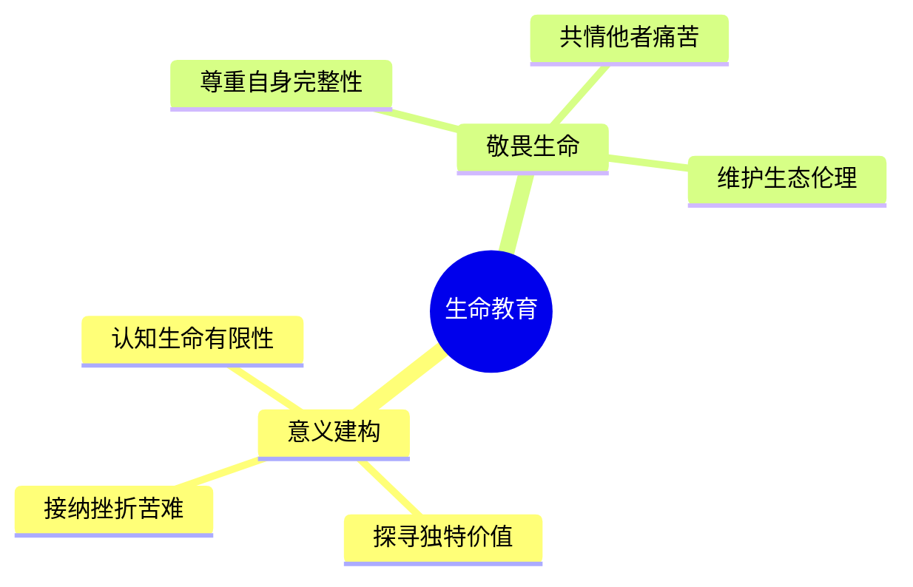

# 生命教育的意义与敬畏生命的价值观

## 生命教育的内涵与价值锚点

当我们谈论“生命教育”时，你是否认为它仅仅等同于“防止自杀”或“安全教育”？如果只把生命看作需要被保护的物理客体，我们是否忽略了支撑个体度过危机的内在精神力量？

> [!IMPORTANT]
> 生命教育不仅是危机干预的==前置防线==，更是帮助大学生确立存在意义、实现自我超越的==价值基石==。

在南邮《大学生心理健康》课程体系中，生命教育包含两个核心维度：**认知层面的“意义建构”**与**实践层面的“敬畏价值观”**。前者解决“为何而活”，后者解决“如何对待生命”。

## 为什么需要敬畏生命的价值观

在学业压力、人际冲突或未来迷茫等应激源面前，单纯的心理技巧往往治标不治本。唯有建立稳固的生命价值观，才能在极端情境下提供==终极心理韧性==。

| 维度 | 传统安全教育 | 生命教育（敬畏观） |
| :--- | :--- | :--- |
| 关注焦点 | 避免身体伤害 | 提升生命质量与尊严 |
| 应对逻辑 | 外部规则约束 | 内在价值驱动 |
| 危机视角 | 需消除的故障 | 成长的契机与警示 |
| 目标导向 | 活着（Survival） | 活出意义（Thriving） |

> [!NOTE]
> 敬畏生命不等于盲目乐观或无视痛苦，而是==在承认脆弱的前提下，依然选择对生命保持庄重与关怀==。这种价值观是区分“被动生存”与“主动生活”的关键分水岭。

## 如何在实践中落实敬畏生命

敬畏生命并非抽象口号，它体现在具体的身心照护技能与伦理抉择中。以心肺复苏（CPR）为例，这既是急救技术，更是“在行动中践行敬畏”的典型场景。

> [!TIP]
> 记忆口诀：胸外按压定位准，“两乳连线中点”稳；深度频率要达标，敬畏生命在手心。

让我们通过一道真题来检验对“敬畏”的技术化理解：

> **例题**：下列对心肺复苏中胸外按压的位置叙述正确的是（ ）。
> A. 心脏上方 B. 胸骨上部 C. 胸骨中、下部2/3交界处 D. 胸骨正中，两乳头水平连线处

==正确答案：D==。选项C是过时的解剖学描述，实际操作中难以快速定位；D项“两乳头水平连线中点”才是现行指南推荐的==体表标志法==，能在紧急状态下最大限度保障施救有效性。选错位置不仅无效，还可能造成肋骨骨折等二次伤害——这恰恰说明，==真正的敬畏必须建立在精准的专业能力之上==。

> [!WARNING]
> 常见误区：将“敬畏生命”等同于“不惜一切代价维持生物学存活”。实际上，在终末期医疗等情境中，尊重患者意愿、减轻无谓痛苦同样是敬畏生命的体现。

## 易混淆概念辨析

- **生命教育 vs 心理治疗**：前者面向全体学生的==发展性预防==，后者针对已出现障碍个体的==矫治性干预==。
- **敬畏生命 vs 害怕死亡**：敬畏源于对生命价值的肯定，恐惧则源于对未知的焦虑；前者导向建设性行动，后者可能导致回避或强迫行为。

> [!CAUTION]
> 切勿将生命教育简化为“感恩教育”或“励志鸡汤”。脱离现实困境的空泛说教，反而会削弱学生对课程的信任感，使敬畏价值观沦为道德绑架。
