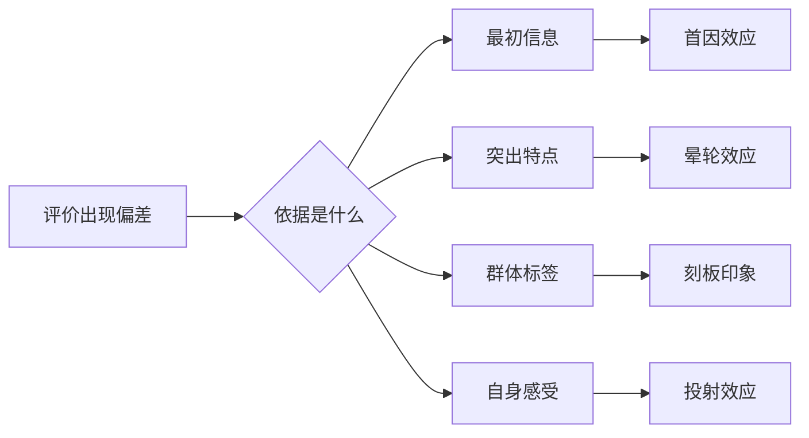

# 首因效应、晕轮效应、刻板印象与投射效应

## 首因效应：第一印象的“先入为主”

首因效应是指交往双方形成的第一印象，对后续交往关系产生的重要影响。初次见面时，对方的仪表、谈吐、举止等有限信息，会被我们优先接收并赋予较大权重，成为评价对方的“基线”。例如，面试时前几分钟的得体表现，可能让面试官在后续提问中更倾向于寻找支持“此人优秀”的证据。

首因效应并非总是误导，它能帮助我们在信息不足时快速建立初步判断；但若长期停留在第一印象，就可能忽视对方后续的真实变化。因此，既要重视初次交往中的真诚与礼貌，也要提醒自己：第一印象只是起点，不是结论。

## 晕轮效应：以一点推及整体

晕轮效应又称光环效应，是指根据一个人的某一突出特征，推断其其他方面也同样优秀或糟糕。例如，认为“成绩好的学生一定品德好、能力强”，或因为某人一次失误，就否定其全部能力。

它与首因效应的区别在于：首因效应强调信息出现的时间先后，晕轮效应强调由局部特征向整体品质扩散。两者可能叠加，如第一次见面觉得对方谈吐优雅，随后便推断其学习、工作、品德都很出色。

## 刻板印象：把群体标签套到个人身上

刻板印象是对某一类人或事物形成的较为固定、概括的看法。例如，“某地区的人都不好”“理工科学生都不善表达”。它有时能简化认知，但容易忽视群体内部差异，并进一步演变为偏见或歧视。

> [!WARNING]
> “地域黑”通常属于==刻板印象或偏见==，不是投射效应。判断时不要只看到“错误评价他人”，还要分析评价依据来自哪里。

## 投射效应：把自己的特点推给别人

投射效应是指个体将自己具有的特性、感受或想法归因到他人身上的倾向。例如，自己跑步回宿舍感到闷热，不问舍友意愿便调低空调温度，就是默认“我热，所以你也一定热”。

自我投射并非单纯的缺陷。很多时候，它能帮助我们换位思考、体谅他人；关键在于是否结合对方处境进行核实。若双方处境相似，自身感受可作为理解他人的线索；若处境不同，就不能把“我觉得”直接等同于“你也觉得”。

| 效应 | 判断依据 | 典型提问 |
|---|---|---|
| 首因效应 | 最先获得的信息影响后续评价 | 是否被第一印象带偏？ |
| 晕轮效应 | 由一个突出特点推断整体 | 是否以一点概括全部？ |
| 刻板印象 | 用群体固定标签评价个人 | 是否把“某类人”套到“这个人”？ |
| 投射效应 | 把自己的特点归于他人 | 是否认为“我这样，你也这样”？ |

## 一个判断对了的例子

“自己刚跑步回宿舍感到热，不考虑舍友是否也闷热，就直接大开冷气空调。”这里的信息来源是自己的感受，并将其直接推给舍友，因此答案是==投射效应==。若改成“某省的人都怕热，所以舍友一定怕热”，才是刻板印象。

> [!TIP]
> 解题先找“评价依据”：最早信息看首因，一点扩整体看晕轮，群体套个人看刻板，自己推别人看投射。实际交往中，则应多观察、多询问、允许修正，避免一次判断定终身。
