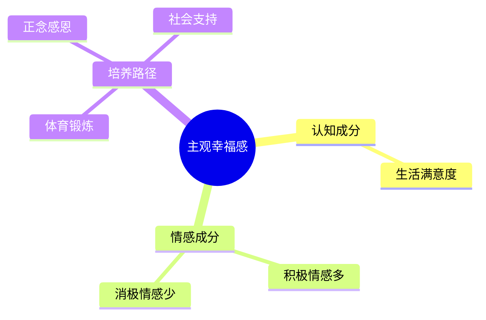

# 积极情绪的培养与主观幸福感的提升

## 积极情绪与主观幸福感是什么

你是否认为只要没有焦虑、抑郁等负面情绪，就等于拥有了心理健康？其实，心理健康不仅是“没病”，更是“蓬勃”。==积极情绪的培养与主观幸福感的提升==正是从“消除痛苦”转向“构建优势”的关键路径。

> [!IMPORTANT]
> 核心定义辨析
> **积极情绪**：个体对内外刺激产生的愉悦、感激、希望等正向体验，具有扩展认知和建构资源的功能。
> **主观幸福感（swb）**：个体根据自定标准对生活质量的总体评价，包含==生活满意度（认知）+ 积极情感 - 消极情感==三要素。

## 为什么大学生需要主动培养

如果仅仅等待快乐“自然发生”，往往会陷入被动。为什么要刻意练习？因为积极情绪并非天生固定，而是可以通过行为干预积累的“心理资本”。它能拓宽思维-行动范畴，帮助你在学业压力、人际冲突中更快复原，形成向上的螺旋效应。

## 如何科学提升：以体育锻炼为例

培养积极情绪不能仅靠“想”，更要靠“做”。在众多方法中，体育锻炼是课件强调的==身心交互核心手段==。但锻炼不是盲目拼命，必须遵循科学原则。

> [!TIP]
> 记忆口诀
> 锻炼原则记三点：实际出发、循序渐进、持之以恒。其中“实际出发”是安全与有效的前提。

[!NOTE]
> 延伸辨析：实际出发的内涵
> “从实际出发”不仅指外界环境（场地、天气），更核心的是指==个人的身体状况、体能基础和心理状态==。脱离个人实际的高强度运动反而会诱发挫败感，损害主观幸福感。

## 概念区分与常见误区

| 维度 | 积极情绪 | 主观幸福感 | 享乐主义快乐 |
| :--- | :--- | :--- | :--- |
| 性质 | 即时情感体验 | 长期稳定评价 | 感官满足 |
| 持续性 | 短暂、波动 | 相对持久 | 易消退 |
| 功能 | 扩展建构资源 | 整体生活质量指标 | 无深层建设性 |

> [!WARNING]
> 易错坑点
> 将“主观幸福感”等同于“永远开心”。实际上，高swb的人也会经历悲伤，但他们==积极情感频率更高、恢复更快==，且对生活有整体满意感。追求“零负面情绪”反而是误区。

## 真题应用示例

来看一道典型选择题，检验你对“实际出发原则”的理解：

> 体育锻炼的从实际出发的原则是指锻炼身体应从（ ）的实际情况和外界环境条件的实际出发……
> a. 个人  b. 集体  c. 经济  d. 政治

==正确答案：a==。解析：该原则强调锻炼方案必须适配个体的生理心理条件。若选“集体”则忽视个体差异；“经济”“政治”虽影响外部环境，但非该原则的核心指向。只有立足“个人”实际，才能通过适宜负荷产生积极情绪，进而提升主观幸福感。这正是知识点在行为层面的精准落地。
