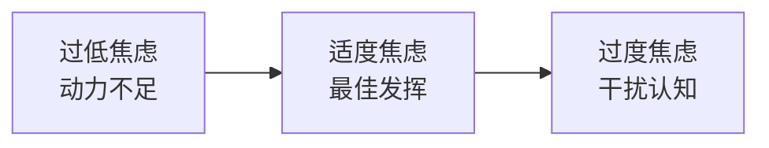
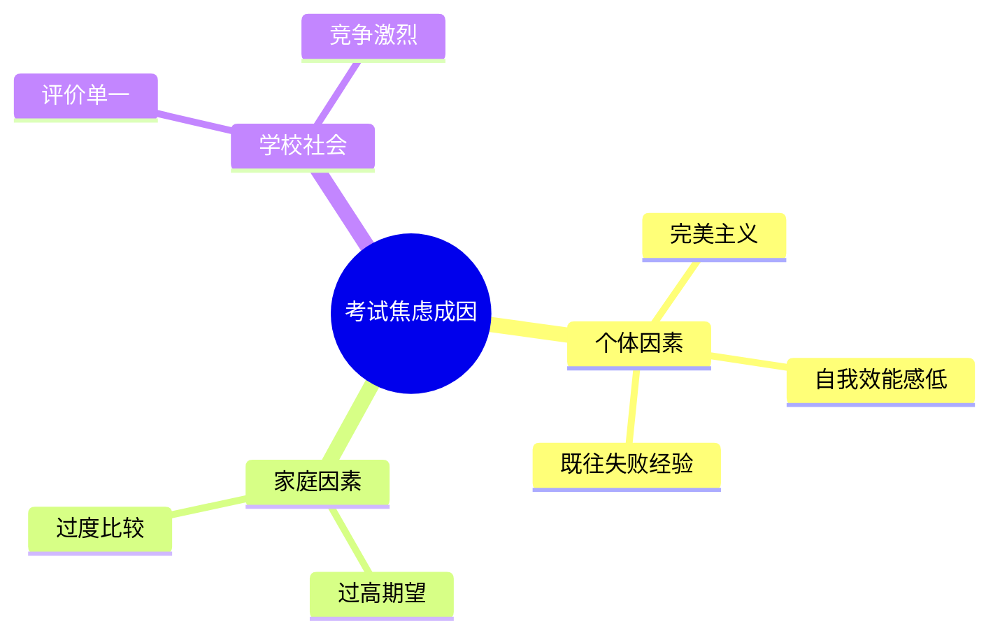
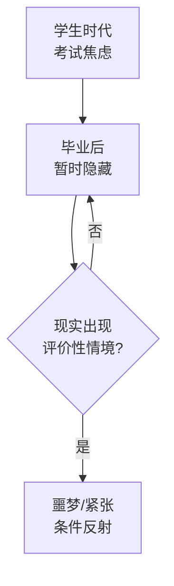

# 考试焦虑的表现、成因与干预方法

## 考试焦虑是什么

考试焦虑是大学生在面临考试情境时，因担心评价结果而产生的过度紧张、担忧与躯体不适。它不是简单的"考前紧张"，而是==焦虑水平高到一定程度、干扰正常发挥==的状态。

先想一个问题：考前完全不紧张，就一定好吗？心理学研究表明，焦虑与成绩呈**倒 U 型关系**（耶克斯-多德森定律）——适度焦虑能提升动机与专注，过低或过高都会拖累表现。

## 有哪些表现

考试焦虑通常从四个层面表现出来，可对照自查：

| 层面 | 典型表现 |
|------|----------|
| 情绪 | 紧张、担忧、害怕失败、易烦躁 |
| 认知 | 注意力难集中、记忆力下降、思维僵化、自我否定 |
| 躯体 | 心跳加速、出汗、手抖、失眠、食欲下降 |
| 行为 | 拖延复习、逃避考试、反复检查、考场大脑"空白" |

> [!WARNING]
> "考场大脑一片空白"不是知识没学会，而是==过度焦虑占用工作记忆资源==，导致提取失败。这正是需要干预的信号，而非"我完了"的证据。

## 为什么会焦虑

成因可从三个维度理解，彼此交织放大：

- **个体**：把考试结果与自我价值绑定（"考不好=我不行"）、对失败的灾难化预期。
- **家庭**：父母期望过高、常以他人作比较，强化"考不好就对不起家人"的信念。
- **环境**：成绩作为单一评价标准、同伴竞争压力，使考试被赋予超出其本身的意义。

## 如何干预

干预遵循"先调认知、再练行为、必要时求助"的思路：

| 方法 | 适用场景 | 操作要点 |
|------|----------|----------|
| 认知调整 | 灾难化想法 | 用证据检验"考砸就完了"，替换为合理预期 |
| 放松训练 | 考前/考场躯体反应 | 腹式呼吸、渐进式肌肉放松 |
| 系统脱敏 | 对考试情境的条件性恐惧 | 从低焦虑场景逐级暴露 |
| 时间管理 | 复习不足导致的焦虑 | 制定可行计划，减少临时抱佛脚 |
| 寻求支持 | 自我调节无效 | 心理咨询中心专业帮助 |

> [!TIP]
> 考场上快速平复：==4 秒吸气—7 秒屏息—8 秒呼气==，重复 3～4 轮，可显著降低生理唤醒水平。

## 考试情结：毕业也带得走的条件反射

一个值得警惕的延伸现象是**考试情结**。它指考试焦虑并未随毕业消失，而是被"隐藏"起来；一旦现实出现**类似评价性情境**（如面试、述职、汇报），噩梦与紧张便条件反射般重现，==理智上知道没必要，情绪上仍控制不住==。

> [!IMPORTANT]
> 判断题考点：==重复的考试梦意味着存在"考试情结"==，且该情结可在离校多年后、遇到类似评价情境时被重新激活。题干描述与这一结论一致，故判断为 **√**。

## 常见的坑

- 把考试焦虑等同于"心理素质差"，忽视其可干预性；
- 只盯躯体症状（如失眠）而忽略背后的灾难化认知；
- 认为"彻底不焦虑才最好"，忽视了适度焦虑的积极作用；
- 考完即放松，不处理残留的考试情结，导致它在职场评价情境中复发。
