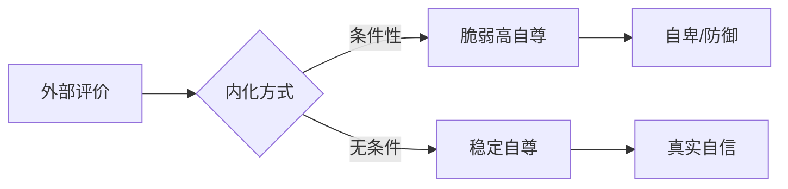

# 自尊、自信与自卑的心理机制及调适

## 核心概念辨析

你是否曾把“我很优秀”等同于“我值得被爱”？这正是混淆自尊与自信的典型表现。==自尊是对自我价值的整体接纳==，关乎“我是谁”；而==自信是对特定能力的评估==，关乎“我能做什么”。自卑则是自尊受损后的消极体验，常伴随过度敏感与回避行为。三者并非线性关系，高自尊者也可能在某领域缺乏自信。

| 维度 | 自尊 | 自信 | 自卑 |
| :--- | :--- | :--- | :--- |
| 指向 | 整体自我价值 | 具体能力评价 | 负面自我认知 |
| 稳定性 | 相对稳定 | 情境依赖性强 | 易受外界触发 |
| 调适重点 | 无条件接纳 | 技能提升与验证 | 认知重构 |

> [!IMPORTANT]
> 自尊是心理健康的基石，自信是自尊的外显之一，但≠自尊本身。

## 心理机制与调适路径

为何有人成绩优异仍深陷自卑？关键在于==自我评价是否建立在条件性标准上==。当自我价值绑定于绩点、外貌等外部指标时，一旦失败便全盘否定自我。健康自尊源于内在稳定的自我认同，而非持续达成的成就。

> [!TIP]
> 调适口诀：价值不靠比，能力可练习，失败非定义。

调适应分三层推进：认知上识别“全或无”思维，用“虽然…但我依然…”句式重构自我评价；行为上设定阶梯目标积累成功体验；情感上练习自我关怀，像对待好友般回应自身挫折。

## 常见误区与正例解析

> [!WARNING]
> 误将“盲目自大”当作高自尊，实为防御性虚假自尊，遇挫极易崩塌。

> [!CAUTION]
> 认为“消除自卑=建立自信”，忽略自尊修复才是根本前提。

**正例分析**：某生竞赛失利后认为“我一无是处”（自卑泛化）。调适步骤：① 识别自动化负性思维；② 区分“这次没做好”≠“我这个人不行”；③ 回顾过往成功经历锚定自我价值；④ 制定针对性训练计划重建该领域自信。此过程既修复了自尊损伤，又避免了以新成就替代旧伤疤的陷阱。

> [!NOTE]
> 真正的高自尊允许自己在某些方面“不够好”，而不威胁整体价值感。
