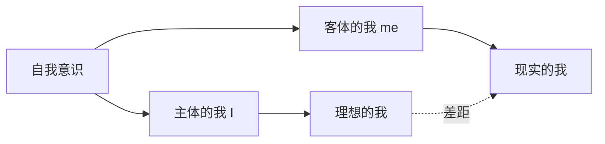
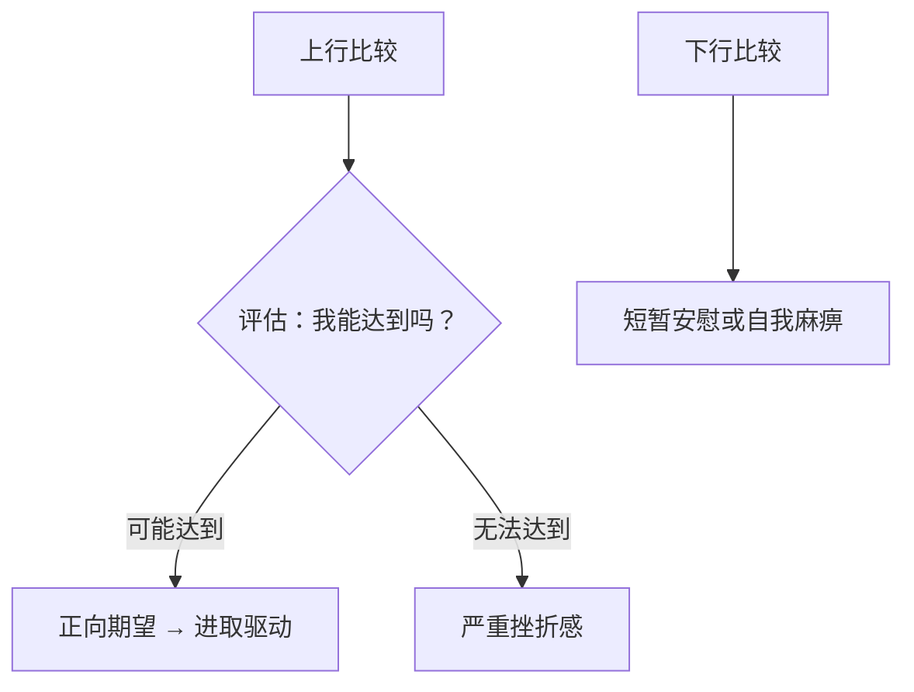

# 大学生自我意识发展的特点与矛盾

## 自我意识的分化：从“我”中分出两个我

进入大学后，自我意识最显著的变化是**分化**：原来浑然一体的“我”分裂为“主体的我”（I，观察者、评价者）和“客体的我”（me，被观察、被评价者）。

你可以做一个简单实验：现在在心里问自己——“我到底是个怎样的人？”此刻，提问的是主体的我，而被你打量、描述的“那个人”，就是客体的我。

> [!NOTE]
> 分化是自我意识走向成熟的起点。没有分化，就谈不上自我反思——你不可能审视一个和自己完全黏在一起的东西。

分化之后，“现实的我”与“理想的我”也随之分离。你开始清楚地看到自己“现在是什么样”和“应该是什么样”之间的差距。

## 三组核心矛盾

分化带来的直接后果是**矛盾感的集中出现**。

### 理想我与现实我的矛盾

你期待自己自律、绩点靠前、人际从容，但现实中可能天天熬夜刷手机、课堂上走神。理想我是努力方向的参照系，但当差距长期无法弥合时，会转化为持续的自责与无力感。

### 独立意向与依附心理的矛盾

你渴望“自己的事自己决定”，选课、花钱、交友都不想被父母干涉；但遇到实际困难（生活费告急、生病、重大挫折）时，第一反应往往还是“问爸妈”。这不是软弱，而是从依附走向独立过程中的正常拉扯。

### 交往需要与自我闭锁的矛盾

你希望被理解、被接纳，但又因为担心暴露弱点或不被认可而选择沉默，把真实想法锁起来。大学宿舍里“想说又咽回去”的时刻，几乎人人都有。

> [!IMPORTANT]
> 这三组矛盾不是心理疾病的表现，而是==自我意识发展过程中必然出现的张力==。真正需要关注的不是“有没有矛盾”，而是“如何应对矛盾”。

## 社会比较：矛盾被激化或缓解的关键机制

大学生的自我评价，很大程度上不是凭空产生的，而是在**比较**中形成的。

- **上行比较**：与比自己强的人比。
- **下行比较**：与比自己弱（或境遇更差）的人比。

以曾经考过的填空题为例：

> 在进行（==上行==）的社会比较时，你分析自己有可能达到与别人一样的成就或超过他而产生正向期望，就会产生积极进取的内在驱动力；但当你觉得你尽其所能仍无法达到你比较的人的成就时，就会产生严重的挫折感。

理解这句话的关键在于：上行比较本身**不自动等于**动力或挫败，决定结果的是你对**达成可能性**的评估。

> [!WARNING]
> 常见的坑：把“上行比较”直接等同于“积极进取”。题干里明确有一个**转折**——“但当你觉得尽其所能仍无法达到时”，所以填空题填的是“上行”，不是“积极”或“正向”。

## 一个“算对”的例子

某大一学生看到同班同学高数考了 95 分（上行比较对象）。他先评估：自己平时作业正确率在 85% 左右，期末前还有六周，每周多投入 5 小时专项刷题，拿到 90 分以上有可能。这个“有依据的可能性”让他产生了正向期望，于是制定了具体计划，开始行动——这就是上行比较转化为内在驱动力的完整路径。

反过来，如果他直接认定“别人就是聪明，脑子不如人家，再努力也没用”，同样一场比较就可能导向回避学习、自我否定。

> [!TIP]
> 判断一道题考的是“社会比较”还是“自我矛盾”，看**场景里有没有另一个参照人**。有参照人 → 社会比较；只有“我想……但我……”的内心拉扯 → 理想我与现实我的矛盾。
