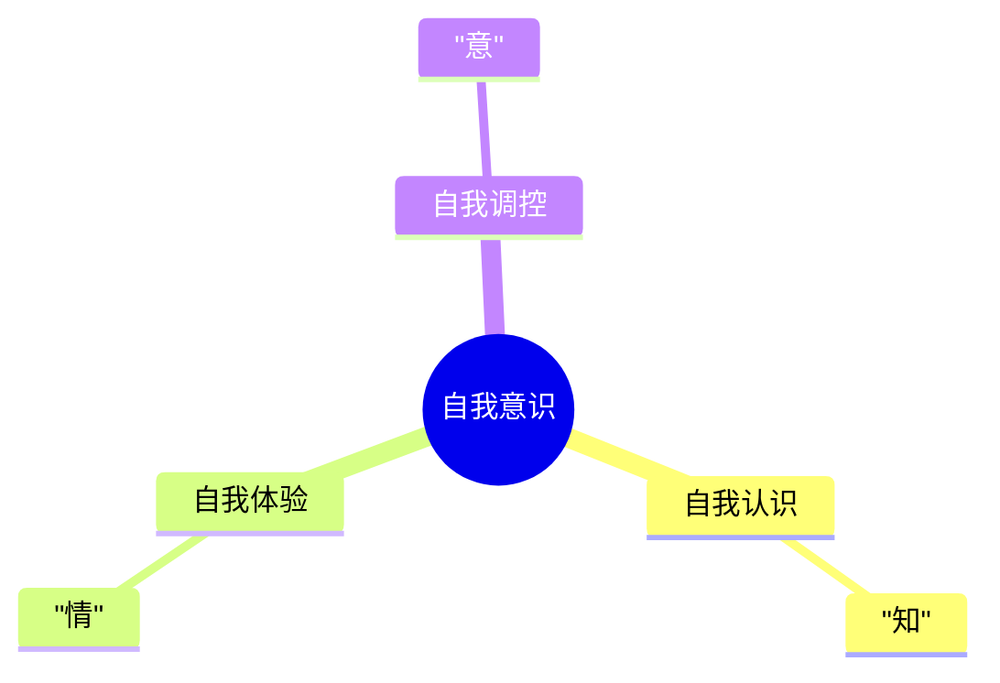

# 自我意识的结构（自我认识、自我体验、自我调控）

当你照镜子时，你看到了什么？是“我长这样”（认知），还是“我觉得自己挺好看”（体验），又或者是“我要去健身改善体态”（调控）？这三者共同构成了完整的自我意识。

## 它是什么

> [!IMPORTANT]
> 自我意识的结构包含三个相互联系的成分：==自我认识、自我体验、自我调控==。

- **自我认识**：属于“知”的层面。指个体对自己的洞察与理解，包括自我观察、自我分析、自我评价等。例如：“我是一个性格内向的人。”
- **自我体验**：属于“情”的层面。指伴随自我认识而产生的情绪情感体验，如自尊、自信、自卑、内疚等。例如：“因为内向，我在社交时常感到焦虑。”
- **自我调控**：属于“意”的层面。指个体对自身心理与行为的主动调节与控制，包括自我监督、自我激励、自我控制等。例如：“我决定每天主动和一位同学打招呼来锻炼自己。”

## 为什么需要

如果只有认识没有体验，人就像一台冷漠的机器；有体验却没有调控，人就会陷入情绪的漩涡无法自拔。三者协同运作，才能让大学生在面临学业压力、人际冲突或身份转变时，保持心理健康并实现个人成长。

## 怎么做

完善自我意识结构，可以从以下路径入手：

1. **拓宽自我认识的渠道**：不要只凭主观臆断，多通过他人反馈（如乔哈里视窗中的“盲目区”）、社会实践和心理测评来客观了解自己。
2. **接纳真实的自我体验**：允许自己有负面情绪，不压抑、不逃避，将自卑转化为成长的动力而非自我攻击的武器。
3. **强化自我调控的执行力**：制定具体可行的小目标，运用自我暗示和自我激励，把“我想改变”落实为“我正在做”。

## 相近概念的区别

很多同学容易把这三个成分搞混，尤其是“评价”与“体验”的界限。

| 维度 | 自我认识 | 自我体验 | 自我调控 |
| :--- | :--- | :--- | :--- |
| **心理过程** | 认知过程 | 情感过程 | 意志过程 |
| **核心问题** | “我是谁？” | “我接纳自己吗？” | “我该怎么做？” |
| **典型表现** | 自我观察、自我评价 | 自尊、自信、自卑感 | 自我控制、自我教育 |
| **关键词** | 客观描述/判断 | 主观感受/情绪 | 行为干预/改变 |

> [!NOTE]
> “自我评价”属于自我认识，它是得出一个结论（如“我数学不好”）；而因为数学不好产生的“挫败感”，则属于自我体验。

## 常见的坑

> [!WARNING]
> 考试中常设的陷阱是将不同结构的成分张冠李戴。比如把“自尊心”归入自我认识，或者把“自我反省”当成自我调控。记住口诀：==认识是判断，体验是感受，调控是行动==。

> [!CAUTION]
> 不要把“自我投射”等同于自我认识的缺陷。虽然投射带有主观色彩，但它在人际交往中具有积极意义。

## 算对了的例子

我们来看一道判断题：

**题干**：自我投射并非单纯的缺陷，相反，很多时候自我投射是一种社会性的行为，它能更好地帮助我们去换位思考，去体谅他人。

**解析**：这道题考查的是对自我心理机制的理解。在自我认识的过程中，我们有时会将自己的特点投射到他人身上。虽然过度投射会导致认知偏差，但适度的自我投射本质上是一种共情机制。通过假设“如果是我，我会怎样”，我们能够跨越个体差异，实现换位思考与体谅。因此，自我投射具有积极的社会性功能。

**答案**：√（正确）。

> [!TIP]
> 遇到这类判断题，看到“并非单纯……”“很多时候能……”这种辩证表述，且符合心理学常识中“防御机制/心理现象具有两面性”的原则时，大概率为正确。
