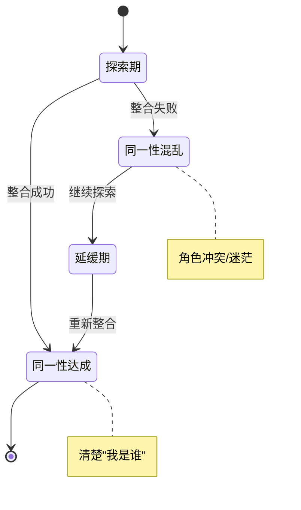

# 埃里克森自我同一性（认同感）理论

你有没有想过：当别人否定你的某个行为时，为什么你会感到不安甚至愤怒？这种不安仅仅是因为“丢面子”，还是因为它动摇了更深层的东西？

## 它是什么

埃里克森将人的一生划分为八个心理社会发展阶段。大学生正处于第五阶段（青年期），核心任务是建立 ==自我同一性==（又称身份认同）。

> [!IMPORTANT]
> 自我同一性是指个体把自身的动机、能力、信仰和经验整合成一个连贯、稳定的自我形象，清楚地知道“我是谁”“我将走向何方”。

如果这一任务失败，就会陷入 ==同一性混乱==（角色混乱），表现为对未来迷茫、价值观摇摆、无法做出承诺。

## 为什么需要它

在团体心理辅导和心理健康教育活动中，我们常会与他人互动。试想：为什么我们在交往中总希望得到他人的肯定？

因为 ==否定性的反应很可能对行动者的存在状态提出质疑，进而威胁到对自己的身份认同==。他人就像一面镜子，我们通过这面镜子确认自己构建的“自我形象”是否成立。缺乏同一性的人，往往过度依赖外界评价来维持脆弱的自我感。

## 怎么做

结合本课程实践环节，你可以通过以下途径促进自我同一性的建立：

1. **参与团体心理辅导**：在心理班会的安全氛围中暴露真实想法，观察他人反馈，检验并修正自我认知。
2. **投入心理健康教育活动**：通过完成规定的活动次数，在不同情境中尝试新角色，拓宽自我边界。
3. **主动反思与整合**：活动结束后记录感受，将碎片化的经验拼凑成完整的自我叙事。

> [!TIP]
> 记忆口诀：“探角定诺”——探索角色、做出承诺、确立认同。

## 与相近概念的区别

| 比较维度 | 自我同一性（身份认同） | 自尊 | 自我概念 |
| :--- | :--- | :--- | :--- |
| **核心问题** | “我是谁，要去哪” | “我有多大价值” | “我有哪些特征” |
| **时间指向** | 强调过去、现在与未来的连续性 | 侧重当下的情感评价 | 侧重当前的静态描述 |
| **结构特点** | 动态整合过程 | 单一情感体验 | 多维度认知集合 |

> [!NOTE]
> 自我概念是“砖块”，自我同一性是用砖块建成的“大厦”。有自我概念不等于拥有稳固的自我同一性。

## 常见的坑

> [!WARNING]
> 易错点：认为“听从父母安排选了热门专业”就是达成了同一性。这只是 ==同一性早闭==（未经探索就盲目承诺），并非真正的同一性达成。

> [!CAUTION]
> 高危误区：把“特立独行、拒绝一切建议”等同于找到了自我。这可能是同一性混乱的防御表现，而非真正的认同感。

## 真题实战

来看一道考过的判断题：

**题干**：人们在交往中非常注意他人对自己行动的反应并总希望得到肯定，就是因为否定性的反应很可能对行动者的存在状态提出质疑，进而威胁到对自己的身份认同。

**解析**：
- 第一步，定位考点：本题考查的是人际交往与“身份认同”（即自我同一性）的关系。
- 第二步，代入理论：根据埃里克森理论，青年期极度关注他人评价，是因为外部反馈直接关系到自我同一性能否稳固。否定性反应会打破个体刚建立的内在一致性，引发存在性焦虑。
- 第三步，得出结论：题干表述完全符合理论逻辑。

**答案**：$\checkmark$（正确）
