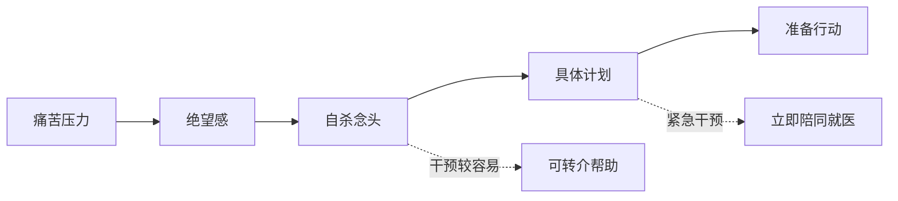
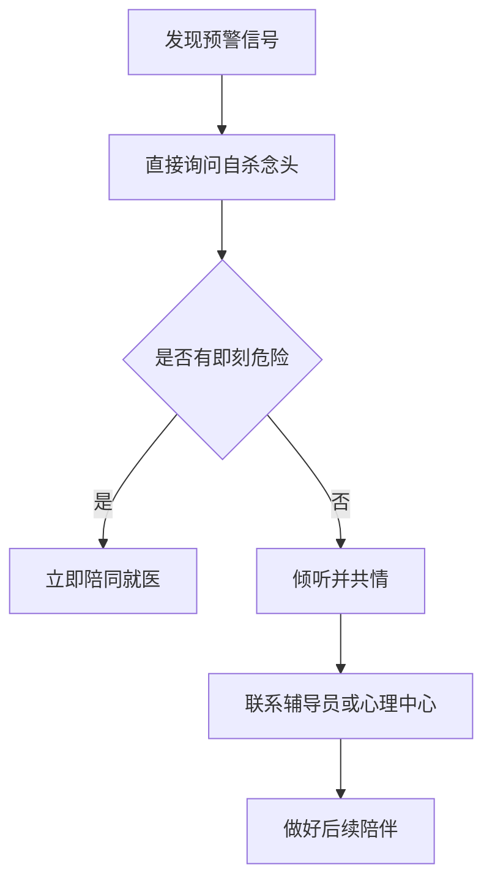

# 大学生自杀风险评估与守门人干预策略

## 自杀风险评估：先说清一个常见误区

在进入“守门人”怎么操作之前，先澄清一件事：**询问自杀念头，不会“提醒”或“诱导”一个人去自杀。** 相反，直接、温和地询问是评估风险最有效的一步。很多同学担心“万一我问了，对方本来没事，结果想多了怎么办”，这在研究里没有依据。真正危险的是——对方已经在想，但没人问，也就没人知道。

> [!IMPORTANT]
> 直接询问自杀念头是风险评估的起点，不会造成“诱导”。

## 为什么需要风险评估

自杀行为通常不是突如其来的冲动，而是一个从“痛苦—绝望—念头—计划—行动”逐渐推进的过程。评估的目的不是给学生“贴标签”，而是判断**当前处于哪一步、离行动有多近、现在需要什么级别的帮助**。

风险不是一个“有/没有”的开关，而是一个连续谱：

## 怎么评估：抓三个核心问题

评估时不绕弯子，三个层次逐步明确：

| 层次 | 问题 | 关注点 |
|------|------|--------|
| 念头 | “最近有没有觉得活着没意思，或者不想活了？” | 有没有 |
| 计划 | “有没有想过具体怎么做？” | 方式、时间、地点 |
| 既往行为 | “以前有没有实施过？” | 既往史是强预测因素 |

三个问题都得到肯定回答时，风险显著升高，尤其是**已经有了具体计划、时间、工具**，或者**既往有过自杀行为**。

> [!WARNING]
> “他只是说说而已，不会真做的”——这是高危误区。任何自杀表达都必须当作真实信号对待。

## 守门人干预：没学过咨询也能做

守门人（gatekeeper）不是要做心理咨询师，而是**识别、询问、陪同、转介**。南邮课程中该模块的核心动作可以概括为“问—听—陪—转”：

具体来说：

- **问**：用第一节里的方式直接询问。
- **听**：不评判、不说教，不急着讲“想开点”。先让对方把痛苦说出来。
- **陪**：高风险时刻不让学生独处，陪同去心理中心或医院。
- **转**：校内可转介心理健康教育与咨询中心、辅导员；校外可拨打 24 小时心理援助热线。

> [!TIP]
> 口诀：**守门人不是“修门的人”，而是“认出门里危险、快按报警器的人”。** 不负责治疗，负责不放过。

## 和相近概念的区别

| 概念 | 核心任务 | 谁来做 |
|------|----------|--------|
| 心理教育 | 普及知识、降低病耻感 | 任何人 |
| 守门人干预 | 识别、询问、陪同、转介 | 同学、辅导员、宿管等非专业者 |
| 危机干预 | 专业评估、心理治疗或住院 | 心理咨询师、精神科医生 |

三者是**递进漏斗**：教育让更多人愿意求助，守门人把高风险者筛出来且安全送到专业处，专业人员做治疗。学生最容易上手的角色是中间一层。

## 常见的坑

- 只问“你还好吗”，对方说“还行”就放过。**要问具体内容**。
- 发现风险后自己一个人扛，不敢告诉老师，怕“出卖朋友”。实际上**保护生命优先于保守秘密**。
- 以为“已经安慰过了就没事了”。安慰替代不了专业评估和持续关注。

## 一个算对了的例子（选题自节选）

题干（节选）：

> 基本急救中的“ABC”三原则不包括（ ）。  
> 选项含：保持伤者的呼吸道畅通、保持正常呼吸、保持正常血液循环、保持与伤者的语言交流——对应的选择是：

ABC 三原则分别指：**A**irway（开放气道）、**B**reathing（维持呼吸）、**C**irculation（维持循环）。三个原则全部指向**生命体征维持**，属于急救处置范畴。而“语言交流”属于心理安抚，不属于 ABC 的内容。

因此学生判断：

- A 对应气道 ✅
- B 对应呼吸 ✅
- C 对应循环 ✅
- “语言交流” ❌ ——— 于是正确选项是 D。

> [!NOTE]
> 延伸一个易混点：CPR 中的“C-A-B”顺序和本文“A-B-C”不是同一场景表述。CPR 强调先胸外按压（C），再气道（A）、人工呼吸（B）；而急救“ABC”原则作为识别与维持生命体征的框架，按气道—呼吸—循环顺序记忆即可。
