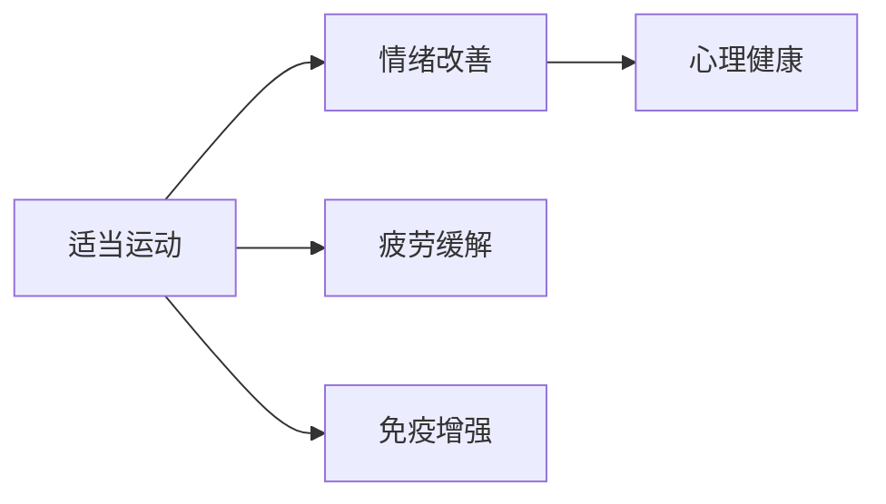

# 体育锻炼对心理健康的促进作用及生理机制

## 它是什么

先想一个问题：为什么很多同学跑完步、打完球，虽然身体累了，心里却反而轻松了？这说明运动不只是练肌肉，也在调整情绪。

在课件里，这属于“第10章 体育与健康（身心关联）”。**体育锻炼对心理健康的促进作用**，指的是：规律、适当的体育运动，可以改善情绪、缓解疲劳、调节不良情绪，并增强机体抵抗力。

## 为什么需要

现代人常久坐、看屏幕、压力大，容易出现疲劳和情绪低落。运动能给心理“换挡”。

> [!IMPORTANT]
> 核心结论：==适当运动能调节免疫、缓解疲劳、改善情绪==。

它不是“治病万能药”，但确实是低成本、易执行的心理保健方式。

## 生理机制简述

运动后，身体会释放一些让人愉快的神经递质，如内啡肽、多巴胺；同时改善睡眠和代谢，帮助机体恢复。可用简化关系表示：

$$
情绪改善 \uparrow \Leftarrow 规律运动 + 生理恢复
$$

课件相关说法包括：运动调节免疫功能、提高抗病能力、转移现代生活方式造成的疲劳。

## 和相近概念的区别

| 说法 | 对/错 | 关键点 |
|---|---|---|
| 运动可以缓解疲劳 | 正确 | 不是所有疲劳都靠睡解决 |
| 运动调节不良情绪 | 正确 | 属于心理促进 |
| 运动对痛苦忧愁没帮助 | 错误 | 可缓解、转移 |
| 体质因人而异 | 正确 | 运动方案要个体化 |

> [!WARNING]
> 易错坑：不是“越剧烈越好”，==过度运动反而伤身心==；也不是“一次就永久有效”，要经常参与。

## 常见的坑与算对了的例子

很多判断题就考上面几句话。例如：

> [!TIP]
> 解题技巧：看到“适当/经常/可以调节/缓解/愉快”，通常选正确。

例子：题“适当的运动可以很好地调节人体的免疫功能，提高机体的抗病能力。”——用课件术语看，“适当运动”“调节免疫”“提高抗病能力”都对，因此答案是 **A. 正确**。

又比如“运动对人的痛苦和忧愁没有帮助。”——与“运动可调节不良情绪”直接冲突，所以是 **B. 错误**。

> [!NOTE]
> 延伸辨析：个别差异存在，所以有人跑步开心，有人更适合球类或瑜伽；选自己能坚持的项目更重要。
