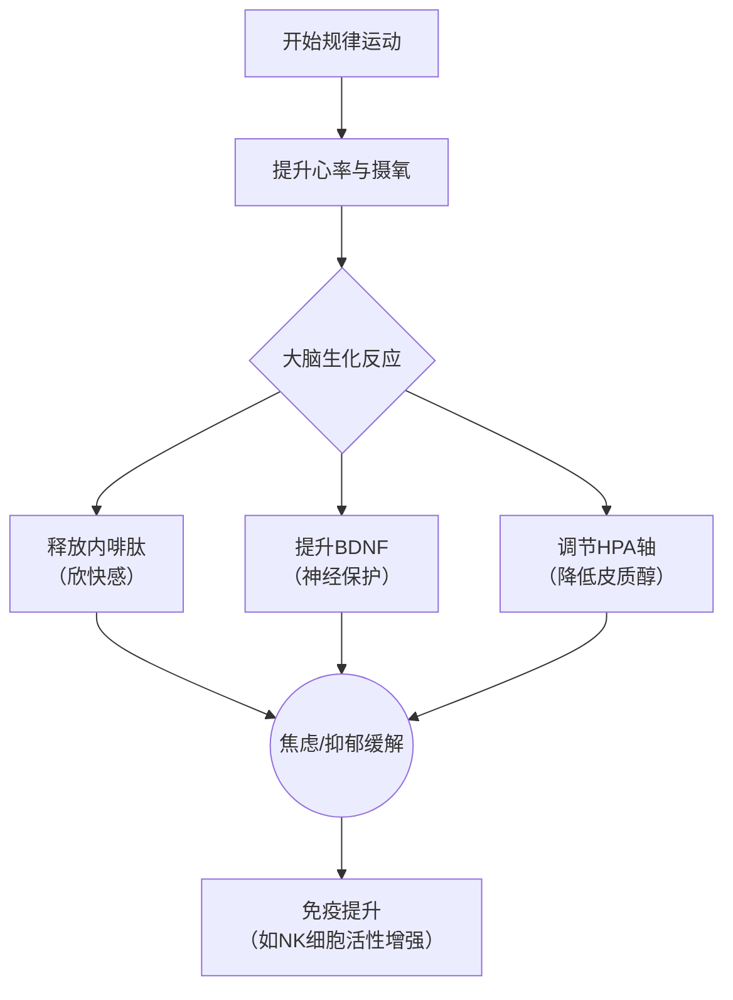

# 体育锻炼缓解焦虑和抑郁的实证效果

## 它是什么

体育锻炼对心理健康的促进作用，并非仅是一种模糊的“感觉良好”，而是经过大量心理学和神经科学实证支持的生理-心理协同效应。在南京邮电大学《大学生心理健康》课程中，这一知识点聚焦于**规律运动如何通过量化数据证实，改变大脑内化学物质、调节免疫与代谢，从而显著降低焦虑与抑郁水平**。

> [!IMPORTANT]
> ==体育锻炼不仅强身，更是调节情绪、预防心理疾病的“非药物处方”。==

## 为什么需要运动来调节情绪

当面临焦虑或抑郁时，大脑常陷入“神经递质失衡”与“应激激素过量”的双重困境。问问自己：如果不借助外部手段，仅凭主观意志能否快速扭转这一生理状态？答案往往是否定的，因为情绪有坚实的生理基础。

运动介入的路径非常直接：
- **提升单胺类递质**：促进5-羟色胺（5-HT）、多巴胺与去甲肾上腺素的合成与释放，这是多数抗抑郁药物的药理靶点。
- **降低应激激素**：规律有氧运动可显著降低静息皮质醇水平，减轻“过度警觉”状态。
- **神经营养与新生**：增加脑源性神经营养因子（BDNF），促进海马体神经发生，逆转抑郁导致的神经元萎缩。

## 怎么做（实证机制）

从实证角度看，运动心理学的经典研究常采用**随机对照组实验**，通过量化量表（如SDS、SAS）得分变化来呈现效果。其内在机制可用以下流程图表示：

## 与相近概念的区别

很多同学容易将“运动后片刻的放松感”等同于“实证的抗焦虑/抑郁效果”，二者有明显区别：

| 对比维度 | 短暂放松（非实证效果） | 实证缓解焦虑与抑郁 |
| :--- | :--- | :--- |
| **持续时间** | 单次运动停止后迅速消退 | 规律运动≥8周后产生持续性改善 |
| **生理标志** | 仅为心跳平复、肌肉松弛 | 检测到BDNF升高、皮质醇基线下降 |
| **量表证据** | 主观感受，无标准化数据 | 汉密尔顿焦虑/抑郁量表（HAMA/HAMD）得分显著下降 |
| **免疫关联** | 无明确关联 | ==规律运动可增强免疫监视，降低炎症因子，间接改善情绪== |

## 常见的坑

> [!WARNING]  
> **单次过度运动**
> 临时抱佛脚式的极限运动往往加重氧化应激与皮质醇飙升，反而恶化焦虑。实证效果依赖**中等强度+长期坚持**（如每周150分钟）。

> [!CAUTION]  
> **迷信“运动万能论”**
> 体育锻炼是辅助手段，中重度抑郁必须结合专业心理治疗或药物，切不可贸然停药。

## 算对了的例子

我们回到讲义中的判断题，看看如何运用实证结论得出正确答案：

**题：运动对人的痛苦和忧愁没有帮助。（  ×  ）**

**解析**：这与所有实证研究相悖。正确的逻辑链是：运动→内啡肽释放+单胺类递质提升→痛苦和忧愁的感知减弱。因此，题干说法错误，正确答案应为“错误”。

**题：适当的运动可以很好地调节人体的免疫功能，提高机体的抗病能力。（  √  ）**

**解析**：实证表明，规律运动会引起免疫球蛋白A（IgA）和自然杀伤（NK）细胞活性的适应性变化。此题正是运动“身心共健”的体现：免疫提升是生理端，抗病能力增强，同时心理韧性也随之提升，题干描述完全正确。

> [!TIP]  
> 复习时牢记关键词：==**8周规律运动**==、==**BDNF提升**==、==**HPA轴调节**==、==**内啡肽**==。在判断题中，凡是绝对化否定运动对情绪益处的说法（如“没有帮助”），均为错误选项。
