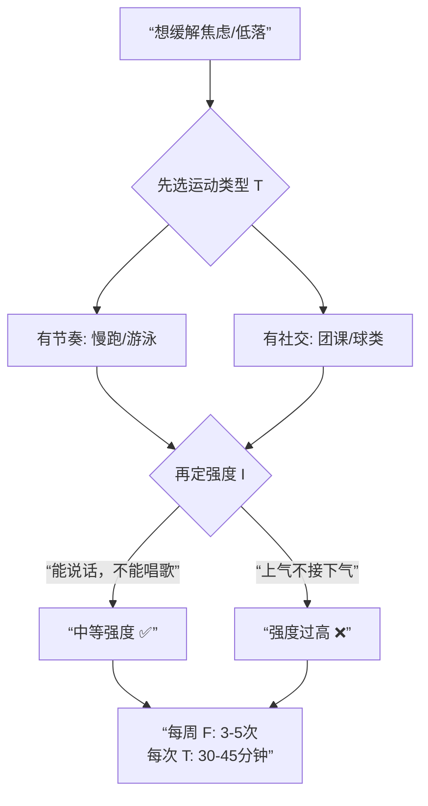

# 促进心理健康的运动处方要素（FITT原则）

## 促进心理健康的运动处方要素（FITT原则）

运动不仅能强身健体，更是调节情绪、缓解压力、改善认知功能的“良药”。但并非只要动起来就有效。要充分发挥运动对心理健康的促进作用，需要像医生开处方一样，科学地制定运动计划。这就是**运动处方**的核心，而它的四个基本要素被称为 **==FITT原则==**。

### 什么是FITT原则？

FITT 是四个英文单词首字母的缩写，它们共同构成了制定个性化运动方案的基本框架：

| 字母 | 要素 | 含义 | 关于心理健康的典型设定 |
| :--- | :--- | :--- | :--- |
| **F** | 运动频率 (Frequency) | 每周进行运动的次数 | 有氧运动每周 3–5 次； 力量训练每周 2–3 次，不连续进行 |
| **I** | 运动强度 (Intensity) | 运动时的费力程度 | 中等强度为主，即运动时心率达到最大心率的 60–70%，主观感觉“稍累” |
| **T** | 运动时间 (Time) | 每次运动持续的时间 | 每次 30–60 分钟的有氧运动，不包括前后热身与整理活动 |
| **T** | 运动类型 (Type) | 所采用的锻炼方式 | 有氧运动（慢跑、游泳、骑行）与团体性或节奏性运动（舞蹈、球类）效果更佳 |

> [!IMPORTANT]
> 四要素相互制约，==强度大则时间需缩短，频率过高则身体无法恢复==。心理健康导向的运动处方，强调“适度”与“可持续”，而非追求极限。

### 为什么用它就能促进心理健康？

运动对心理的益处，是通过 FITT 四要素的组合落到实处的：

- **稳定的频率** 提供了规律的生活节律，对抗抑郁带来的混乱感。
- **适中的强度** 能最佳地促进大脑分泌内啡肽、多巴胺等“快乐递质”，而极高强度可能带来过多的生理应激。
- **足够的时间** 让身体进入“燃烧与释放”状态，同时给大脑一段隔绝压力的专注时间。
- **恰当的类型** 直接关联愉悦感——团体运动增加社会联结，对抗孤独感；节奏性运动（跑步、游泳）的重复动作能引导思绪进入一种类似冥想的状态，缓解焦虑。

### 如何填写你的“心理运动处方”？

1.  **确定 F（频率）**：你的目标不是每天都把自己练垮。`有氧`选 3–5 天，给身体留出恢复日。`力量`训练隔天做一次。
2.  **设定 I（强度）**：用“说话测试”快速判断——==运动时能流畅地说出完整句子，但不能唱歌==，大致就是中等强度。
3.  **规划 T（时间）**：你需要 30 分钟以上的持续活动。可以从 15 分钟快走开始，逐步增加。
4.  **选择 T（类型）**：想想什么让你期待？一个人听着播客慢跑，还是和朋友打一场球？选择权在你手里，这是坚持的前提。

### 常见的误区与坑

理解了 FITT 框架，我们再来看看那些判断题里挖的“坑”：

> [!WARNING]
> **“可以不做准备活动”** 或 **“可以大量饮水”** 都是错的。
> 准备活动是身心从静止到运动的**安全过渡**，能预防受伤和心理排斥。
> 运动中和运动后，饮水应 **“少量多次”** ，一次狂饮会加重心脏负担、引发不适。

> [!CAUTION]
> **“患心血管疾病的人，参加剧烈运动时要谨慎”** —— 这完全正确。这类人群的运动处方必须由医生严格评估后制定，普通人不要自我诊断和自我开方。

### 一个“算对了”的例子

结合判断第 33 题：“对一般的体育锻炼者来说，没有必要每天都进行力量训练，如果每天都进行力量练习，会造成整体机能的不协调发展。”

这个说法是 **正确** 的。我们把它放进 FITT 框架里就非常清晰了：

- **解读的是“F”（频率）**：力量训练通过微小的肌肉撕裂来激发其超量恢复，从而变得更强壮。
- **为什么对？** 恢复本身就是训练的一部分。天天练同一块肌肉，不给恢复时间，会走向过度疲劳和损伤。这是典型的 **F 设定错误**。
- **如何解决？** 遵循 FITT：将力量训练的 F 设定为“每周 2–3 次”，或者采用分化训练（如今天练上肢，明天练下肢），保证同一肌群有 48 小时以上的恢复时间。

同样的逻辑看判断题第 1 题：“适当的运动可以很好地调节人体的免疫功能”。用 FITT 的观点看，只有“适当”（即 FITT 四要素配比合理）的运动才能增强免疫力，而长期不合理的 “T”（总时间过长）或 “I”（强度过大）反而会造成免疫“开窗期”，短期内更易生病。因此这个说法是 **正确** 的。

总之一句话：用 FITT 原则给自己开一份能坚持、有愉悦感、强度适中的运动处方，才是从“知道运动好”到“真正用运动改变心情”的关键一步。
