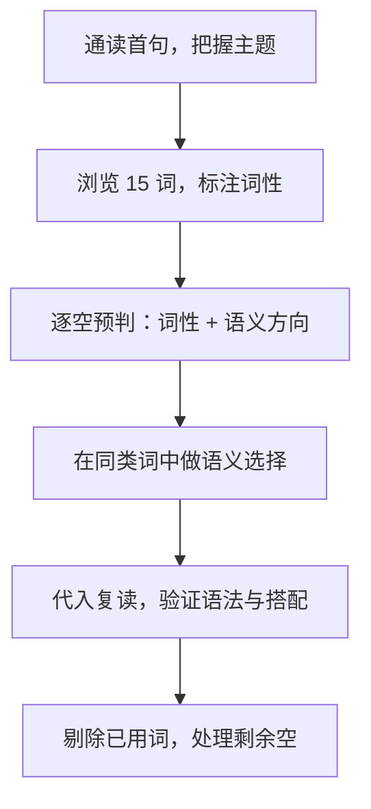

# Unit 1 Banked cloze（十五选十选词填空）

# Banked cloze：十五选十选词填空的解题逻辑

先想一个问题：十五个备选词摆在你面前，逐一代入原文试，和先给每个空**预判词性与语义方向**再去找词，哪种更不容易被干扰项带偏？

显然是后者。Banked cloze 的核心不是“认不认识词”，而是**先缩小范围，再精确匹配**。

## 它考查什么

十五选十的官方名称是 **banked cloze**（词库式完形填空）。与传统的四选一完形不同：

| 对比维度 | 四选一完形 | Banked cloze |
| --- | --- | --- |
| 选项数量 | 每空 4 个 | 全局 15 个，选 10 个 |
| 干扰强度 | 低，局部比较 | 高，5 个词完全不用 |
| 核心策略 | 语义理解为主 | ==词性预判 + 语义验证== |
| 重复使用 | 无 | 每个词只能用一次 |

> [!IMPORTANT]
> 十五选十的首要筛选条件不是词义，而是==词性==。一个空的最大可能范围，通常不超过 2～3 个词性类别。

## 通用解题流程

### 第一步：给 15 个词做“词性分类”

拿到备选词后，**不要先看空**。先把这 15 个词按词性归类。以本题词库为例：

| 词性 | 词汇 |
| --- | --- |
| 形容词 | abundant, superficial, tedious, absorbed, adjusted, beneficial, curious, obliged |
| 动词 | absorbed（过去式/过去分词）, adjusted（同前）, obliged（同前）, functions（三单） |
| 名词 | distress, functions（复数）, destinations, bulk |
| 副词 | presently, efficiently, evidently |

> [!TIP]
> 很多词身兼多职。比如 `functions` 既是名词复数又是动词三单；`absorbed` 既可能是动词过去式也可能是形容词“专注的”。分类时**凡有可能的用法都标注**，不要只记一个身份。

### 第二步：预判空的词性

看空在句中的位置，用语法“框”出可能词性：

- **冠词 / 形容词性物主代词后有名词时**：空大概率是形容词。
  - 例：`a(n) ____ answer` → 形容词。
- **主语后、宾语前无谓语**：空是动词。
  - 例：`they often ____ their parents` → 动词原形。
- **副词或介词短语修饰动词**：空可能是副词。
- **冠词 + 空 + of**：空是不可数名词。

### 第三步：语义验证

词性锁定后，再回到语义层面。在同词性的几个词里，代入看哪个符合上下文逻辑。

> [!WARNING]
> 只靠词性做题会翻车——同一个空可能有 3 个同词性词都“语法通”。语法只是**第一轮筛选**，语义与固定搭配才是最终决定因素。

## 用真题走一遍

### 真题一

> Many children are addicted to computers, so they often **defy** their parents and play the computer games for hours every day.

**预判**：`so they often ____ their parents` — 主语 `they`，宾语 `their parents`，缺**谓语动词原形**。

**词库验证**：备选词里能做谓语动词的有 `functions`（三单，主谓不一致，排除）、`absorbed / adjusted / obliged`（都是过去式/过去分词形式，此处需要原形，排除）。`defy` 不在原十五词中，但在另一组考查词里出现，意思是“违抗、不服从”——“违抗父母，每天玩数小时电脑”，语义通顺。

这题提醒我们：==banked cloze 可能在不同题组之间混合词库==，不要假设某一空只能出自某一张表。

### 真题二

> It is very important for students to understand and **take in** new information.

**预判**：`understand and ____ new information` — 并列结构，空应与 `understand` 同功能，为**动词原形**，且语义与“理解信息”并列。

**选择逻辑**：`take in` 是固定短语，意为“吸收、理解”。这里不能填 `absorb`，因为空格前已有 `and`，需要的是与 `understand` 并列的动词成分，而 `take in` 整体承担了这个角色。两者的区别是：`absorb` 是单词动词，`take in` 是短语动词——在 banked cloze 中，**若空前已有信号词（如 `and`、`to`）限制了答案必须是某个特定形式或短语的一部分，优先考虑固定搭配**。

## 常见陷阱

> [!CAUTION]
> **陷阱一：词库里有“看起来对”的近义词。**
> 如 `absorbed` 和 `take in` 都有“吸收”义，但语法位置不同——一个是形容词/过去分词，一个是动词短语。选词前先确认**语法空位**。

> [!CAUTION]
> **陷阱二：先入为主地“翻译”。**
> 很多同学习惯把句子先翻译成中文再选词，这很容易被表面语义带走。应坚持==先语法定位，再语义判断==的顺序。

> [!CAUTION]
> **陷阱三：忽略词的“第二身份”。**
> `obliged` 既是“感激的”（形容词），也是“迫使”（动词过去式）；`functions` 既是名词复数也是动词三单。归类不全，等于在筛选第一阶段就漏掉了正确选项。

## 一个完整算例

以本题词库中的 `beneficial` 为例：

**题干**（假设）：`Regular exercise is highly ____ to physical health.`

**步骤 1**：`is highly ____ to` — `is` 是系动词，`highly` 是副词修饰空，空应为**形容词**。

**步骤 2**：词库形容词有 `abundant, superficial, tedious, absorbed, adjusted, beneficial, curious, obliged`。

**步骤 3**：语义筛选——主语是 `Regular exercise`，说的是锻炼对健康的积极作用。“锻炼对健康是高度____的”，填入 `beneficial`（有益的），搭配 `be beneficial to` 完全正确。

而 `abundant`（丰富的）、`superficial`（肤浅的）、`tedious`（乏味的）、`curious`（好奇的）语义均不通；`absorbed` 需搭配 `in` 表“专注于”，`adjusted` 需搭配 `to` 但语义是“调整过的”，`obliged` 搭配 `to` 表“感激的”或“有义务的”，均不匹配。

---

**总结**：Banked cloze 的本质是==“词性筛选 + 语义精配 + 搭配验证”三层漏斗==。先框定语法空间，再做意义匹配，最后检查固定用法。三步走完，十个空十拿九稳。
