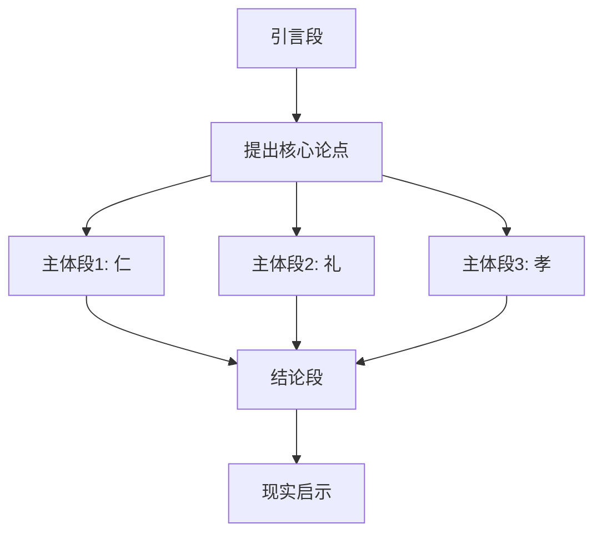

# Text A: Confucianism 课文主旨与段落结构

## 课文主旨与段落结构是什么

在《大学英语》Unit 1 Text A "Confucianism" 中，==课文主旨==并非单纯介绍儒家历史，而是阐释儒家思想如何作为“文化基因”塑造当代中国人的行为模式与价值观。段落结构则服务于这一主旨，通常采用“总—分—总”或“现象—溯源—现实意义”的说明文逻辑。

> [!IMPORTANT]
> 主旨提炼公式：$Main\ Idea = Topic + Author's\ Attitude/Purpose$
> 不要只写“Confucianism”，必须补全作者对它的核心论断（如 influence, relevance, values）。

为什么考试常考主旨与结构？因为填空题和阅读理解往往在语篇层面设空。例如真题填空6 “Talking about negotiations... Chinese sometimes wonder at the slow pace...” 表面讲谈判节奏差异，实则对应课文中“儒家重关系、重过程”的主旨段落。若脱离篇章结构孤立背句子，极易混淆语境。

## 如何快速拆解段落功能

面对一篇说明文，怎样判断某段是引入、论证还是总结？可以问自己：这段是在“提问题”“给证据”还是“下结论”？

| 段落类型 | 信号词/特征 | 对应主旨作用 |
| :--- | :--- | :--- |
| Introduction | define, refer to, traditionally | 引出话题+亮明观点 |
| Body | for example, in contrast, specifically | 用具体概念支撑主旨 |
| Conclusion | therefore, in summary, ultimately | 升华主旨+联系当下 |

> [!TIP]
> 做题时先扫首尾段抓主旨，再根据题干关键词定位主体段。真题填空1中 “discipline... enjoy yourself... contradict” 正是主体段中对比论证的典型句式，用于支撑“传统与现代冲突”这一分论点。

## 主旨概括与细节信息的区别

许多同学把“文中提到的事实”误当作主旨。比如课文提到“孔子生于公元前551年”，这是细节；而“儒家思想强调社会和谐优于个人利益”才是主旨层面的概括。

> [!WARNING]
> 主旨题选项若只是某个段落的例子或数据，即使原文有也≠正确答案。==主旨必须覆盖全文核心意图==。

以真题填空2为例：“destroyed the evidence that was at odds with his earlier statement” 是具体事件描述，服务于“诚信/言行一致”的儒家伦理讨论。若题目问主旨，选“evidence destruction”就错了，应选“integrity in Confucian ethics”。

## 常见误区与正确示范

分析结构时最易犯的错是把“并列”当“递进”。儒家五常（仁义礼智信）在文中多为并列展开，而非层层推进。误判会导致排序题或段落匹配题失分。

> [!CAUTION]
> 别把文化背景知识替代文本分析。即使你知道“孝”很重要，也要看课文是否将其作为主旨支撑点。一切以文本为准。

**算对了的例子**：  
真题填空6 “He is a very considerate and generous person... derive pleasure from helping others.”  
- ✅ 正确关联：该句体现“仁者爱人”主旨，位于主体段举例部分。  
- ❌ 错误做法：将其当作全文主旨，忽略其他核心概念如“礼”“中庸”。  

掌握主旨与结构，本质是学会用作者的逻辑读文章，而非用自己的常识答题。
