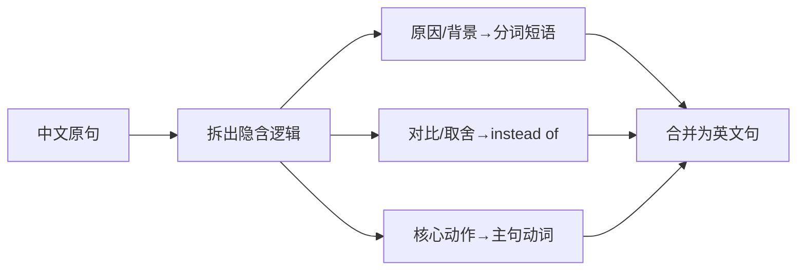

# Text A 参考译文与中英表达对照

## 中译英：从“字面对应”到“意义传达”

你拿到一段中文，要给成英文，最直接的冲动往往是逐词翻译。但“大禹吸取父亲的教训”如果写成 *Yu absorbed his father’s lesson*，英语读者会觉得模糊：他父亲到底怎么了？参考译文给了 *drawing lessons from his father’s failure*——**failure** 补出了中文里隐含的信息。这就是本课翻译训练的核心：==把中文的“压缩信息”展开成英文的“明示信息”==。

看一句简单的中文：“坚持 13 年，最终战胜水患”。如果写成 *persisted for 13 years and defeated the floods*，立刻出现两个问题：
1. “坚持”在语境里不是“被批评了还不退出”，而是**持续努力**，更适合译为 *perseverance*；
2. “战胜水患”是“治理、驯服洪水”，不是打仗，所以用 *tame the floods* 而非 *defeat*。

> [!IMPORTANT]
> 中译英时，选词优先考虑语境含义，而不是字面意思。中文常用具体动作表达抽象过程，英文需要用准确的抽象名词或动词把过程写透。

再看“愚公的选择是带领全家老小移山而非搬家”这一句。参考译文处理成 *Yu Gong, instead of moving away, chose to remove the mountains with his family members*。这里有两个技巧：
- **对比结构前置**：英文习惯把对比快拆出来，用 *instead of…* 引入，让主句简洁有力。
- **逻辑关系显化**：原文没有“但是”，但“面对高山”本身意味着阻碍，参考译文用 *Blocked by* 开头的分词短语，把原因、处境交代清楚，后半句用主句表选择。

> [!TIP]
> 拿到长中文句：先问“谁在什么处境下、放弃了什么、选择了什么”，把这三层信息分别安排到**分词背景、对比插入、主句动词**三个槽位，句子立刻变清晰。

## 高频失分点：文化概念的抽象浓缩

“我命由我不由天”是神话精神的抽象概括，直译成 *My fate is up to me, not to heaven* 虽然没错，但前文在讲神话，后文在谈抗争精神，参考译文做了功能翻译：*to have their fate in their own hands rather than that of gods*。它把“我”扩展为“中华民族”，把“天”具体化为 *gods*，与西方神话中的神祇体系对应，降低认知门槛。

再看“已经成为了一种文化基因”，如果写成 *has become a cultural gene*，对英语读者而言略显生物化。参考译文用 *has evolved into a gene of Chinese culture*，加了动词 *evolve*，表明是长期积淀的结果，语义更自然。

> [!WARNING]
> 考试中遇到“文化基因”“精神血脉”这类隐喻，不要死译成 *gene* 或 *blood*，先判断它是否只在中文里成立。如果是比喻用法，常用策略是：**保留意象 + 补充解释**，或直接译成 *deep-rooted trait / core value* 等能独立表意的表述。

## 一句话拆解实例：课后第 7 题

题面：*There is more to a woman than her looks, so I resent the fact that after a woman grows old and loses her looks people stop paying attention to her.*

拆开看三层结构：
- **There is more to… than…** → 一个女性不只有外貌（内涵更重要）。
- **so I resent the fact that…** → 因而我对“某件事”感到愤慨。
- **after… people stop paying attention to her** → 当她衰老、容颜不再后，人们就不再关注她。

> [!CAUTION]
> 很多同学会把 *resent the fact that* 误写成 *resent that*，考试时会判错。**resent 是及物动词，必须接名词性宾语**，要接从句就必须用 *the fact that* 做形式宾语。

反过来看这道题对中译英训练的启示：你是否能写出类似 *There is more to X than Y* 这种“抽象定性在前、具体事实在后”的句式？练习时，可以有意识地把“中华民族屹立至今”这类中文表述，套入英文的**评价先行、事实支撑**框架：
- 评价：*This unyielding struggling spirit has contributed much to…*
- 事实：*…making China one of the longest-standing nations in human history.*

==想写出地道的英文句子，先在脑海里完成“评价—事实”的语序切换，再把信息填进句型框架，而不是顺着中文语序逐词填词。==
