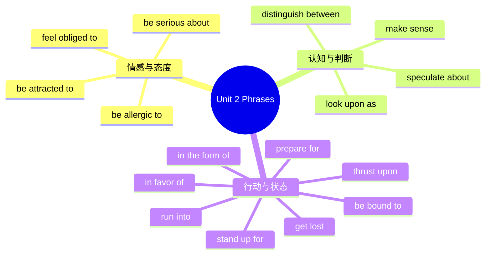

# Unit 2 Expressions in use（重点短语与句型操练）

## 核心短语与语境匹配

本单元 `Expressions in use` 旨在掌握高频动词短语及固定搭配。这些表达不仅是完形填空和翻译题的考点，更是提升书面语地道程度的关键。==核心在于准确理解短语的语义色彩（如被动、义务、因果）及介词搭配==。

## 语义辨析与易错点

许多短语含义相近，但用法迥异。例如 `be bound to` 表示“注定、一定”，强调客观必然性；而 `feel obliged to` 侧重主观或道德上的“义务感”。

| 短语 | 核心含义 | 常见搭配/语境 |
| :--- | :--- | :--- |
| **make sense** | 有道理/讲得通 | It doesn't make sense to do... |
| **distinguish between** | 区分A与B | distinguish between facts and opinions |
| **thrust upon** | 强加于 | responsibilities thrust upon sb. |
| **look upon as** | 视为/看作 | be looked upon as a success |

> [!WARNING]
> **介词陷阱**：`distinguish` 后接 `between A and B` 或 `A from B`，切勿混淆。`allergic` 后必须接 `to`，而非 `with` 或 `for`。

> [!TIP]
> **语态敏感**：`thrust upon` 和 `look upon as` 在考题中常以**被动语态**出现（如 `have been thrust upon`, `was looked upon as`），解题时需识别动作的承受者。

## 典型例题解析

通过真题回顾，掌握如何在语境中锁定答案。

**例1：义务与社交礼仪**
> Since we have invited all the other neighbors..., we \_\_\_\_\_\_ invite the Browns too.
> **答案**：`feel obliged to`
> **解析**：前文提到邀请了其他邻居，基于社交对等原则，主语感到“有义务”邀请 Browns。`obliged` 体现了这种心理负担或礼貌要求。

**例2：逻辑合理性**
> It doesn't \_\_\_\_\_\_ to buy that expensive coat when cheaper ones are just as good.
> **答案**：`make sense`
> **解析**：句意为“买贵外套没道理”。`make sense` 是固定搭配，意为“合乎情理”。注意否定形式 `doesn't make sense` 的高频考法。

**例3：意外相遇**
> When you \_\_\_\_\_\_ a friend that you haven't seen for a long time...
> **答案**：`run into`
> **解析**：`run into` 意为“偶然遇见”，符合“long time no see”的惊喜语境。区别于 `meet`（正式或约定）。

> [!IMPORTANT]
> **复习策略**：不要死记硬背中文释义。请尝试用每个短语造一个与你生活相关的句子，例如用 `be allergic to` 描述食物偏好，用 `stand up for` 描述维护观点的场景，从而建立深层记忆连接。
