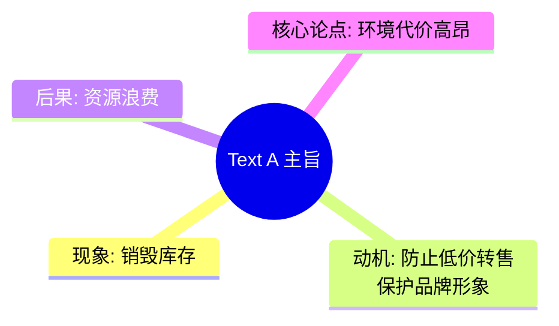

# Unit 2 Text A 课文主旨与长难句分析

## 课文主旨与长难句分析

本单元 Text A 聚焦于**快时尚行业处理过剩库存的伦理与环境代价**。理解文章主旨不仅有助于应对阅读理解题，更是掌握学术英语逻辑的关键。

> [!IMPORTANT]
> ==核心主旨==：文章批判了时尚品牌为保护品牌价值而销毁未售商品的行为，重点揭示了其背后的==环境成本==（hidden environmental cost）。

### 为什么需要分析主旨？

在考试中，主旨题往往干扰项极强。例如 Exercise A 的选择 1，选项 A、C、D 分别涉及营销策略、生产成本和销售难度，虽在文中有所提及，但均非核心。只有选项 B 涵盖了“销毁原因”与“环境成本”两个维度，才是对全文最全面的概括。

### 长难句拆解技巧

面对复杂句式，建议采用“剥洋葱”法：先找主干（主谓宾），再析修饰（从句、分词）。

以考题中的句子为例：
> *As she entered the most dynamic period of her career, Kylie took stock of her success and tried to analyze the strong impact of her college education.*

1.  **定位连接词**：`As` 引导时间状语从句。
2.  **提取主干**：主语 `Kylie`，谓语 `took stock of` 和 `tried to analyze`。
3.  **理解短语**：`take stock of` 意为“评估、审视”。

> [!TIP]
> 遇到长句时，先忽略逗号前的状语或插入语，直接寻找**第一个实义动词**确定主语动作。

### 常见误区与辨析

学生常混淆“直接成本”与“隐藏成本”。文中指出，销毁商品不仅需要生产时的资源，还需要额外的运输、填埋或焚烧能源。

| 概念 | 定义 | 文中对应点 |
| :--- | :--- | :--- |
| **Direct Cost** | 生产制造成本 | 生产衣物本身的物料与人工 |
| **Hidden Cost** | 处置与环境成本 | 销毁过程消耗的额外资源 (Option A) |

> [!WARNING]
> 勿将“防止低价转售”（Option C）误认为最终目的。这只是手段，文章落脚点在于该行为造成的==资源浪费==。

### 实战演练

回顾 Exercise A 选择 3：*What is the hidden cost of destroying goods?*
正确答案 A 提到 "More resources are required... besides the cost of producing them"。这正是对文中长难句逻辑的验证：除了生产（producing），处置（getting rid of）本身也是资源消耗大户。

通过梳理主旨与拆解长句，你能更准确地捕捉作者态度，避免被表面细节误导。
