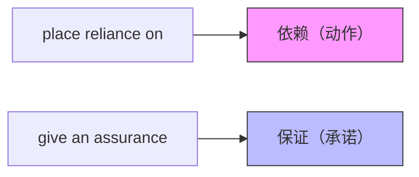

# Unit 2 Words in use（核心词汇辨析与应用）

## 核心词汇辨析与应用

### 为什么需要精准用词？

在大学英语学习中，我们常遇到“认识但不会用”的困境。比如，“很多”这个词，你会想到 many、much，但在正式表达中，==abundant== 更能体现语言的丰富度。选词填空题看似简单，实则考查三点：词义是否匹配语境、搭配是否地道、词性是否正确。下面我们聚焦本单元最易混淆的几组词，帮你建立清晰的辨析框架。

### 极易混淆的词组对比

首先看两组考试中反复出现的“形近词”和“意近词”。

#### 辨析一：“依赖”与“保证”

> [!IMPORTANT]
> 核心区别：`reliance` 强调“依靠的动作或状态”，常与 `place...on` 搭配；`assurance` 强调“口头或书面的保证”。

请看这道真题：

*My boss has failed me so many times that I no longer place any \_\_\_\_ on what he promises.*  
*A) assurance  B) probability  C) reliance  D) conformity*

- **解题引导：** 老板让我失望，“我不再把任何____放在他的承诺上”。空格前有 `place`，后有 `on`，构成 `place + 名词 + on` 的结构。能填入此处的词，必须能和 `on` 搭配，表达“依赖”。
- **正确选择：** C) reliance。==place reliance on== 是固定搭配，意为“信赖、依靠”。
- **干扰项分析：** A) assurance 虽与“相信”有关，但它指“担保、保证”，常用搭配是 `give an assurance that...`，不接 `on`。B) probability 意为“概率”。D) conformity 意为“一致、符合”，常与 `in conformity with` 连用。

#### 辨析二：“模糊的”与“不确定的”

*Very few people could understand his lecture because the subject was very ______.*  
*A) faint  B) indefinite  C) obscure  D) gloomy*

- **解题引导：** 讲座“很少人能听懂”，说明主题不是“不确定”，而是“晦涩难懂”。
- **核心辨析：**
  - **obscure**: 指 ==（语言、含义）晦涩的、费解的==，直接对应“听不懂”。
  - **indefinite**: 指 ==（轮廓、范围、回答）不明确的、模糊的==，如 `indefinite plan`（不确定的计划）。
  - **faint**: 指 ==（光、声、希望）微弱的==。
  - **gloomy**: 指 ==（环境、心情）阴暗的、沮丧的==。

> [!TIP]
> 记忆口诀：说话听不懂用 obscure，计划没敲定用 indefinite，灯光太暗用 faint，心情糟糕用 gloomy。

#### 辨析三：“过多”的四种表达

*______ quantities of water are being used nowadays...*  
*A) Excessive  B) Extensive  C) Extreme  D) Exclusive*

> [!IMPORTANT]
> 这四个词构词相似但含义全然不同，是考试高频陷阱。

| 词汇 | 核心含义 | 常见搭配 | 例句语境 |
| :--- | :--- | :--- | :--- |
| **Excessive** | **过量**的，超出合理范围的 | excessive drinking | 水被“过量”使用，符合题意。 |
| **Extensive** | **广泛**的，大面积/大范围的 | extensive reading | 强调范围广，不强调“过量”。 |
| **Extreme** | **极端**的（程度） | extreme weather | 强调程度严重，如极度寒冷。 |
| **Exclusive** | **独有**的，排外的 | exclusive interview | 强调独占性，如独家专访。 |

- **正确选择：** A) Excessive。
- **常见错误：** 误选 B) Extensive。注意，此题语境是“随着工农业快速发展”，强调水用得“太多”，而不是“广泛使用”（如 extensively used）。

### 如何攻克完形填空式选词？

上面的选词填空 1-10 题，考查的是篇章理解与词性判断的结合。

1.  **先判词性**：读空格所在句 `were _____ to spend time`，缺形容词或分词。
2.  **再看语义**：下文说过去找书很不方便，可知过去学生“被迫”泡图书馆。==obliged== 有“强迫、不得不”之意。
3.  **对比易混**：注意到 `tedious`（枯燥的）与 `distress`（痛苦、忧虑）也出现在选项中。`tedious` 用来修饰 textbooks（tedious textbooks 枯燥的课本），而 `distress` 指记不住词时的心理“苦恼”。

> [!WARNING]
> 区分 `efficiently` 与 `effectively`
> `efficiently` 强调 ==“高效地”（方法省时省力）==，而 `effectively` 强调 ==“有效地”（能达成目标）==。原文 `efficiently accumulate vocabulary` 强调借助网络“高效率”地积累词汇。

---

**通过以上辨析，你应掌握的解题闭环是：**  
看到空格 → 判断词性或搭配（如 place...on） → 理解句意（是被迫还是保证？是过多还是广泛？） → 排除干扰项选定答案。平时多记固定搭配和词义的细微差别，这类题便不会失分。
