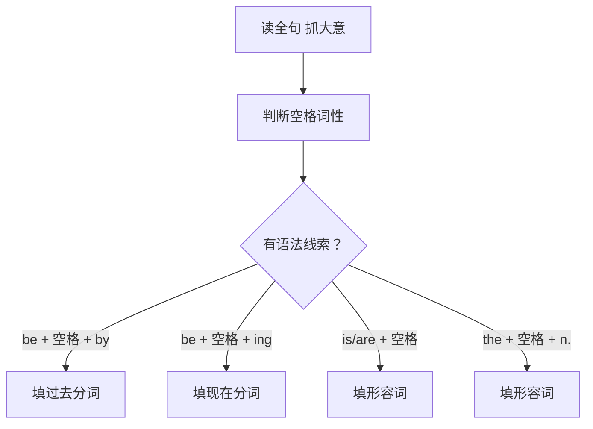

# Unit 2 词汇与短语填空综合练习（填空4-10）

## 它是什么

Unit 2 的词汇与短语填空，考的是**核心词在真实语境中的搭配与变形**。题目给出完整英文句子，挖去一个目标词，要求根据句意、词性、搭配写出正确形式。上面 7 道题的考点高度集中：

| 题号 | 目标词 | 词性 | 句中搭配 |
|------|--------|------|----------|
| 填空 4 | sensible | 形容词 | It is ==sensible== for sb. to do sth. |
| 填空 9 | equivalent | 形容词 | the ==equivalent== amount |
| 填空 2 | intimidated | 过去分词 | Do not be ==intimidated== by |
| 填空 4 | explicit | 形容词 | be direct and ==explicit== |
| 填空 5 | suspended | 过去分词 | was ==suspended== |
| 填空 9 | manipulating | 现在分词 | is ==manipulating== events |

## 为什么需要

这类题不是考"认不认识"，而是考**会不会用**。同一个词在句子里要随语法环境变形：被动语态用过去分词，进行时态用现在分词，系动词后接形容词。只背词表、不记搭配，就会出现"认得词但填不对形式"的失分。

## 怎么做

三步定位法：

> [!TIP]
> 先看**空格前后的语法信号**，再回头确认词义是否通顺。语法决定形式，句意决定选词，两者缺一不可。

## 和相近概念的区别

| 易混点 | 区别 |
|--------|------|
| sensible vs. sensitive | sensible=明智的；sensitive=敏感的 |
| equivalent vs. equal | equivalent=等值的（价值/效果）；equal=相等的（数量） |
| intimidated vs. timid | intimidated=被吓住的（被动）；timid=胆小的（本性） |
| explicit vs. implicit | explicit=明确的；implicit=含蓄的 |
| suspend vs. stop | suspend=暂停（可恢复）；stop=停止（终止） |
| manipulate vs. handle | manipulate=暗中操控（含贬义）；handle=处理（中性） |

## 常见的坑

> [!WARNING]
> 忽略被动语态标志。看到 "was/were/be + 空格" 且后面有动作执行者或语境暗示被动，必须填过去分词。如 *The new teaching program was ==suspended==*，程序是"被暂停"的。

> [!CAUTION]
> 把进行时标志当形容词。看到 "is + 空格" 不一定填形容词，若后面接宾语（如 events），则是现在进行时，填 -ing 形式：*is ==manipulating== events*。

> [!IMPORTANT]
> 主谓一致与时态要随全句时间状语调整。句中出现 *last semester*，动词用过去时；出现 *following an earthquake*，用现在分词作后置定语。

## 一个做对了的例子

以填空 4 为例：

> It is ==sensible== for every family to make earthquake emergency plans...

**推理过程**：
1. 空格在 *It is ___ for sb. to do* 结构中，is 后接形容词作表语。
2. 句意：家庭制定地震应急计划是"明智的"。
3. sensible 符合语法（形容词）和语义（明智的）。

> [!NOTE]
> 若填 sensitive，语法成立但语义不通——"制定计划是敏感的"不符合逻辑。因此**语法+语义双验证**是最后防线。
