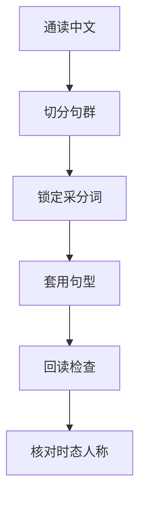

# Unit 2 课后翻译（汉译英参考答案与采分点）
### 它是什么 & 为什么考

课后翻译属于《大学英语》第二单元的产出型考点：给定一段中文（通常是说明文或议论文），要求译成英文，阅卷时按 ==采分点==（关键词、固定搭配、语法结构）逐点给分。翻译题不是"写大意"，而是"踩点得分"——==译对了词组结构，句子没连好也能拿大部分分==；反之，再漂亮的句子若漏掉采分词，分数仍然很低。

### 翻译流程

### 采分点常出现在哪几类

| 中文现象 | 英文策略 | 例（取自 Bhutan 题） |
|---|---|---|
| 专有概念 | 括注全称 | 国民幸福总值 → GNH (Gross National Happiness) |
| 对比、让步 | while / although 引导 | 虽然同样渴望……→ Although likewise thirsting for… |
| "以……为代价" | at the price/cost of | 不以牺牲…为代价 |
| "在于" | consist in | 幸福在于合理管理欲望 |
| 数字 + 单位 | respectively 置后 | 30% 和 5% respectively |
| 高级动词替换 | 抓、用、搞→strive/boost/restrain | 拼命发展→strive to develop |

### 常见坑

> [!WARNING]
> - **漏译"respectively"**：两个及以上数字对应两个及以上主语时，必须用 `respectively`，否则含义错位。
> - **"不丹认为……" 直译成 "Bhutan thinks"**，采分答案用 `Bhutan believes that…`，因为"认为（一种理念）"更接近 believe。
> - **时态混用**：说明文整段以一般现在时为主，描述历史才切一般过去时，==切忌一段内随意跳时态==。
> - **"以自己的步伐、根据自己的需要、在自己觉得合适的时机"**：三连状语，采分答案用 `at their own pace, according to their own needs, at their own proper time`，不要合并或漏掉其中任何一个。

### 一个"算对了"的示例（不丹段落节选）

> [!TIP]
> 试着对照下表自检，看能不能踩到采分点：

| 中文 | 采分答案 |
|---|---|
| 在日益现代化的社会 | In an increasingly modernized society |
| 最后一个开放电视与网络的国家 | the last country that is open to TV and the Internet |
| 普及率 | penetration(s) |
| 与现代世界格格不入 | out of tune with the modern world |
| 拼命发展经济 | strive to develop economy |
| 不惜代价 | at all costs |
| 国民幸福总值 | GNH (Gross National Happiness) |
| 合理管理欲望 | sensible restraint on desire |
| 实现……平衡 | strike a balance between A and B |
| 吸取现代技术的益处 | take advantage of modern technology |
| 以牺牲……为代价 | at the price of… |

> [!IMPORTANT]
> ==句子连接比词汇炫技更值钱==：`While other countries are striving…, what Bhutan pursues is GNH.` 这种"对比状语从句 + what 主语从句"是阅卷组偏爱的高分结构，一篇里出现 1～2 处即可。

> [!CAUTION]
> 千万不要把"值得我们研究与深思"翻成 `deserves us to research`。采分答案是 `==deserves our research and reflection==`（deserve + 名词），这是典型中式英语陷阱。
