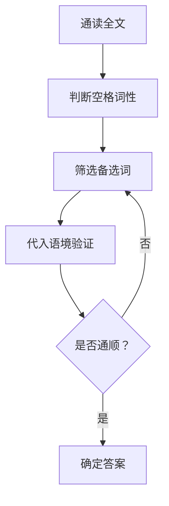

# Unit 3 Banked cloze（选词填空与词性判断）

> [!IMPORTANT]
> 选词填空（Banked Cloze）是从给定的备选词汇库中，根据上下文语境和语法结构，选出正确单词填入文章空格处的题型。==核心在于“先判词性，再定词义”==。

为什么需要掌握它？因为这道题不仅考查词汇量，更考查你在真实语篇中运用语法和逻辑的能力。面对十几个备选词，我们该如何下手？

## 解题流程

拿到题目后，不要急着把词往空里塞。我们可以把整个过程拆解为三步：

1. **通读全文**：把握文章主题（如 Unit 3 探讨的“人文素养”），了解大意。
2. **判断词性**：分析空格在句中的成分，确定这里需要一个名词、动词、形容词还是副词。
3. **筛选与验证**：在备选库中挑出符合该词性的词，结合上下文语义选出最贴切的一个，最后代入原句读一遍，检查语法和逻辑是否通顺。

## 实战演练

以考过的真题为例，我们一步步来推导。

**原文节选**：Because these skills allow us to gain new `[ 1 ]` into everything from poetry and paintings... humanistic subjects have been at the heart of a liberal arts `[ 2 ]`...

**备选词汇**：speculate, prospect, insight, boost, contest, affected, appreciation, education, spectacular, mystery, recovery, promote, invest, effected, aspiration

先看第 1 空。空格前是 `gain new`，`gain` 是及物动词，`new` 是形容词，那么空格处必须填一个==名词==。再看后面的介词 `into`，什么名词能和 `into` 搭配表示“深入了解”？在备选词的名词中，`insight` 完美契合固定搭配 `gain insight into`（对……获得深刻见解）。

再看第 2 空。前面是 `a liberal arts`（文科/博雅），后面需要填一个名词构成复合概念。结合本单元“人文素养”的主题，`education`（教育）是最合理的选项，`liberal arts education` 即“博雅教育”。

> [!TIP]
> 遇到拿不准的空，优先寻找==固定搭配==或==介词线索==。例如看到 `about` 想到 `speculate about`（推测），看到 `of` 想到 `appreciation of`（欣赏）。

## 易混词辨析

备选词库中经常设置“长得像”或“意思近”的干扰项。

| 易混词 | 词性与含义 | 常见搭配 / 考点 |
| :--- | :--- | :--- |
| **affected** | v. 影响（affect的过去式/分词） | `life affected his decisions` |
| **effected** | v. 实现、引起（effect作动词） | `effect a change`（促成改变） |
| **promote** | v. 促进、提升 | `promote the ideal foundation` |
| **boost** | v./n. 推动、增加 | `boost our knowledge` |

> [!WARNING]
> `affected` 和 `effected` 是高频陷阱！真题中“an artist's life `[ 9 ]` his creative decisions”，表达“生活**影响**了决定”，应选 `affected`。而 `effect` 作动词意为“使发生/实现”，极少用于此处语境。

## 常见的坑

> [!CAUTION]
> 忽略词形变化！虽然南邮的 Banked Cloze 通常直接提供原形或已变形好的词，但务必注意空格处是否需要过去式、被动语态或复数形式。例如第 9 空描述过去发生的事，所以用过去式 `affected` 而非原形。

> [!NOTE]
> 做完所有空后，务必将剩余未使用的词（如 `contest`, `spectacular`, `recovery` 等）作为“排除法”的最终校验。如果发现某个空用备选词里的生僻词也能勉强说通，但另一个空因此无词可用，说明前面的选择有误。
