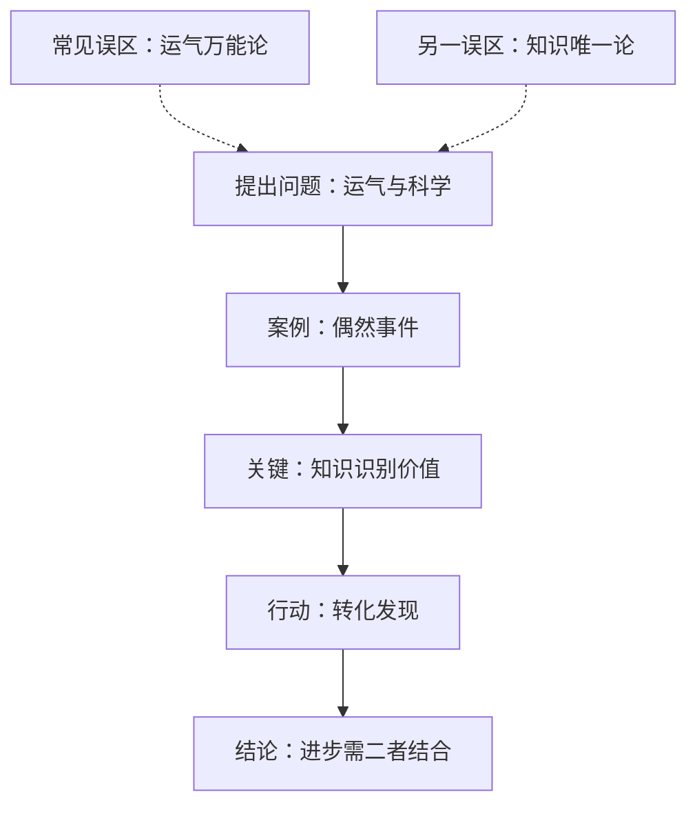
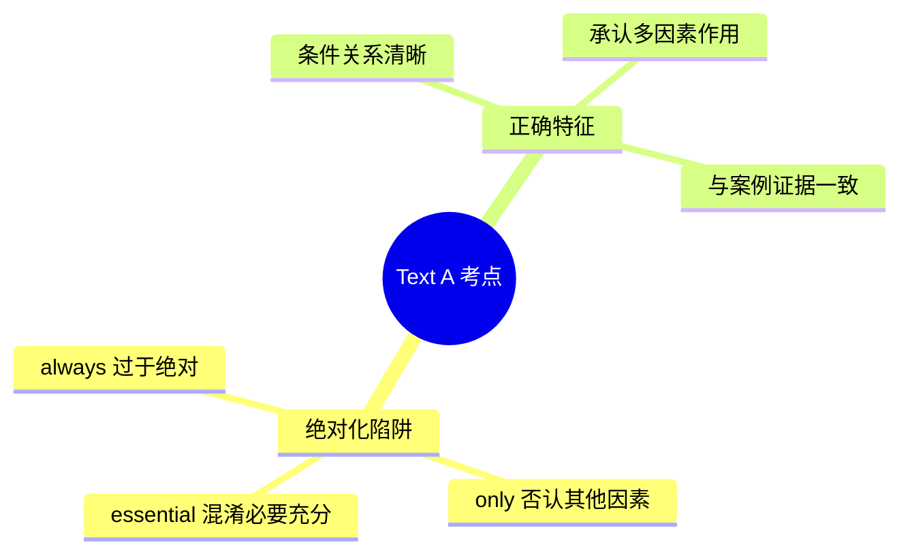

# Unit 3 Text A 课文内容与篇章逻辑

## 课文内容与篇章逻辑

Unit 3 Text A 围绕"偶然发现（serendipity）"展开，核心论点是：**运气与知识结合，才可能产生科学突破**。文章先提出"运气在科学中的作用"这一问题，再通过具体案例论证"仅有运气不够，还需知识储备与行动力"，最后落脚于"科学进步离不开偶然，但偶然需被有识之士捕捉"。

> [!IMPORTANT]
> 核心逻辑链：运气（serendipity）→ 知识识别（knowledge）→ 行动转化（action）→ 科学发现（discovery）。缺了中间任何一环，偶然事件只会被忽视。

## 篇章结构图解

文章通常采用"现象—分析—升华"三段式：先列举科学史上的偶然发现（如青霉素、咖啡废料提取燃料等），再分析这些发现背后的共性——发现者都具备足够的专业知识，能意识到偶然现象的意义，并主动深入研究。

## 与相近概念的区别

| 概念 | 含义 | 文中态度 |
|------|------|----------|
| Serendipity | 意外发现珍奇事物的运气 | 必要条件，非充分条件 |
| Knowledge | 科学知识储备 | 识别偶然的基础 |
| Action | 主动探索与实验 | 将运气转化为成果 |

> [!WARNING]
> 易错选项特征：含 **always**、**only**、**essential**、**directly** 等绝对化词汇的选项，通常与文章"辩证看待运气"的立场相悖。正确答案往往承认运气的价值，但强调需与知识结合。

## 真题示例解析

以 Exercise A 选择 3 为例：

**题目**：Under what condition does serendipity become meaningful?

**正确思路**：回到原文定位"serendipity"出现的段落，寻找条件状语或转折句。文章核心论点是"仅有运气无意义，需知识支撑"。

- A: Only with scientific knowledge and skill can serendipity be meaningful. ✅ 准确表达条件关系
- B: 强调"即使有知识也可能忽视"，偏离"条件"问题
- C/D: 仅重复"运气有用"，未回答"何时有意义"

> [!TIP]
> 解题口诀：见 **condition** 找 **if/only when**，见 **attitude** 找 **but/however** 后的转折。绝对化选项优先排除，辩证表述优先选择。

## 常见陷阱与验证

做细节题时，先判断题目问的是 **factor**（因素）、**condition**（条件）还是 **result**（结果），再回原文找对应逻辑词。主旨题则抓首尾段：首段引出问题，尾段给出"运气+知识"的总结论。
