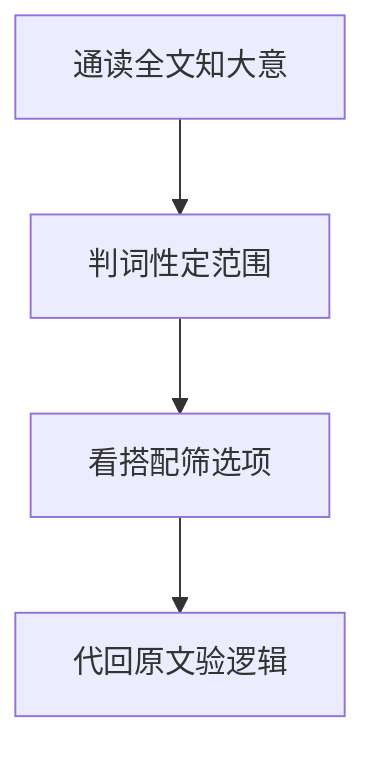

# Unit 3 Exercise A/C/E/G 综合课后练习

> [!IMPORTANT]
> 本知识点覆盖 Unit 3 课后练习 A/C/E/G，核心考查 ==选词填空（Banked Cloze）== 与 ==阅读理解细节定位== 两大题型。

## 它是什么

Unit 3 围绕“人文素养”与“科技能源创新”双线展开。Exercise A 为 15 选 10 的选词填空；Exercise C 为基于科技类语篇的阅读理解选择题。两者共同检验你是否能在语境中精准匹配词汇，以及能否快速抓取文章主旨与细节。

## 为什么需要

南邮《大学英语》期末考试中，选词填空和阅读细节题占分极高。如果只背单词中文意思而不看词性与搭配，或者读文章时逐字翻译而不找关键词，极易丢分。掌握解题流程能帮你把“凭感觉”变成“有依据”。

## 怎么做：选词填空四步法

面对 Exercise A 这类题，我们可以先问自己：空格处缺什么成分？是动词、名词还是形容词？

以真题第 7 空为例：“Learning another language might help to ______ you with great insights...”
1. **判词性**：`to` 后接动词原形。备选词中动词有 `boost, contest, promote, invest, speculate` 等。
2. **看搭配**：空格后有介词 `with`。哪个动词能和 `you with sth.` 连用？
3. **筛选项**：`invest sb. with sth.` 是固定搭配，意为“赋予某人……”。
4. **验逻辑**：学语言“赋予”你深刻见解，语义通顺。答案为 ==invest==。

> [!TIP]
> 记忆口诀：**先定词性再定搭，最后代入查逻辑**。遇到生僻用法（如 `invest...with`），平时需积累熟词生义。

## 怎么做：阅读细节定位

Exercise C 的科技文（如利用噪音发电）要求快速定位。题干问“What is the source material used in the experiment?”，直接去原文找 `source material` 或 `use...to generate` 的同义替换。原文若提到“everyday sounds”，对应选项即为 ==Noise==。

> [!WARNING]
> 不要看到备选项在文中出现过就秒选！必须确认该词是否回答了题干所问的具体问题（如问的是“主要创新点”还是“具体材料”）。

## 相近概念辨析

选词填空中最易混淆的是词根相同但词性/意义不同的词：

| 易混词 | 词性 | 含义 | 典型搭配 |
| :--- | :--- | :--- | :--- |
| `affected` | 动词过去式/形容词 | 影响 / 受影响的 | be affected by |
| `effected` | 动词过去式 | 实现、引起 | effect a change |
| `prospect` | 名词 | 前景、可能性 | prospect of future |
| `speculate` | 动词 | 推测、思索 | speculate about |

> [!NOTE]
> `affect` 通常作动词（影响），`effect` 通常作名词（效果）。但当 `effect` 作动词时意为“实现”，其过去式为 `effected`，切勿与 `affected` 搞混。

## 常见的坑

> [!CAUTION]
> **词性误判**是最大的失分点。例如 `boost`（提升）和 `mystery`（谜团），前者常作及物动词，后者常作名词。如果在 `help to ______ our knowledge` 中填入名词，句子结构直接崩塌。务必根据前后语法结构（如冠词后加名词、情态动词后加动词原形）来锁定词性。
