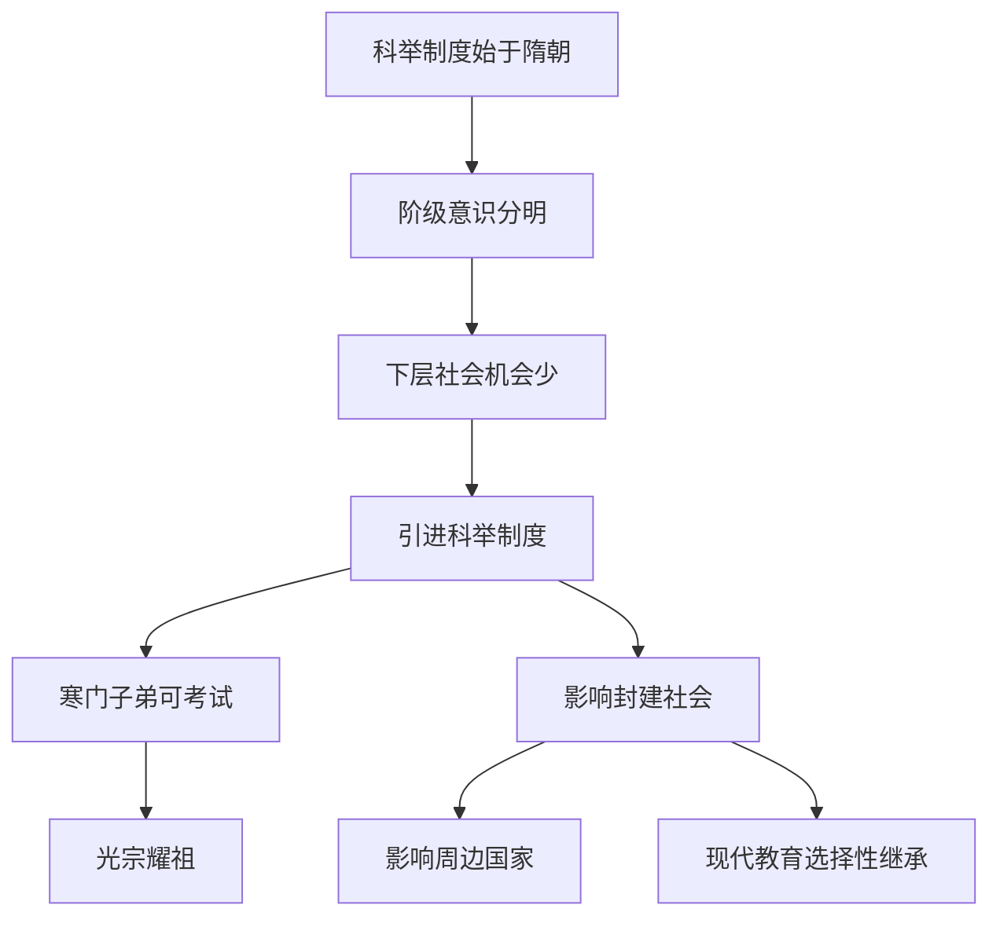

# Unit 3 课后翻译（汉译英参考答案）

## 这次课后翻译在考什么

这道汉译英的核心并不在于词汇本身有多生僻，而在于你能否把中文的“流水句”拆解成英语习惯的**主从关系**和**逻辑连接**。先看两个原文里最关键的信息点：

1. “**但自从引进科举制度后**”——这里有一个时间/条件转折，英语里常用 `once` 引导从句来表示“一旦……就……”；
2. “**这种人才选拔制度不仅……还……**”——这是典型的递进结构，英语里用 `not only...but also...` 承接，而且要保证前后两个部分在语法上平衡。

所以这道题真正的考点是：==中文短句之间的逻辑关系在英文里必须显性化==，不能逐字直译。

> [!IMPORTANT]
> 汉译英时如果看到“一旦/只要……就……”“不但……而且……”“因为……所以……”这类逻辑词，要主动用 `once`、`not only...but also`、`so...that` 等英语连词结构把关系说清楚，而不是把中文逗号也照搬成英语逗号。

---

## 逐句拆解翻译策略

### 第一句：朝代与时间跨度

> 中国的科举制度始于隋朝，历经 1,300 多年。

这里“始于”用 `began in` 即可，但注意“历经”不是“经历某个事件”的 `experienced`，而是“持续了”一段时间，所以用 ==`lasted more than 1,300 years`==。

`lasted` 后面直接接时间段，不需要加 `for`，因为 `last` 本身就可以作及物动词表示持续时长：
- ✅ `The exam system lasted more than 1,300 years.`
- ❌ `The exam system lasted for more than 1,300 years.`（虽然口语里能听到，但正式书面语更倾向不加 `for`）

### 第二句：阶级意识与机会

> 在中国古代，阶级意识分明，下层社会鲜有机会在朝廷占据一席之地。

这句的中文是两个并列分句，中间用逗号连接。英文里可以考虑用 `and` 并列：

> In ancient China, class consciousness was distinct `and` people from lower classes had little chance to gain a position in the official court.

三个容易写错的词：

| 中文 | 参考译法 | 易错点 |
|------|----------|--------|
| 阶级意识 | `class consciousness` | 不要写成 `class awareness`，`consciousness` 更侧重“意识形态层面的认知” |
| 分明 | `distinct` | 不要用 `clear`，`distinct` 强调“界限清晰可辨” |
| 在朝廷占据一席之地 | `gain a position in the official court` | “占据一席之地”不是 `occupy a seat`，而是“获得一个职位” |

### 第三句：转折 + 结果

> 但自从引进科举制度后，寒门子弟得以参加考试，有机会光宗耀祖。

这是全段最关键的句型结构。中文用“但自从……后，……得以……，有机会……”表达**条件触发结果**。英文用 `once` 引导时间/条件状语从句，主句用 `which` 引导非限制性定语从句来补充说明结果：

> But `once` the imperial examination system was introduced, scholars from poor families had opportunities to take the government exams, `which enabled them to bring honor to their families`.

这里的 `which` 指代前面整个主句“寒门子弟有机会参加考试”这件事，而不是某个名词，所以必须用**非限制性定语从句**（有逗号的 `which`），不能用 `that`。

> [!WARNING]
> `which` 引导非限制性定语从句时，前面必须加逗号，而且不能替换为 `that`。如果写成 `exams that enabled them...` 意思就变成“那些让他们光宗耀祖的考试”，逻辑重心完全变了。

### 第四句：递进结构

> 这种人才选拔制度不仅对中国封建社会的政治、经济、教育、文化观念和社会风尚有重大影响，还影响到了日本、朝鲜、越南等周边国家的教育体制。

这是全段最长的句子，核心框架是：

```
not only + 对 A 有重大影响
but also + 影响到了 B
```

参考译文用了一个精简的结构：

> Such a talent-selection system had great impact `not only on` the politics, economy, education, cultural concepts and social customs of Chinese feudal society, `but also on` the education systems of such neighboring countries as Japan, Korea and Vietnam.

注意 `not only on...but also on...` 的**介词平衡**：如果前面是 `impact on A`，后面也要是 `impact on B`，不能前面用了 `on` 后面忘了用。

另外“日本、朝鲜、越南等周边国家”的译法是 `such neighboring countries as Japan, Korea and Vietnam`，这种 `such + 名词 + as + 例子` 结构比 `neighboring countries like Japan, Korea and Vietnam` 在书面语中更正式，适合翻译题。

### 第五句：程度限定 + 继承

> 在某种程度上，中国现行的教育体制也选择性地继承了一些科举制度的优越之处。

两个关键词：

| 中文 | 参考译法 | 说明 |
|------|----------|------|
| 在某种程度上 | `To some extent` | 句首做状语，后面加逗号 |
| 选择性地继承 | `selectively inherited` | 副词 `selectively` 修饰动词 `inherited`，表示“有所取舍地继承” |

“优越之处”不用直译成 `superior points`，用 ==`advantages`== 更自然。

---

## 全段译文对照速记表

| 中文关键信息 | 英文核心表达 |
|--------------|--------------|
| 始于隋朝，历经1300多年 | `began in the Sui Dynasty and lasted more than 1,300 years` |
| 阶级意识分明 | `class consciousness was distinct` |
| 鲜有机会在朝廷占一席之地 | `had little chance to gain a position in the official court` |
| 自从引进……后 | `once...was introduced` |
| 寒门子弟 | `scholars from poor families` |
| 光宗耀祖 | `bring honor to their families` |
| 人才选拔制度 | `talent-selection system` |
| 对……有重大影响 | `had great impact on...` |
| 周边国家 | `neighboring countries` |
| 在某种程度上 | `To some extent` |
| 选择性地继承 | `selectively inherited` |

---

## 结构图：这句的逻辑骨架



从图中可以直观看出这整段翻译的逻辑线：**背景 → 问题 → 转折 → 结果 → 影响 → 继承**。中文通过“但”“自从……后”“不仅……还……”来串联，英文则分别用 `but once`、`which`、`not only...but also` 来显性表达。

> [!TIP]
> 考场上如果遇到这类段落翻译，可以先花 30 秒在草稿纸上画出上面这样的**逻辑关键词链**，再逐句翻译。先理顺“谁导致谁”，再下笔写英文，比拿到中文就逐字翻要稳得多。

---

## 常见扣分点自查

- ❌ **把“历经”写成 `experienced more than 1,300 years`**——`experience` 不用于表示时间持续长度，应该用 `last`。
- ❌ **把“光宗耀祖”翻译成 `glorify their ancestors`**——这种直译过于生硬，参考答案用的是 `bring honor to their families`，更符合英语习惯。
- ❌ **漏掉 `once` 引导的从句中的被动语态**——“引进科举制度”在英文里应该是 `was introduced`，因为制度是被引进的，不是自己引进自己。
- ❌ **`not only...but also` 后面结构不对称**——前面是 `on A`，后面也要是 `on B`，不能前面用 `on` 后面直接跟名词。

> [!CAUTION]
> 本题最隐蔽的扣分点是第四句的 `such...as` 结构。如果写成 `Japan, Korea and Vietnam and other neighboring countries` 就属于中式英语，英文里“A、B、C 等同类事物”的标准表达是 `such A, B and C as...` 或 `A, B, C and other...`，两者不能混用。
