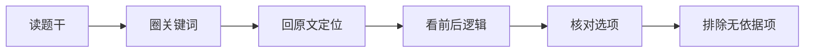

# Unit 4 Text A 课文阅读与细节理解

## 它是什么

Text A 的课文阅读与细节理解，不只是“读懂大意”，而是能根据题干回到原文，找到依据，判断句子的含义、人物的态度和文章的目的。填空题常考原句、关键词和同义改写；选择题常考主旨、细节、推断和说话人的真实意思。

> [!IMPORTANT]
> 做这类题要坚持：==答案必须有原文依据，不能只凭常识或选项看起来合理。==“读懂文章”和“选对题目”并不完全相同。

## 为什么需要

课文中的长句往往包含时间、原因、转折和条件。例如：

> As our sweet childhood gives way to adolescence's temptation of love, we begin to learn, as adults, that most pleasures do not last forever.

其中 **give way to** 表示“被……取代”，**as adults** 插入说明身份，真正的核心结构是：

$$we\ begin\ to\ learn\ that\ most\ pleasures\ do\ not\ last\ forever$$

如果不先找主干，就容易把 *childhood*、*adolescence* 或 *adults* 错当成句子重点。

## 怎么做

先读题干，圈出人名、时间、动作和抽象名词，再回原文定位。遇到长句，先找主语、谓语和宾语，再处理从句与插入语。例如：

> People who work in offices are referred to as "white-collar workers" for the simple reason that they traditionally wear a white shirt with a collar and a tie to go to work.

主干是 **People are referred to as "white-collar workers"**；**who work in offices** 修饰 *people*，**for the simple reason that...** 解释原因。因此，白领称呼的依据是传统着装，而不是工作一定轻松或收入一定很高。

## 和相近题型的区别

| 题型 | 主要任务 | 判断标准 |
|---|---|---|
| 细节理解 | 找到具体事实 | 原文是否明确支持 |
| 主旨理解 | 概括全文中心 | 是否覆盖全文，而非某一段 |
| 推理判断 | 推出隐含意思 | 是否能由原文合理推出 |
| 词义猜测 | 判断语境含义 | 是否符合上下文逻辑 |

主旨题尤其要警惕“原文提到过，但范围太窄”的选项。例如关于环境的文章，**Walking instead of driving** 可能只是具体措施，而 **younger generations will be able to enjoy what the earth can provide** 更接近代际责任和可持续发展的写作目的。

## 常见的坑

> [!WARNING]
> 不要看到选项中有原文单词就选。出题人常保留关键词，却偷换对象、范围、因果或程度；也不要把“可能影响”改成“必然发生”。

另一个易错点是态度题。若人们已经取得一些进展，但仍需努力脱贫，正确理解应是“承认进步，同时继续努力”，不能选成“对现状失望且不相信会好转”，也不能选成“满足现状，不关心未来”。

## 一个做对的例子

题目问：Which statement best describes the impact mentioned in the text?

若原文讨论的是全球环境或资源问题，并明确涉及人类未来，则选：

**C. It has an impact on the future of humankind.**

理由是 *future of humankind* 与原文的影响对象和范围一致。A、D 把影响缩小到某类国家，B 则把全球影响改成生活态度变化，都属于范围或内容偷换。最后检查时应问一句：==这个选项是原文真正说的，还是我自己补充的？==
