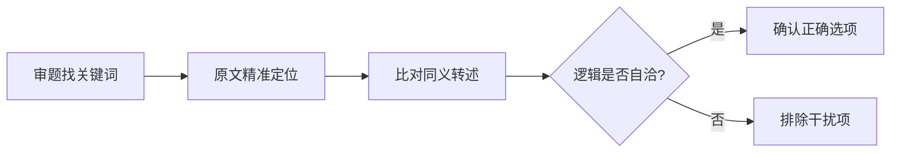

# Unit 4 词汇与语法综合练习

## 词汇与语法综合练习解题逻辑

面对 Unit 4 的综合练习，你是否曾觉得单词都认识，但选出的答案总与原文“差一口气”？这往往不是因为词汇量不足，而是缺乏将==语境线索==与==选项逻辑==精准匹配的能力。综合练习考察的不是孤立记忆，而是在科技、社会等特定语篇中快速定位信息并排除干扰项的思维过程。

> [!IMPORTANT]
> 核心原则：答案必须源于原文的==同义转述==或==逻辑推导==，严禁脱离文本的主观臆断。

## 阅读理解：从定位到推断

在做 Exercise G 这类科技说明文阅读时，如何避免被看似正确的干扰项误导？关键在于建立“题干关键词→原文定位→逻辑验证”的闭环。

以真题为例，当题干问“新技术的功能”时，若原文出现 “pilot’s blood flow” “acceleration” 等词，即便选项 A 提到了 “warn miners”，也因场景不符被排除。选项 C “keep pilots safe” 虽未直接复现原文词汇，却是对 “detect disasters” 和生理保护机制的==上位概括==。而在询问 “pilot face what problem” 时，需区分表象与本质：“plane accelerating too quickly” 是外部诱因，而 “blood flows too slowly” 才是导致黑视的==生理机制根源==。

> [!TIP]
> 科技类阅读常考因果链。遇到 “problem/solution” 题型时，优先寻找描述==内在机制==而非表面现象的选项。

## 主旨与细节：避免过度推断

Exercise E 和 C 涉及人物故事与社会议题，这类文章最容易在“主旨大意”和“事实判断”上设坑。为什么你选的“全文主旨”总是太窄或太宽？因为混淆了==支撑细节==与==核心论点==。

| 考查维度 | 正确思路 | 常见误区 |
| :--- | :--- | :--- |
| 主旨大意 | 覆盖全文核心矛盾与解决方向 | 仅概括某一段落或次要人物 |
| 事实判断 | 严格对应原文限定词（如程度、范围） | 将“部分改善”等同于“完全恢复” |
| 因果推理 | 寻找显性连接词或隐性逻辑链 | 用常识替代文本依据 |

例如关于仿生眼的题目，选项 “restore full sight” 往往是陷阱，因为当前科技通常只能 “improve perception”。同理，在 Jessie 的故事中，“breaking the cycle of poverty” 是主题升华，而 “father works long hours” 只是导致她承担照顾责任的==直接原因==，并非文章最终要传达的思想。

> [!WARNING]
> 绝对化表述（all, only, full, no cure）在细节题中多为错误选项，除非原文明确使用相同限定词。

## 词汇辨析：搭配优先于释义

Exercise C 第 40 题暴露了词汇题的典型痛点：四个选项中文释义似乎都说得通，为何只能选 reservation？因为英语词汇的选择取决于==固定搭配==与==语境适配度==，而非单纯的汉语对译。

“make a ______” 后接 “hotel...completely filled”，这一语境锁定了“预订”语义场。虽然 complaint（投诉）、claim（索赔）、decision（决定）都能与 make 搭配，但只有 ==make a reservation== 能与 “酒店客满” 构成合理的因果逻辑链。

> [!CAUTION]
> 切勿仅凭中文意思选词。务必检查动词与宾语、形容词与名词之间的==习惯搭配==，这是南邮《大学英语》词汇题的高频考点。

综合练习的本质是训练==证据意识==。无论是阅读还是词汇，每一个正确选项背后都必须有原文或搭配规则作为支撑。养成“选出答案后回原文划线验证”的习惯，你的准确率将显著提升。
