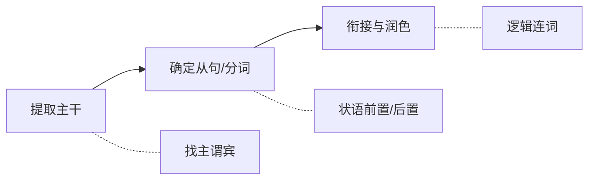

# Unit 4 课后翻译（汉译英参考答案与句式转换）

## 它是什么与为什么需要

Unit 4 课后翻译（汉译英）并非简单的词汇替换，而是针对“中国文化叙事”的==句式重构训练==。考试中常以段落形式出现，要求将中文的意合流水句转换为英文的形合逻辑句。掌握这一知识点，不仅能应对期末翻译题，更是用英语讲好中国故事、避免“中式英语”的关键能力。

## 怎么做：三步转换法

面对长难句，不要逐字对译。试着问自己：这句话的“主干动作”是什么？修饰成分该挂在哪个位置？

> [!IMPORTANT]
> 核心策略是“化零为整”。中文多短句并列，英文需通过非谓语动词、介词短语或从句将其整合为一个主从复合句。

以真题中“大禹治水”为例：

-   **中文原句**：面对滔滔洪水，大禹吸取父亲的教训，坚持 13 年，最终战胜水患。
-   **错误直译**：Facing floods, Yu learned lessons. He persisted 13 years. He won.（句式破碎，缺乏逻辑链）
-   **正确重构**：==Confronted with raging floods==, Yu, ==drawing lessons from his father's failure==, eventually managed to tame the floods after 13 years of perseverance.

这里运用了两个关键转换：一是将“面对……”处理为过去分词短语 `Confronted with...` 作状语；二是将“吸取教训”处理为现在分词插入语 `drawing lessons...`，使句子主次分明。

## 相近概念辨析与高频考点

在表达“选择做某事而非另一件事”时，需注意以下搭配的细微差别：

| 表达方式 | 结构特征 | 适用语境 | 真题示例 |
| :--- | :--- | :--- | :--- |
| instead of | + n./v.-ing | 强调“替代”关系 | chose to remove mountains instead of moving away |
| rather than | + v. (原形/n.) | 强调“主观偏好” | fate in own hands rather than gods |
| opt to | + v. (不定式) | 正式语体“选择” | opted to shoot down nine suns |

> [!TIP]
> 记忆口诀：“面对”用 `Confronted with`，“本质体现”用 `essentially embody`，“文化基因”译为 `gene of culture`。这些是 Unit 4 的高频得分词块。

## 常见的坑

> [!WARNING]
> 警惕“我命由我不由天”的过度意译。切勿译为 "My life is mine"，应准确传达“掌握命运”的内涵：`have their fate in their own hands rather than that of gods`。

> [!CAUTION]
> 避免主语缺失。中文常省略主语（如“面对高山，选择移山”），但英文必须补出逻辑主语 `Yu Gong`，否则会造成悬垂修饰语错误。

## 算对了的例子解析

回顾参考译文最后一段：“这是中华民族屹立至今的重要原因之一。”

-   **分析**：若译为 "This is an important reason..." 略显平淡。
-   **高分处理**：使用定语从句 + 贡献搭配 `..., which has contributed much to making China one of the longest-standing nations...`。
-   **亮点**：用 `longest-standing` 精准对应“屹立至今”，用 `contributed much to` 替代简单的 `is the reason`，体现了==学术英语的严谨性与地道性==。这正是阅卷老师寻找的“句式转换”得分点。
