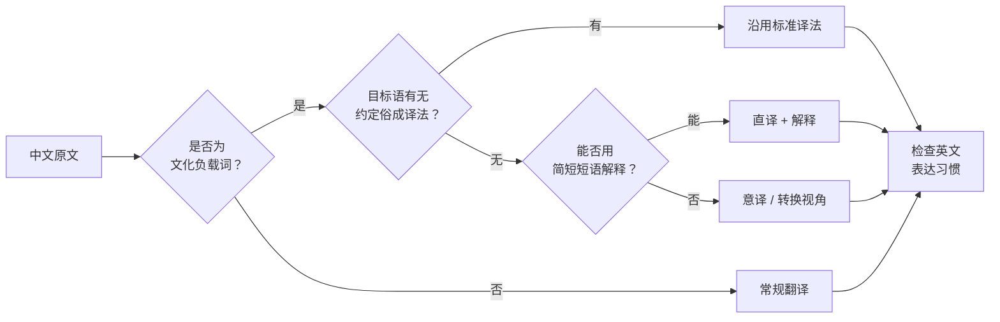

# Unit 5 翻译练习（Exercise D/F/I 文化与翻译）

## 文化与翻译：从“孝道”到“个人自由”

做这一单元的翻译练习，本质上是在处理一个语言问题：**同样的社会关系，在不同文化里被“切分”和“命名”的方式完全不同**。中文里“孝”一个字携带了尊敬、赡养、顺从、家族延续等多层含义，英文里没有一个对等单词能做到这一点，只能展开为 `filial piety`（对父母的虔诚/尽责）并辅以解释。

> [!IMPORTANT]
> 文化与翻译类题目的核心不是“背单词”，而是==识别原文中文化负载词，并用目标语读者能理解的方式重构它==——先理解概念，再选择策略（直译加解释、意译、借用对应概念），最后检查英文是否符合表达习惯。

### 为什么会丢分：逐字翻译的陷阱

先看一个典型的错误倾向：

中文“中国人把孝视为人格之本” → 逐字想译成 `Chinese people regard filial piety as the root of personality`。

这里有两个问题：

1. **“人格之本”的“本”** 在中文里不是植物学意义上的“根”，而是“根本、基础、核心”。`personality` 侧重“个性”，与“人品、立身之本”有偏差，更合适的词是 `integrity`（正直、完整人格）或 `essence`（本质）。
2. **“家庭和睦之本、国家安康之本”** 里“本”重复出现，英文如果机械重复 `root` 三次会显得单调，不如用 `the essence of a person’s integrity, family harmony, and the nation’s well-being` 一次性统摄三个宾语。

再对比一个正向例子：

原文“与自由相伴而来的是照顾自己的责任” → 参考译文 `With freedom comes the responsibility to care for oneself`。这里用了倒装结构 `With + 名词 + comes + 名词`，既保持了原句的强调语气（“相伴而来”），又符合英文书面表达习惯。

> [!WARNING]
> 遇到“本”“道”“德”这类高度凝练的汉字时，==不要查一个词典义项就往上套==。先问：它在句子里充当什么语义角色？是“基础”“准则”“核心”还是“义务”？再选对应的英文名词。

### 文化负载词的处理策略

结合本单元两个翻译段落（美国家庭观 / 孝道），可以归纳三种常见策略：

| 策略 | 适用情况 | 本单元例子 |
|------|----------|------------|
| **直译 + 解释** | 目标语中有对应表达但不完全等价 | 孝道 → `filial piety`（学界通用译法，已约定俗成） |
| **意译 / 转换视角** | 中文四字格、重复强调 | “人格之本、家庭和睦之本、国家安康之本” → 合并为 `the essence of a person’s integrity, family harmony, and the nation’s well-being` |
| **借用目标语对应概念** | 双方有类似社会范畴 | “道德规范” → `code of ethics`；“自力更生” → `self-reliant` |

> [!TIP]
> 记忆口诀：**“有约定用约定，无约定先解释，解释不清换说法”**。比如“一带一路”已经是官方译名 `the Belt and Road Initiative`，考试中不要自己另造译法；而“孝道”在学术英文里通用 `filial piety`，也不宜意译为 `being good to parents`。

### 例题拆解：从真题看评分点

以复习提纲中的翻译段为例：

> 原文：**“由于孝道是儒家伦理思想的核心，它成了中国社会千百年来维系家庭关系的道德准则。”**

参考译文：`With filial piety being the core of Confucian ethics, it has been the moral standard for the Chinese society to maintain the family relationship for thousands of years.`

拆解得分点：

| 原文字眼 | 参考处理 | 避坑提示 |
|----------|----------|----------|
| “由于……是……的核心” | `With filial piety being the core of...` | 中文“由于”不一定译 `because`，`With + 名词 + 分词` 更书面，且能紧凑连接两个分句 |
| “儒家伦理思想” | `Confucian ethics` | 固定搭配，不要译为 `Confucian ethical thought` |
| “千百年来” | `for thousands of years` | 位置放在句尾，符合英文时间状语后置习惯 |
| “维系家庭关系” | `to maintain the family relationship` | “维系”在此是“维持、保持”，不是“维修” `repair` |

再看一例反向考核——给出了不太恰当的英文，要求选出符合中文原意的选项。这类题常见于选择题：

> 中文：“一位充满活力和干劲的 64 岁女士。”
> 干扰项倾向：`a 64-year-old lady full of energy and drive`

需要注意英文合成定语 `64-year-old` 中 **`year` 不加 `s`**，这是经常考的语法点，与文化翻译结合出现。

> [!CAUTION]
> 文化翻译段落里出现的数字、时间表达照常遵守英文语法规则。`a 64-year-old lady` 不是“文化问题”，却常因注意力集中在大词上而写错小地方。

### 怎么练：一个“算对了”的过程

建议用“三步校对法”自检每次翻译：

1. **查文化词**：圈出中文里所有涉及社会伦理、历史制度、传统观念的表达，确认是否有约定俗成译法。
2. **查句法**：中文多用逗号连接的流水句，英文宜用介词短语、分词结构、定语从句合并。检查自己是不是译成了连续多个简单句。
3. **查搭配**：动词与名词、形容词与名词的搭配是否在英文中自然。拿不准时换一个更普通的动词，比如“促进交流”不一定是 `promote`，也可以是 `facilitate`。

以“丝绸之路”段落为例：

`As an international trade channel and a bridge of cultural exchanges, the Silk Road effectively improved the economic and cultural exchanges and development between the East and the West...`

这里 `bridge of cultural exchanges` 保留了原文的比喻，`improved the exchanges and development` 是标准动宾搭配，`exerting a profound impact on...` 用现在分词表结果，比另起一句更紧凑。

> [!NOTE]
> 英汉文化翻译中，“桥梁”“纽带”“窗口”这类比喻在英文里同样成立，可以直译；但“精神文明”“天下”“节气”等词则必须解释性翻译，因为目标语读者的文化图式里没有对应概念。
