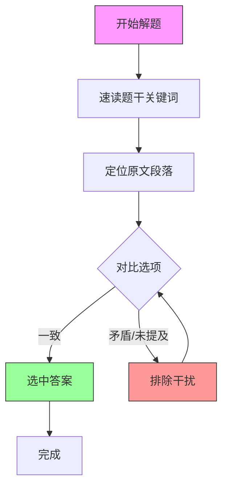

# Unit 6 课文与练习概览

## Unit 6 课文与练习概览：科技前沿与细节捕捉

本单元聚焦于**人工智能与机器人技术**（如四足机器人 Laikago、仿生检测设备），旨在提升学生在科技类文本中的**专有名词识别**、**细节捕捉**及**对比分析**能力。面对此类说明文，核心挑战在于从密集的技术参数中剥离出关键信息。

### 它是什么：科技说明文的阅读逻辑

Unit 6 的课文通常遵循“引入概念 -> 技术特征 -> 应用场景 -> 未来展望”的逻辑链条。
- **专有名词**：如 `Unitree Robotics`（宇树科技）、`Laikago`、`Spotmini`。
- **功能动词**：如 `predict`（预测）、`detect`（检测）、`monitor`（监控）。

> [!IMPORTANT]
> ==核心结论==：科技文阅读不依赖背景知识，而依赖**原文定位**。答案往往是对原文句子的同义替换或概括。

### 为什么需要：应对考试中的“陷阱”

在 Exercise C 和 G 中，出题人常设置以下干扰项：
1. **张冠李戴**：将 A 产品的功能安在 B 产品上（如混淆 Laikago 与 Spotmini）。
2. **范围偏差**：选项过于绝对（如 `Swimming across a river`）或过于宽泛。
3. **时地错配**：混淆研发时间、地点或发布主体。

### 怎么做：三步定位法

1. **圈画关键词**：在题干中寻找专有名词（如 `Laikago`）、数字（`2016`）、地点（`China`）或特定动作（`climbing`）。
2. **回文定位**：在课文中找到包含这些关键词的句子。注意，答案可能在关键词的前一句或后一句。
3. **比对验证**：将选项与原文进行逐词比对，警惕“形似神非”的陷阱。

> [!TIP]
> **解题技巧**：遇到比较题（如 Choice 3），先在文中画出两个对象的特征列表，再逐一核对差异点。

### 常见坑与辨析

| 维度 | 正确思路 | 常见误区 |
| :--- | :--- | :--- |
| **主体识别** | 严格区分制造商与产品名 | 误将 `Unitree Robotics` 当作机器人名字 |
| **功能描述** | 依据原文提到的具体场景 | 凭常识推断（如认为机器狗会游泳） |
| **细节匹配** | 精确匹配时间、地点、人物 | 忽略介词短语中的限定条件 |

> [!WARNING]
> **高危误区**：不要根据“常识”做题。例如，虽然现实中有水下机器人，但若原文未提及 `Laikago` 能游泳，则选项 D 为错误干扰项。

### 算对了的例子

以 **Exercise C - Choice 1** 为例：
*   **题干推断**：询问 “Laikago” 的定义或来源。
*   **原文线索**：文中提到 “Laikago is a four-legged robot dog developed by Unitree Robotics.”
*   **选项分析**：
    *   A. 上海大学毕业生（无关主体）
    *   B. 宇树科技公司（这是开发者，不是 Laikago 本身）
    *   C. 名为 Laikago 的四足机器狗（==完全匹配==）
    *   D. 名为 Spotmini 的机器狗（主体错误）
*   **结论**：选 **C**。关键在于区分“产品”与“制造商”，并精准匹配专有名词。

再以 **填空 5** 为例：
*   **原句**：Economists are interested in all the factors that can help to predict the extent to which a price change will affect supply and demand in the market.
*   **考点**：`predict`（预测）与 `extent`（程度）的搭配，以及定语从句的理解。此处需掌握 `the extent to which...` 这一固定结构，意为“……的程度”。
