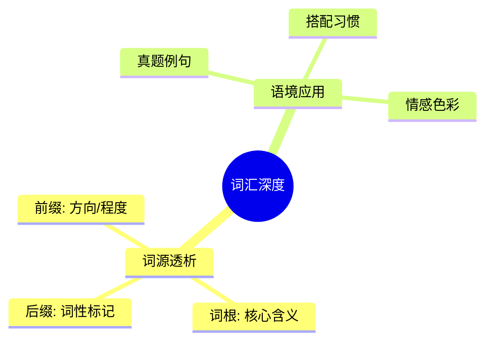
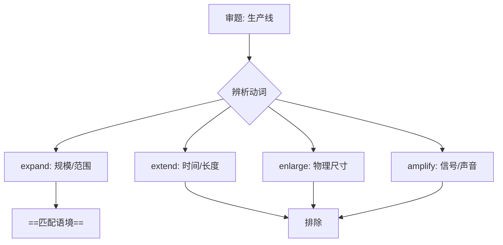

# 四级词汇真题例句与语境应用（图解记忆与词源透析）

## 语境应用与词源透析

在四级备考中，孤立背诵单词表往往导致“认识但不会用”。==核心高亮==在于将词汇置于**真题语境**中，通过**词源逻辑**构建记忆网络。这不仅是记忆技巧，更是理解长难句和精准选词的基础。

试想：为何 `predict`（预测）和 `dictate`（口述）都含有 `dict`？若不解其源，便只能死记硬背。

## 词源拆解：透视构词逻辑

英语词汇如同积木，由前缀、词根、后缀组合而成。掌握高频词根，可实现“举一反三”。

| 组件 | 功能 | 示例 (`spect` = 看) |
| :--- | :--- | :--- |
| **Prefix** | 改变方向/否定 | **in**spect (向里看→检查) |
| **Root** | 承载核心语义 | re**spect** (反复看→重视) |
| **Suffix** | 决定词性 | respect**ful** (形容词) |

> [!TIP]
> 记忆口诀：**前缀定方向，词根定含义，后缀定词性**。遇到生词先拆后猜。

## 真题复盘：从语境到解题

以真题为例，分析词汇在具体语境中的细微差别。

**例题**：The company decided to ______ its production line to meet the growing demand.
A. expand  B. extend  C. enlarge  D. amplify

**解析流程**：
1.  **语境判断**：宾语是 `production line`（生产线），目的是 `meet demand`（满足需求）。
2.  **辨析近义词**：
    *   `expand`：指范围、规模、体积的扩大（常指业务、版图）。
    *   `extend`：指长度、时间的延伸。
    *   `enlarge`：指照片、孔洞等具体物体的放大。
    *   `amplify`：指声音、信号的增强。
3.  **锁定答案**：生产线属于“规模/业务范围”，故选 **A**。

> [!IMPORTANT]
> **核心结论**：词汇选择不仅看意思，更要看**搭配对象**（Collocation）。`expand` 常搭配 business, market, production；`extend` 常搭配 deadline, visa, road。

## 常见陷阱与避坑指南

学生常在以下两点失分：

1.  **望文生义**：忽略熟词僻义。例如 `promise` 不仅有“承诺”之意，在 `show promise` 中意为“有前途/希望”。
2.  **感情色彩混淆**：忽视褒贬义。如 `notorious`（臭名昭著的）是贬义，不能用于形容著名的科学家。

> [!WARNING]
> **高危误区**：不要仅凭中文翻译做题。必须回到原文，检查**主谓宾逻辑**及**上下文情感倾向**。

通过词源建立骨架，通过真题填充血肉，方能实现词汇的深度掌握。
