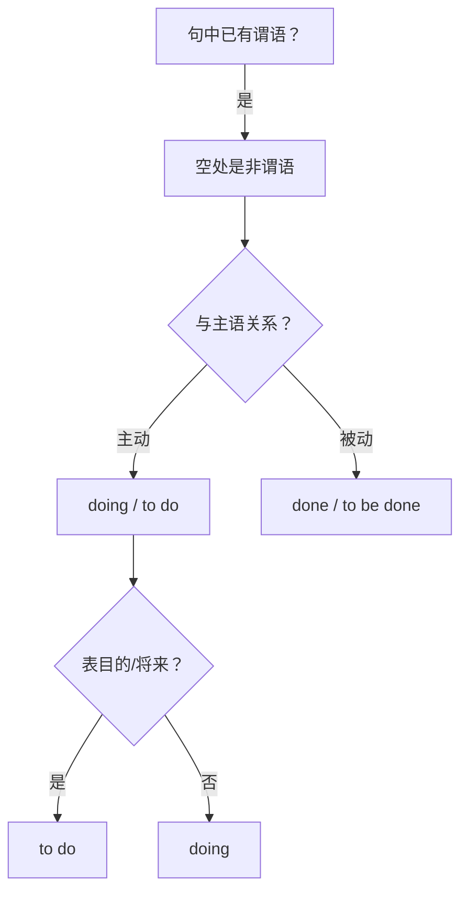

# 词汇与语法单项选择题练习(2)（选择21-40：时态语态与非谓语动词）

## 时态语态与非谓语动词的高频考点

先看一个问题：下面这个句子为什么不对？

> *Heard the news, she burst into tears.

如果你能立刻反应出“heard 是非谓语，但这里缺少逻辑主语，且主动被动关系可能不对”，那说明你已经有了不错的语法意识。如果还没想通，继续往下看。

### 为什么需要同时掌握时态语态和非谓语动词？

时态语态告诉你**动作什么时候发生、谁做的**；非谓语动词告诉你**在不用谓语的情况下，动作如何依附于主句**。南邮《大学英语》单选题里，这两块经常混在一起考——因为一个句子里既要有正确的谓语时态语态，又要有正确的非谓语形式。

> [!IMPORTANT]
> 做这类题的核心步骤：先判断句中**谓语动词**的位置，再确定剩余动词必须用非谓语形式，最后判断主动/被动和时态先后。

### 时态语态的核心判断链

句子的谓语动词承担两种信息：**时间（现在/过去/将来）** 和 **状态（一般/进行/完成）**，语态（主动/被动）取决于主语能否执行这个动作。

常见高频时态辨析：

| 时态 | 核心语义 | 典型标志词 |
|---|---|---|
| 一般现在时 | 客观事实、习惯动作 | always, often, every day |
| 现在完成时 | 过去开始延续至今或对现在有影响 | since, for, already, yet |
| 过去完成时 | 过去的过去 | by the time + 过去时间 |
| 将来完成时 | 到将来某时已经完成 | by + 将来时间 |

语态判断的关键在于：==主语是动作的执行者用主动，主语是动作的承受者用被动==。

### 非谓语动词的三种形式与判断顺序

非谓语动词有三种：**不定式（to do）**、**动名词（doing）**、**分词（doing/done）**。

做题时的判断思路可以用下面这个流程来梳理：

> [!TIP]
> 记忆口诀：**谓非谓语先分清，主动被动看主语，目的将来用 to do，进行伴随用 doing。**

### 常见陷阱

- **悬垂分词**：非谓语动词的逻辑主语必须与主句主语一致，否则就是悬垂分词，是错误的。开头那句 *Heard the news, she burst into tears 其实是对的（she 听到消息），但如果写成 *Walking down the street, the flowers were blooming，就是错的（花不能走路）。
- **分词与动名词混淆**：分词 doing 表主动进行，动名词 doing 表事件本身。  前有物主代词是动名词，前无冠词是分词。
- **完成式的非谓语**：having done / having been done 表示非谓语动作发生在谓语之前。

> [!WARNING]
> 最常见的丢分点：在需要过去分词的被动非谓语位置，误用了现在分词。例如 *The problems discussing at the meeting are important 应改为 discussed。

### 真题思路演示

以课件中出现过的时态语态类题目为例，还原判断过程：

**题目**：By the time he retires, he ______ for thirty years.
A) will work B) works C) will have worked D) has worked

**判断步骤**：
- 第一步：句中已有谓语动词 retires，但空前需要另一个谓语动词。
- 第二步：看到 by the time + 一般现在时，主句表示“到将来某时已经完成的动作”。
- 第三步：确定用将来完成时。

答案选 **C**，by the time 是从句的现在时代替将来时，主句用 will have done 表示将来完成。

> [!NOTE]
> 非谓语动词中，如果原题是“He was able to understand their poor living conditions and take more effective measures”，这里的 to understand 和 take 并列，都跟在 was able to 后面，用动词原形，这是不定式并列省略 to 的用法。遇到这种结构，先找到并列连词 and，再确认前面共享的 to。

### 一类常考的假“非谓语”结构

有些动词后面接 doing 和 to do 含义完全不同：

- remember doing（记得做过） / remember to do（记得要做）
- forget doing（忘记做过） / forget to do（忘记要做）
- regret doing（后悔做过） / regret to do（遗憾地要做）
- stop doing（停止做） / stop to do（停下来去做）

这类题目解题的关键在于==判断动作发生的先后顺序==：doing 表示该动作已发生，to do 表示该动作还未发生。

> [!CAUTION]
> mean doing（意味着做）和 mean to do（打算做）最容易被混淆，注意区分：Success means working hard 是“意味着”，I mean to go 是“打算”。

用本节开头的思维流程去套每一道非谓语题，你就能把模糊的语感变成清晰的判断路径。
