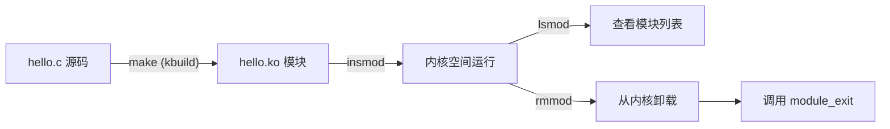

# Linux可加载内核模块（LKM）的编写、编译（insmod/rmmod）与测试

## 先想清楚一个问题

一个跑在 Linux 上的 C 程序，要让它“进入内核”干活——比如驱动一个 LED 灯、读一个传感器——它还能像普通程序那样 `gcc hello.c -o hello && ./hello` 吗？

不能。因为普通程序运行在用户空间，受内核保护，根本碰不到硬件寄存器。Linux 提供了另一条路：把你写的代码编译成**内核模块**，用 `insmod` 塞进正在运行的内核里，让它成为内核的一部分，以内核的权限执行。

这就是 **LKM（Loadable Kernel Module，可加载内核模块）** 的由来。

> [!IMPORTANT]
> 模块程序运行在**内核空间**，普通应用程序运行在**用户空间**。内核空间拥有访问硬件的全部权限，一旦出错可能导致整个系统崩溃；用户空间出错最多让这个程序挂掉。

## 一个最小模块长什么样

```c
// hello.c
#include <linux/init.h>
#include <linux/module.h>

static int __init hello_init(void)
{
    printk(KERN_INFO "Hello, kernel!\n");
    return 0;                       // 返回 0 表示加载成功
}

static void __exit hello_exit(void)
{
    printk(KERN_INFO "Goodbye, kernel!\n");
}

module_init(hello_init);            // 指定入口函数，insmod 时调用
module_exit(hello_exit);            // 指定出口函数，rmmod 时调用

MODULE_LICENSE("GPL");              // 许可证，没有它会有警告
MODULE_AUTHOR("NJUPT");
MODULE_DESCRIPTION("A minimal LKM example");
```

和普通 C 程序最大的区别：

| 对比项 | 普通应用程序 | 内核模块 |
| --- | --- | --- |
| 入口 | `main()` | `module_init()` 指定的函数 |
| 出口 | `main()` return 或 `exit()` | `module_exit()` 指定的函数 |
| 头文件 | `stdio.h` / `stdlib.h` | `linux/init.h` / `linux/module.h` |
| 打印方式 | `printf()` | `printk()`（带日志级别前缀） |
| 能不能调用 `libc` | 能 | ==不能==，只能用内核提供的函数 |
| 运行空间 | 用户空间 | 内核空间 |

## 怎么编译成 .ko

内核模块的编译和普通程序不同，==必须使用内核构建系统（kbuild）==，不能直接 `gcc hello.c -o hello.ko`。

需要一个 `Makefile`：

```makefile
obj-m := hello.o
KDIR := /lib/modules/$(shell uname -r)/build
PWD  := $(shell pwd)

all:
    $(MAKE) -C $(KDIR) M=$(PWD) modules
clean:
    $(MAKE) -C $(KDIR) M=$(PWD) clean
```

然后执行：

```bash
make
```

当前目录下就会生成 `hello.ko`，这就是可以加载的内核模块文件。

> [!NOTE]
> 交叉编译到 ARM 平台时，`KDIR` 要指向目标板内核源码树的构建目录，同时需要指定交叉编译器，例如：
> ```bash
> make ARCH=arm CROSS_COMPILE=arm-linux-gnueabihf-
> ```

## 加载、查看与卸载

```bash
# 加载模块（需要 root 权限）
insmod hello.ko

# 查看已加载的模块列表
lsmod

# 查看内核日志输出（printk 写到这里）
dmesg | tail

# 卸载模块
rmmod hello
```

看到 `dmesg` 里输出 `Hello, kernel!` 就说明模块代码真的在内核里跑起来了。

> [!TIP]
> 记忆口诀：**装载进内核 `insmod`，列出看 `lsmod`，移走用 `rmmod`**。三个命令首字母分别是 **i**nsert、**l**ist、**r**emove。

## 常见坑

> [!WARNING]
> **内核模块没有 `printf`**。用 `printf` 编译直接报错，必须用 `printk`。而且 `printk` 的输出不一定打印到终端，通常要用 `dmesg` 或查看 `/var/log/kern.log` 才能看到。

> [!CAUTION]
> **模块代码不能调用 C 标准库**。`malloc`、`free`、`strcpy`、`sleep` 这些统统不能用。内核有对应的替代函数：`kmalloc`、`kfree`、`strscpy`、`msleep`。这是因为模块链接的是内核符号表，不是 libc。

> [!WARNING]
> **`rmmod` 时模块必须没有被使用**。如果有其他模块或进程还在引用它，会报 `Module is in use`。另外，如果模块的 `module_exit` 函数没有正确释放申请的资源，卸载后会造成内存泄漏或内核崩溃——更可怕的是内核崩了整机就死了，所以模块开发通常建议**先在虚拟机里测试**。

## 一个算对了的例子

以考试填空题为例：

> 嵌入式 Linux 系统模块程序 hello.c 被编译成模块 hello.ko 后，动态插入内核的命令为\_\_\_\_，查看 Linux 内核中有哪些模块的命令为\_\_\_\_，删除内核中模块 hello.ko 的命令为\_\_\_\_。

**答案**：

```bash
insmod hello.ko
lsmod
rmmod hello
```

> 设备驱动软件 leddrv.ko 位于==内核空间==，加载命令 `insmod leddrv.ko`，卸载命令 `rmmod leddrv`。

## 整体流程



内核模块的本质上是一段**在内核权限下运行的代码**。它写起来像 C 程序，但生存环境完全不同：没有 main、没有 libc、出了错就是系统崩溃。掌握它的编写、编译、加载与卸载流程，是嵌入式 Linux 驱动开发的第一步。
