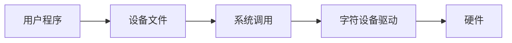
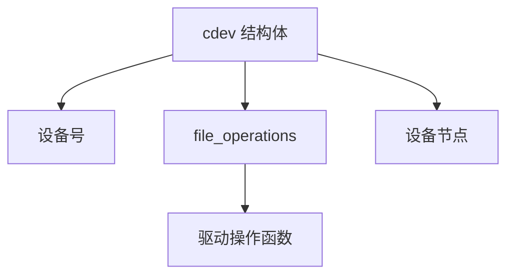
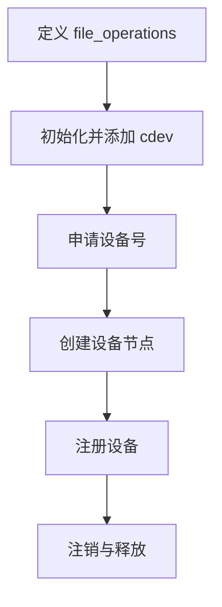

# Linux字符设备驱动程序的基本框架与数据结构（cdev、file_operations）

## 字符设备是什么

Linux 字符设备以**字节流**为单位进行读写，例如串口、键盘、蜂鸣器和 GPIO 设备。用户程序不能像访问普通文件那样直接操作硬件，而是通过设备文件发起 `open()`、`read()`、`write()`、`ioctl()` 等系统调用，由内核驱动程序完成硬件控制。

字符设备通常具有如下路径：



驱动注册后，用户程序可通过 `/dev/mydevice` 等设备节点访问它。

## 为什么需要 cdev

一个设备通常对应多个设备文件，每个文件又需要绑定到各自的驱动操作函数。若逐个建立对应关系，会导致结构零散、扩展困难。

Linux 使用 `struct cdev` 统一描述字符设备，并借助 `kobject`、设备号和 `file_operations` 建立关联：



> [!IMPORTANT]
> `cdev` 是字符设备的内核表示，`file_operations` 是驱动向系统提供的操作接口；二者通过设备号关联。

`struct cdev` 的主要成员包括：

- `kobj`：用于设备模型和设备节点管理；
- `dev`：`dev_t` 类型，保存主设备号和次设备号；
- `ops`：指向 `struct file_operations`；
- `list`：组织字符设备链表。

设备号由主设备号和次设备号组成。主设备号标识**驱动类型**，次设备号区分同一驱动下的**具体设备**。主设备号可由 `alloc_chrdev_region()` 动态分配。

## file_operations 决定“能做什么”

`struct file_operations` 中保存字符设备的各类操作函数。常见成员如下：

| 成员 | 作用 |
|---|---|
| `owner` | 持有模块引用，通常填 `THIS_MODULE` |
| `open` | 打开设备，可进行资源初始化 |
| `release` | 关闭设备并释放资源 |
| `read` | 从设备读取数据 |
| `write` | 向设备写入数据 |
| `ioctl` | 执行设备专用控制命令 |
| `llseek` | 设置文件偏移位置 |

假设驱动提供 `my_open()`、`my_read()` 和 `my_write()`，核心定义可写为：

```c
static const struct file_operations my_fops = {
    .owner   = THIS_MODULE,
    .open    = my_open,
    .read    = my_read,
    .write   = my_write,
    .release = my_release,
};
```

其中 `read` 回调通常通过 `copy_to_user()` 把内核数据复制给用户，`write` 回调通过 `copy_from_user()` 获取用户数据。不能直接解引用用户指针。

## 基本注册流程

字符设备驱动通常按以下步骤实现：



较常见的写法是：先定义 `cdev` 和 `file_operations`，再申请设备号；通过 `cdev_init()` 初始化 `cdev`，使用 `cdev_add()` 将其加入内核；使用 `class_create()` 和 `device_create()` 创建设备节点；使用 `misc_register()` 注册杂项设备。

> [!TIP]
> 记忆顺序：**准备操作表 → 初始化 cdev → 添加 cdev → 创建设备节点 → 注册设备**。

## 与相近概念的区别

| 概念 | 含义 |
|---|---|
| 设备文件 | 用户空间访问设备的入口，如 `/dev/ttyS0` |
| 设备号 | 标识驱动和具体设备 |
| `cdev` | 内核中的字符设备对象 |
| `file_operations` | 字符设备支持的操作函数集合 |
| 设备节点 | 设备号在用户空间中的映射 |

> [!WARNING]
> `cdev_add()` 只把字符设备加入内核，**不会自动创建设备节点**；`device_create()` 创建设备节点，但也**不会替代 `cdev_add()`**。初学者常把两者混为一谈。

## 常见坑与正确示例

常见问题包括：忘记填写 `owner`、设备号未申请便直接使用、重复添加同一 `cdev`、错误处理路径没有调用 `cdev_del()`，以及退出时未释放设备号和设备节点。

一个完整的典型流程可概括为：

```c
dev_t devno;
struct cdev cdev;
const struct file_operations fops = { .owner = THIS_MODULE };

alloc_chrdev_region(&devno, 0, 1, "mydev", 0);
cdev_init(&cdev, &fops);
cdev_add(&cdev, devno, 1);
device_create(cls, NULL, devno, NULL, "mydev");
```

模块卸载时，应按注册的相反顺序释放资源。==注册负责“建立入口”，卸载负责“完整回收”==，二者缺一不可。
