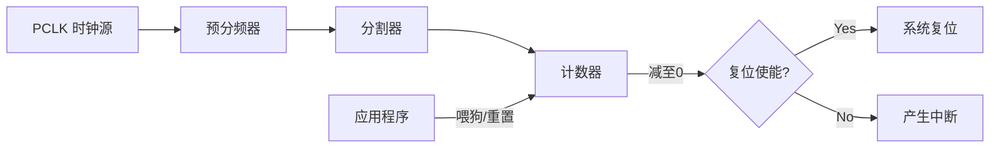

# S3C6410 看门狗定时器设备驱动代码（s3c6410_wdtdrv.c）设计实例

## S3C6410 看门狗定时器驱动设计

在嵌入式系统中，软件跑飞或死锁是常见故障。**看门狗定时器（Watchdog Timer, WDT）** 就像一位“监督者”，若系统在规定时间内未向其“喂狗”（重置计数器），它将强制复位 CPU。S3C6410 基于 ARM11 内核，其 WDT 兼具定时器和复位功能。

> [!IMPORTANT]
> ==核心作用==：防止系统死机，通过硬件机制实现自动重启恢复。

### 工作原理与控制

S3C6410 的 WDT 由预分频器、分割器及计数器组成。时钟源经过两级分频后产生计数时钟 $t_{watchdog}$：

$$ t_{watchdog} = \frac{1}{PCLK / (Prescaler + 1) / Division\_factor} $$

当计数器减至 0 时，若使能了复位功能，则触发系统复位；若仅使能中断，则产生中断信号。

### 驱动编写基本步骤

在南邮《嵌入式系统与开发》课程中，编写字符设备驱动需遵循 Linux 设备模型。结合课件简答题考点，步骤如下：

1.  **硬件接口封装**：定义 `file_operations` 结构体，实现 `open`、`release`、`ioctl` 等函数。在 `ioctl` 中处理启动、停止及喂狗命令，直接操作 S3C6410 的 WDT 寄存器（如 `WTCON`, `WTDAT`, `WTCNT`）。
2.  **注册字符设备**：使用 `register_chrdev` 或 `cdev_init`/`cdev_add` 将驱动注册到内核，建立主设备号与文件操作的关联。
3.  **模块加载与卸载**：编写 `module_init` 和 `module_exit` 入口出口函数，完成资源申请与释放。
4.  **创建设备节点**：加载模块后，使用 `mknod` 命令在 `/dev` 下创建节点，打通用户空间与内核空间的通道。
5.  **应用层测试**：编写应用程序，定期调用 `ioctl(fd, WDIOC_KEEPALIVE, 0)` 进行喂狗。

> [!TIP]
> 记忆口诀：**一封装、二注册、三节点、四应用**。先搞定底层寄存器操作，再挂钩文件系统，最后让用户程序能访问。

### 常见误区与辨析

| 特性 | 普通定时器 | 看门狗定时器 |
| :--- | :--- | :--- |
| **主要目的** | 精确计时、延时 | 系统监控、故障恢复 |
| **超时行为** | 通常产生中断 | 默认复位系统（可配置中断） |
| **操作频率** | 按需设置 | 必须周期性“喂狗” |

> [!WARNING]
> ==高危误区==：在调试阶段，务必先禁用看门狗的复位功能，仅使用中断模式，否则代码稍有延迟就会导致开发板不断重启，无法进行断点调试。

### 实例验证

假设 PCLK 为 66MHz，预分频值为 65，分割因子为 128。则计数时钟周期为：
$$ T = \frac{1}{66 \times 10^6 / (65+1) / 128} \approx 128 \mu s $$
若设定计数值为 10000，则超时时间为 $1.28s$。应用程序需在 1.28s 内至少执行一次喂狗操作，否则系统将重启。这正是实验箱上 LED 跑马灯程序中常结合的守护机制。
