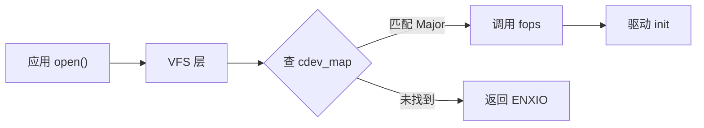

# 主/次设备号的申请注册（register_chrdev）与/dev下设备节点创建

在嵌入式 Linux 中，应用程序如何精准找到对应的硬件驱动？这依赖于==主/次设备号==这一核心寻址机制。当编写字符设备驱动时，必须完成两件事：向内核注册设备号以建立驱动关联，以及在 `/dev` 下创建设备节点以供用户空间访问。

## 设备号的本质与注册

Linux 将设备抽象为文件，但文件名本身不直接对应硬件。内核通过一个 32 位整数（`dev_t`）来唯一标识设备，其中高 12 位为==主设备号==（Major），标识驱动程序；低 20 位为==次设备号==（Minor），标识具体设备实例。

> [!IMPORTANT]
> `register_chrdev` 是传统注册接口，用于将主设备号与 `file_operations` 绑定。若指定主设备号为 0，内核将动态分配并返回实际值。



[!NOTE]
现代内核推荐使用 `alloc_chrdev_region` + `cdev_add` 组合，支持更灵活的次设备号范围管理，但考试中 `register_chrdev` 仍是高频考点。

## 创建设备节点的两种方式

注册仅在内核空间生效，用户空间仍需 `/dev/xxx` 节点才能访问。创建方式分手动与自动：

| 方式 | 命令/函数 | 适用场景 | 注意事项 |
| :--- | :--- | :--- | :--- |
| 手动创建 | `mknod` | 调试、静态系统 | 需已知主次设备号 |
| 自动创建 | `class_create` + `device_create` | 产品级驱动 | 依赖 udev/mdev |

附录5填空2正是考察手动创建：LED 驱动主设备号 253、次设备号 0、设备名 `leddev`，则命令为：

```bash
mknod /dev/leddev c 253 0
```

> [!TIP]
> `mknod` 格式口诀：“==c 主 次==”，即 `mknod <路径> c <major> <minor>`，`c` 代表字符设备，切勿写成 `b`（块设备）。

## 常见误区与避坑指南

[!WARNING]
动态分配的主设备号每次加载可能不同！若用 `register_chrdev(0, ...)` 注册后直接硬编码 `mknod`，卸载再加载后节点将失效。应先通过 `/proc/devices` 查询实际主设备号。

[!CAUTION]
`register_chrdev` 会占用整个主设备号下的所有次设备号（0~255），即使你只用了一个。这在设备密集系统中极易冲突，生产环境务必改用区域注册。

> [!IMPORTANT]
> 模块卸载时必须执行==逆序清理==：先 `device_destroy` → `class_destroy` → `unregister_chrdev`，顺序颠倒会导致内核 oops 或资源泄漏。

## 完整流程示例

以实验中的字符设备为例，正确流程如下：

1.  模块初始化中调用 `register_chrdev(253, "led", &led_fops)`；
2.  确认返回值 ≥ 0（成功）；
3.  执行 `mknod /dev/leddev c 253 0`；
4.  应用层 `open("/dev/leddev", O_RDWR)` 即可触发 `led_fops.open`；
5.  模块退出时先删除节点再注销设备号。

==设备号是内核与用户空间的契约==，注册解决“内核认驱动”，节点解决“用户找设备”，二者缺一不可。实验中若 `open` 返回 `No such file or directory`，优先检查节点是否存在及主次设备号是否匹配。
