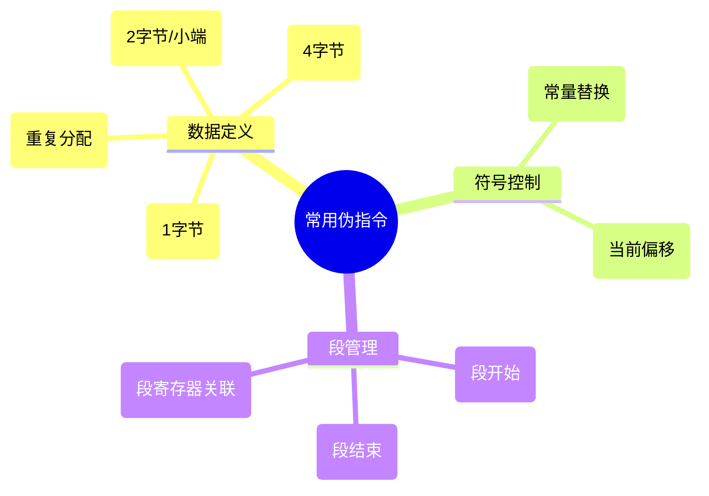

# 常用伪指令（SEGMENT、ASSUME、DB/DW/DD、EQU、END等）

## 伪指令的本质与作用

在汇编语言中，语句分为**指令性语句**（生成机器码，如 `MOV`, `ADD`）和**指示性语句**（即伪指令，不生成机器码，指导汇编器工作）。常用伪指令用于定义数据结构、分配存储空间及建立段关联。

> [!IMPORTANT]
> 伪指令由汇编器处理，**不产生目标代码**，仅决定数据在内存中的布局或程序的逻辑结构。

## 数据定义与等值伪指令

### 1. 数据定义：DB, DW, DD
用于在数据段中预留空间并初始化。
- **DB (Define Byte)**：定义字节（1 Byte）。
- **DW (Define Word)**：定义字（2 Bytes），注意**小端存储**（低字节在低地址）。
- **DD (Define Double Word)**：定义双字（4 Bytes）。
- **DUP**：重复操作符，如 `DB 4 DUP(?)` 表示预留 4 个未初始化字节。

### 2. 等值与计数：EQU, `$`
- **EQU**：符号等价，如 `CNT EQU 10`，编译时替换，不占内存。
- **$**：当前地址计数器。`$ - Label` 常用于计算缓冲区长度。



## 段定义与关联：SEGMENT 与 ASSUME

程序通常划分为代码段 (`CODE`)、数据段 (`DATA`) 等。
- **SEGMENT/ENDS**：界定段的物理范围。`USE16` 指定为 16 位寻址。
- **ASSUME**：**关键考点**。它告诉汇编器哪个段寄存器指向哪个段名，以便正确计算偏移地址。例如 `ASSUME CS:CODE, DS:DATA`。

> [!WARNING]
> `ASSUME` 仅告知汇编器逻辑关系，**不会自动生成指令**将段地址装入寄存器。必须在代码开头手动执行 `MOV AX, DATA` / `MOV DS, AX`。

## 经典例题解析

假设数据段定义如下：
```assembly
DAT1 DW 1234H, 5678H, 'AB', 'CD', '2'
DAT2 DB 4 DUP (?)
DAT3 DD ?
CN   EQU $-DAT1
```

**问题 1：CN 的值是多少？**
`$` 指向 `DAT3` 之后的位置（即 `DAT3` 起始地址 + 4）。
`DAT1` 占用空间计算：
- `1234H`, `5678H`：2 个字 = 4 字节
- `'AB'`, `'CD'`：2 个字 = 4 字节（字符存入字时，低位存首字符）
- `'2'`：1 个字 = 2 字节（ASCII 码 32H，存为 0032H）
- `DAT2`：4 字节
- `DAT3`：4 字节
总长度 = $4+4+2+4+4 = 18$ 字节。故 **CN = 18** (或 12H)。

**问题 2：DAT1+5 字节单元的内容是什么？**
`DAT1` 起始偏移为 0。
- Offset 0-1: `34H, 12H` (1234H 小端)
- Offset 2-3: `78H, 56H` (5678H 小端)
- Offset 4-5: `41H, 42H` ('A'=41H, 'B'=42H，'AB' 作为字存入，低字节 'A' 在低址)
因此，Offset 5 的单元内容是 **42H** (即字符 'B')。

> [!TIP]
> 记忆口诀：**DW 存字符，低位在前；小端模式，高低反填。** 遇到 `'AB'` 存入 DW，内存顺序为 `41H 42H`。
